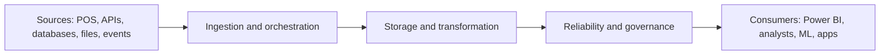
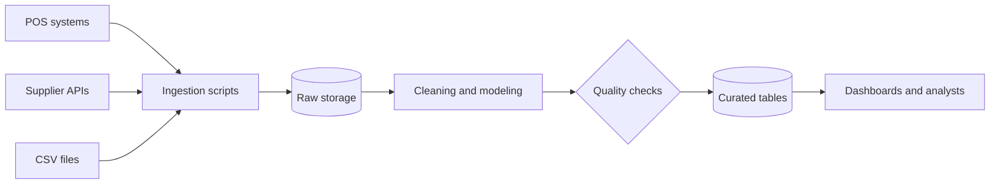

# Phase 01 — The Foundations of Computing and Data

**Study notes and step-by-step procedures** | Month 1 | Estimated effort: 35–45 hours | Stage: Foundation

> **Goal of this phase:** understand the problems data tools solve, then build the command-line, networking and version-control fluency every later phase depends on. By the end you will have a working Linux environment, a documented GitHub repository and the ability to diagnose why a pipeline cannot reach its data.

---

## Contents

1. [How to use this guide](#1-how-to-use-this-guide)
2. [Learning outcomes and four-week plan](#2-learning-outcomes-and-four-week-plan)
3. [Module 1.1 — Understand the data ecosystem](#3-module-11--understand-the-data-ecosystem)
4. [Module 1.2 — Linux and the command line](#4-module-12--linux-and-the-command-line)
5. [Module 1.3 — Networking fundamentals](#5-module-13--networking-fundamentals)
6. [Module 1.4 — Git and GitHub](#6-module-14--git-and-github)
7. [Milestone project — your first documented repository](#7-milestone-project--your-first-documented-repository)
8. [Tools used in this phase](#8-tools-used-in-this-phase)
9. [Troubleshooting guide](#9-troubleshooting-guide)
10. [Self-check quiz](#10-self-check-quiz)
11. [Glossary](#11-glossary)
12. [Exit criteria and what comes next](#12-exit-criteria-and-what-comes-next)
13. [Resources](#13-resources)

---

## 1. How to use this guide

Each module has the same pattern:

- **Notes:** the concepts, explained plainly, with examples.
- **Procedure:** numbered steps you type and run. Commands are in code blocks; lines starting with `$` are what you type, other lines are example output (yours may differ slightly).
- **Checkpoint:** a quick test that you really understood it.

Three working rules for the whole phase:

1. **Type commands yourself.** Copying and pasting teaches far less than typing, making a typo and fixing it.
2. **Explain in your own words.** After every module, write a short note in your repository's `notes/` folder without looking at this guide.
3. **Read error messages fully.** Most beginner problems are solved by reading the last line of the error and the line before it.

> **Assumed environment:** a Windows 10/11 laptop using WSL2 (Ubuntu). If you already run Linux or macOS, skip the WSL steps; the rest applies with minor differences.

---

## 2. Learning outcomes and four-week plan

### Learning outcomes

By the end of Phase 01 you can:

- Explain OLTP vs OLAP, warehouse vs lake vs lakehouse, batch vs streaming and ETL vs ELT using your own examples.
- Navigate Linux, manage files and permissions, chain commands with pipes and write a small Bash script.
- Diagnose a failed connection by layer: DNS, network path, port, TLS, authentication.
- Call a REST API with `curl` and read its JSON response.
- Use Git daily: commit, branch, merge, resolve a conflict and open a pull request.
- Keep secrets out of version control.

### Suggested four-week plan (about 41 hours)

| Week | Focus | Hours | Deliverable |
| --- | --- | --- | --- |
| 1 | Module 1.1 + install WSL2, VS Code, Git | 9 | Environment working; first concept notes |
| 2 | Module 1.2 Linux and command line | 12 | Sales CSV report produced by a Bash script |
| 3 | Module 1.3 Networking + Module 1.4 Git/GitHub | 10 | Troubleshooting log; GitHub repo with a merged pull request |
| 4 | Milestone project + review + quiz | 10 | Documented repository, pipeline diagram, self-check complete |

A good weekly rhythm: 3 sessions of learning and practice, 1 session of building, 1 short review session.

---

## 3. Module 1.1 — Understand the data ecosystem

*Before learning tools, understand the problems they solve.*

**Time:** about 6–7 hours reading and note-making (Week 1).

### 3.1 What is data?

| Type | What it looks like | Examples |
| --- | --- | --- |
| **Structured** | Fixed rows and columns with a defined schema | A sales table, M-Pesa transaction log in a relational database, a CSV with consistent columns |
| **Semi-structured** | Has structure, but flexible or nested; fields can vary per record | JSON from an API, XML, server logs with key-value pairs |
| **Unstructured** | No predefined structure | Emails, PDFs, images, audio, free-text customer feedback |

Most data engineering work starts with structured and semi-structured data. Unstructured data usually needs extra processing before analysis.

### 3.2 Operational systems vs analytical systems (OLTP vs OLAP)

| | **OLTP** (Online Transaction Processing) | **OLAP** (Online Analytical Processing) |
| --- | --- | --- |
| Purpose | Run the business: record each event quickly | Understand the business: answer questions over lots of history |
| Typical operation | Insert/update one or a few rows | Scan and aggregate millions of rows |
| Data shape | Normalized tables, current state | Denormalized or dimensional models, history kept |
| Users | Applications, cashiers, customers | Analysts, dashboards, data scientists |
| Example | A bank recording a transfer | "How did transaction volumes change across counties over five years?" |
| Optimized for | Fast writes, consistency, many small queries | Fast reads of large volumes, aggregation |

**Why both exist:** a system tuned to record one transfer in milliseconds is not the right tool to scan five years of transfers. Data engineering moves data from the first kind of system into the second.

### 3.3 Where analytical data lives

| Approach | Stores | Strengths | Watch out for |
| --- | --- | --- | --- |
| **Data warehouse** | Cleaned, modeled, structured data | Fast, consistent analytics; agreed business definitions | Less flexible for raw or unstructured data |
| **Data lake** | Raw data of any format, usually in object storage | Cheap, flexible, keeps everything | Can become a "data swamp" without governance |
| **Lakehouse** | Lake storage plus table management (open table formats) | Warehouse-like reliability on lake storage | More moving parts; newer ecosystem |

A lake, a warehouse and a lakehouse are **architectural approaches**, not interchangeable names for the same thing.

### 3.4 Batch vs stream processing

- **Batch:** process data collected over an interval (hourly, nightly). Simpler and cheaper. Right answer for most reporting.
- **Stream:** process events continuously as they arrive. Needed when freshness matters (fraud detection, live monitoring). More complex to build and operate.

Rule of thumb: **start with batch; use streaming only when the business needs the freshness.**

### 3.5 ETL vs ELT

| | **ETL** | **ELT** |
| --- | --- | --- |
| Order | Extract → Transform → Load | Extract → Load → Transform |
| Where transformation runs | In a separate processing tool, before loading | Inside the destination (warehouse/database) after loading |
| Typical today | Older systems, limited destinations | Cloud warehouses and tools like dbt |
| Key benefit | Only clean data lands in the destination | Raw data is kept; transformations can be re-run and changed |

### 3.6 Data pipelines and workflows

A **data pipeline** moves data from sources to destinations, usually transforming it on the way. A **workflow** coordinates the steps (order, schedule, retries). Every later phase is about making these two things reliable.



### 3.7 The roles around data

| Role | Main question they answer | Typical tools |
| --- | --- | --- |
| **Data Analyst** | "What happened, and why?" | SQL, Excel, Power BI |
| **Analytics Engineer** | "How do we model data so analysts can trust it?" | SQL, dbt, warehouses |
| **Data Engineer** | "How do we reliably move, store and prepare data at scale?" | Python, SQL, Airflow, Spark, cloud |
| **Data Architect** | "How should the whole data landscape be designed?" | Architecture, modeling, governance |
| **Data Scientist** | "What can we predict or learn from the data?" | Python, statistics, ML libraries |

The roles overlap, especially in small teams.

### 3.8 Worked example — the supermarket chain

A chain with 50 stores in Kenya generates POS sales, stock movements, supplier deliveries, website interactions and accounting records. Management asks: *which products sell fastest, which branches lose money, when to restock, how to forecast demand?*

Problems the engineer must solve:

1. Data is scattered across systems and formats.
2. Some records are duplicated, late or wrong.
3. Different systems define "sale" differently.

The Data Engineer builds the **pipeline** that extracts from each system, stores a raw copy, cleans and models the data, checks its quality and serves it to dashboards.

### 3.9 Procedure — build your concept notes (steps)

1. Create a file `notes/01-data-ecosystem.md` (you will create the repository in Module 1.4; for now use any folder).
2. Write one paragraph each, **in your own words**, for: OLTP vs OLAP, warehouse/lake/lakehouse, batch vs stream, ETL vs ELT.
3. For each concept, write **one example from a Kenyan business** (a bank, M-Pesa-style mobile money, a supermarket, a matatu SACCO, a telecom, a county government).
4. Classify the following data as structured, semi-structured or unstructured (answers below):
   - a. A CSV of daily supermarket sales
   - b. A JSON response from a weather API
   - c. Customer voice recordings from a call centre
   - d. A PostgreSQL `orders` table
   - e. Web server logs in `key=value` format
5. Draw the five-layer pipeline for the supermarket example (sources → ingestion → storage and transformation → reliability and governance → consumers) on paper or in diagrams.net.

<details>
<summary>Answers to step 4</summary>

a. Structured · b. Semi-structured · c. Unstructured · d. Structured · e. Semi-structured.

</details>

### Checkpoint 1.1

Without looking, explain to a friend: *Why can't we just run the CEO's sales analysis on the shop's till database?* A good answer mentions OLTP vs OLAP, load on the operational system, scattered sources and data quality.

---

## 4. Module 1.2 — Linux and the command line

**Time:** about 12 hours (Week 2). This is the most hands-on module; do not rush it.

### 4.1 Why Linux?

Most servers, containers, cloud machines and data tools (Airflow, Spark, Kafka, Docker) run on Linux. Fluency in the terminal is a daily-use skill, not an optional extra.

### 4.2 Procedure A — install Ubuntu on WSL2 (Windows)

1. **Check requirements:** Windows 10 (version 2004+) or Windows 11, and virtualization enabled in BIOS/UEFI (Task Manager → Performance → CPU → "Virtualization: Enabled").
2. Open **PowerShell as Administrator** and run:

   ```powershell
   wsl --install -d Ubuntu
   ```

3. **Restart** the computer when asked. Ubuntu opens and asks you to create a **Linux username and password**. (The password does not display as you type. That is normal.)
4. Confirm it runs WSL version 2. In PowerShell:

   ```powershell
   wsl -l -v
   ```

   You should see Ubuntu with `VERSION 2`. If it shows 1, run `wsl --set-version Ubuntu 2`.
5. In the Ubuntu terminal, update the system:

   ```bash
   sudo apt update && sudo apt upgrade -y
   ```

6. Install the tools used throughout this phase:

   ```bash
   sudo apt install -y build-essential curl wget git unzip jq tree \
     dnsutils iputils-ping traceroute netcat-openbsd openssh-client \
     python3 python3-venv python3-pip
   ```

7. Install **VS Code** on Windows, then the **WSL** extension. From the Ubuntu terminal, in any folder, run `code .` to open VS Code connected to Linux.

> **Tip:** keep your projects **inside the Linux filesystem** (for example `~/de-journey`), not under `/mnt/c/...`. File access is faster and permissions behave correctly.

### 4.3 Notes — the filesystem

| Path | Meaning |
| --- | --- |
| `/` | Root of the whole filesystem |
| `~` or `/home/<you>` | Your home directory |
| `/etc` | System configuration files |
| `/var/log` | System logs |
| `/tmp` | Temporary files |
| `/usr/bin`, `/bin` | Programs |

- **Absolute path** starts with `/` (for example `/home/amina/data/sales.csv`).
- **Relative path** starts from your current directory (`data/sales.csv`, `../notes`).
- `.` is "here", `..` is "parent directory".

### 4.4 Notes — core commands

| Command | What it does | Example |
| --- | --- | --- |
| `pwd` | Print current directory | `pwd` |
| `ls` | List files | `ls -lah` (long, all, human-readable sizes) |
| `cd` | Change directory | `cd ~/de-journey`, `cd ..`, `cd -` |
| `mkdir` | Make directory | `mkdir -p data/raw` |
| `cp` | Copy | `cp a.csv backup/`, `cp -r dir1 dir2` |
| `mv` | Move or rename | `mv old.csv new.csv` |
| `rm` | Remove (**no recycle bin**) | `rm file.txt`, `rm -r folder` |
| `cat` | Print a whole file | `cat notes.txt` |
| `less` | Scroll through a file (`q` to quit) | `less big.log` |
| `head` / `tail` | First / last lines | `head -n 5 file.csv`, `tail -f app.log` |
| `grep` | Search text | `grep -i "error" app.log` |
| `find` | Find files | `find . -name "*.csv"` |
| `sort` | Sort lines | `sort -n numbers.txt` |
| `cut` | Pick columns | `cut -d, -f2 file.csv` |
| `wc` | Count lines/words | `wc -l file.csv` |
| `man`, `--help` | Read the manual | `man grep`, `grep --help` |

> **Safety habits:** run `pwd` and `ls` before `rm`. Never run `rm -rf` on a path you have not printed first. Use `rm -i` while learning.

### 4.5 Notes — permissions and ownership

`ls -l` shows permissions:

```
-rwxr-xr-- 1 amina amina 1024 Oct 21 09:00 script.sh
```

- First character: file type (`-` file, `d` directory).
- Next nine characters: three groups of `rwx` for **owner**, **group**, **others**. `r` = read (4), `w` = write (2), `x` = execute (1).
- So `rwxr-xr--` is owner `7` (4+2+1), group `5` (4+1), others `4` (4) = **754**.

| Command | Meaning |
| --- | --- |
| `chmod +x script.sh` | Make a script executable |
| `chmod 644 file.txt` | Owner read/write; others read-only |
| `chmod 600 ~/.ssh/id_ed25519` | Private key readable only by you (required by SSH) |
| `chown user:group file` | Change owner (usually needs `sudo`) |
| `sudo <command>` | Run as administrator. Use sparingly. |

### 4.6 Notes — pipes, redirection and exit codes

- **Pipe `|`** sends the output of one command into the next: `cut -d, -f2 sales.csv | sort | uniq -c`.
- **Redirection:** `>` overwrite a file, `>>` append, `2>` send errors to a file, `2>&1` combine errors with normal output.
- **Exit code:** every command returns a number. `0` means success, anything else means failure. Check the last one with `echo $?`. Scripts and schedulers (and later Airflow) depend on this.
- `&&` runs the next command only if the previous succeeded; `||` only if it failed.

```bash
$ ls /nonexistent
ls: cannot access '/nonexistent': No such file or directory
$ echo $?
2
```

### 4.7 Notes — environment variables, processes, ports, logs

| Topic | Commands and ideas |
| --- | --- |
| **Environment variables** | `echo $HOME`, `export API_URL="https://example.com"`, `env`. Configure programs without hard-coding values. Persist in `~/.bashrc`. |
| **Shell configuration** | `~/.bashrc` runs for each new terminal. After editing, `source ~/.bashrc`. |
| **Processes** | `ps aux`, `top` (or `htop`), `kill <PID>`, `Ctrl+C` to stop a foreground program, `command &` to run in background, `jobs`. |
| **Ports and services** | `ss -tulpn` lists listening ports and the process behind them. |
| **Logs** | Application logs: `tail -f app.log`. System: `journalctl -xe` (if systemd is enabled), `dmesg`. Develop the habit of reading logs first. |
| **Packages** | `sudo apt update`, `sudo apt install <pkg>`, `apt search <term>`, `apt list --installed` |

### 4.8 Notes — Bash scripting essentials

A script is a text file of commands. Good scripts fail loudly:

```bash
#!/usr/bin/env bash
set -euo pipefail   # stop on errors, unset variables, and pipeline failures
```

| Idea | Syntax |
| --- | --- |
| Variable | `name="Amina"`, use as `"$name"` (always quote) |
| Argument | `$1` first argument; `${1:?message}` = required |
| Command output | `today=$(date +%F)` |
| Condition | `if [ -f "$file" ]; then ... fi` |
| Loop | `for f in data/*.csv; do echo "$f"; done` |
| Function | `log() { echo "[$(date -Iseconds)] $*"; }` |

### 4.9 Notes — scheduling with cron

`cron` runs commands on a schedule. Edit with `crontab -e`. Format:

```
# m   h   dom mon dow   command
*/5   *   *   *   *     /home/amina/de-journey/scripts/profile_csv.sh /home/amina/de-journey/data/raw/sales_sample.csv >> /home/amina/de-journey/logs/cron.log 2>&1
```

Always use **absolute paths** in cron, and redirect output to a log. In WSL, the cron service may need starting: `sudo service cron start`.

### 4.10 Notes — SSH and remote servers

SSH lets you log in to a remote machine securely using a **key pair**: a *private key* (never shared) and a *public key* (placed on the server or GitHub).

```bash
ssh-keygen -t ed25519 -C "you@example.com"   # creates ~/.ssh/id_ed25519 and .pub
ssh user@server-address                      # connect
scp file.csv user@server-address:/tmp/       # copy a file over SSH
```

You will use SSH again in Module 1.4 for GitHub.

### 4.11 Lab — inspect a retail sales CSV from the terminal

**Scenario:** a store manager sends you a sales file. Before anyone loads it into a database, you must find its problems from the terminal and write a report.

**Step 1 — create your workspace.**

```bash
mkdir -p ~/de-journey/{data/raw,scripts,reports,notes,logs,sql,docs}
cd ~/de-journey
tree -L 2
```

**Step 2 — create a sample file with deliberate problems.** (Real downloaded data works too. This gives everyone the same errors to find.)

```bash
cat > data/raw/sales_sample.csv <<'EOF'
order_id,store,product,quantity,unit_price,sale_date
1001,Nairobi CBD,Maize Flour 2kg,3,185,2026-10-01
1002,Nairobi CBD,Cooking Oil 1L,2,320,2026-10-01
1003,Mombasa Nyali,Sugar 1kg,5,150,2026-10-01
1004,Kisumu Central,Rice 2kg,,420,2026-10-01
1005,Nakuru Town,Milk 500ml,10,60,2026-10-02
1006,Nairobi Westlands,Bread 400g,4,65,2026-10-02
1002,Nairobi CBD,Cooking Oil 1L,2,320,2026-10-01
1007,Eldoret Town,Tea Leaves 250g,2,
1008,Mombasa Nyali,Maize Flour 2kg,-1,185,2026-10-03
1009,Kisumu Central,Sugar 1kg,6,150,not-a-date
1010,Nairobi CBD,Rice 2kg,3,420,2026-10-03,EXTRA
1011,Nakuru Town,Cooking Oil 1L,1,320,2026-10-03
EOF
```

**Step 3 — look before you analyse.**

```bash
wc -l data/raw/sales_sample.csv        # total lines (header + records)
head -n 5 data/raw/sales_sample.csv    # first lines
tail -n 3 data/raw/sales_sample.csv    # last lines
```

**Step 4 — find malformed rows** (should have exactly 6 comma-separated fields).

```bash
awk -F, 'NR>1 && NF!=6 {print "line " NR ": " $0}' data/raw/sales_sample.csv
```

Expected: lines for `1007` (too few fields) and `1010` (too many).

**Step 5 — find missing values** in `quantity` or `unit_price` on well-formed rows.

```bash
awk -F, 'NR>1 && NF==6 && ($4=="" || $5=="") {print "line " NR ": " $0}' data/raw/sales_sample.csv
```

**Step 6 — find suspicious values** (zero/negative quantity, bad dates).

```bash
awk -F, 'NR>1 && NF==6 && $4!="" && $4<=0 {print "bad quantity, line " NR ": " $0}' data/raw/sales_sample.csv
grep -nEv ',[0-9]{4}-[0-9]{2}-[0-9]{2}$' data/raw/sales_sample.csv | tail -n +2
```

(The second command prints data lines whose last field is not a `YYYY-MM-DD` date.)

**Step 7 — find duplicate order IDs.**

```bash
cut -d, -f1 data/raw/sales_sample.csv | tail -n +2 | sort | uniq -d
```

Expected: `1002`.

**Step 8 — count records per store.**

```bash
cut -d, -f2 data/raw/sales_sample.csv | tail -n +2 | sort | uniq -c | sort -rn
```

**Step 9 — save findings with redirection.**

```bash
{
  echo "Manual inspection $(date -Iseconds)"
  echo "Record lines: $(( $(wc -l < data/raw/sales_sample.csv) - 1 ))"
  echo "--- Duplicate IDs ---"
  cut -d, -f1 data/raw/sales_sample.csv | tail -n +2 | sort | uniq -d
} > reports/manual_inspection.txt
cat reports/manual_inspection.txt
```

**Step 10 — turn it into a reusable Bash script.** Create `scripts/profile_csv.sh`:

```bash
#!/usr/bin/env bash
# Profile a 6-column sales CSV and write a text report.
set -euo pipefail

file="${1:?Usage: $0 path/to/file.csv}"
[ -f "$file" ] || { echo "File not found: $file" >&2; exit 1; }

base="$(cd "$(dirname "$0")/.." && pwd)"
mkdir -p "$base/reports"
report="$base/reports/profile_$(basename "$file" .csv)_$(date +%Y%m%d_%H%M%S).txt"

{
  echo "File: $file"
  echo "Generated: $(date -Iseconds)"
  echo "Data rows: $(( $(wc -l < "$file") - 1 ))"
  echo
  echo "== Malformed rows (field count != 6) =="
  awk -F, 'NR>1 && NF!=6 {print "  line " NR ": " $0}' "$file"
  echo
  echo "== Missing quantity or unit_price =="
  awk -F, 'NR>1 && NF==6 && ($4=="" || $5=="") {print "  line " NR ": " $0}' "$file"
  echo
  echo "== Non-positive quantity =="
  awk -F, 'NR>1 && NF==6 && $4!="" && $4<=0 {print "  line " NR ": " $0}' "$file"
  echo
  echo "== Duplicate order_id values =="
  cut -d, -f1 "$file" | tail -n +2 | sort | uniq -d | sed 's/^/  /'
  echo
  echo "== Records per store =="
  cut -d, -f2 "$file" | tail -n +2 | sort | uniq -c | sort -rn | sed 's/^/  /'
} > "$report"

echo "Report written to $report"
```

**Step 11 — run it and check the exit code.**

```bash
chmod +x scripts/profile_csv.sh
./scripts/profile_csv.sh data/raw/sales_sample.csv
echo "exit code: $?"
./scripts/profile_csv.sh missing.csv; echo "exit code: $?"   # expect an error and a non-zero code
cat reports/profile_sales_sample_*.txt
```

**Step 12 — schedule it (optional).** Add the cron line from section 4.9 with `crontab -e`, wait five minutes and confirm new reports and a `logs/cron.log` appear. Then **remove** the cron entry so it does not run forever.

### Checkpoint 1.2

You are ready to move on when you can, without this guide:

- [ ] Navigate to any folder, list hidden files and read permissions.
- [ ] Explain what `a | b > out.txt 2>&1` does.
- [ ] Find the process using port 8000 and stop it.
- [ ] Explain why `set -euo pipefail` is in the script.
- [ ] Modify the script to also report the total revenue (`quantity × unit_price`) using `awk`.

---

## 5. Module 1.3 — Networking fundamentals

**Time:** about 5 hours (Week 3, first half).

### 5.1 Why a data engineer needs networking

A pipeline that cannot reach a database may have a **credential** problem, a **DNS** problem, a **firewall** restriction or a service listening on the **wrong port**. A competent engineer finds the real layer of failure rather than randomly changing code.

### 5.2 Notes — addresses, subnets and DNS

- **IP address:** identifies a device on a network. IPv4 looks like `192.168.1.25`.
- **Private ranges** (not routable on the public internet): `10.0.0.0/8`, `172.16.0.0/12`, `192.168.0.0/16`. Home and cloud private networks use these.
- **Subnet mask / CIDR:** defines which part of the address is the network. `/24` (mask `255.255.255.0`) = 256 addresses (254 usable hosts). `/16` = 65,536 addresses.
- **DNS:** the phone book of the internet. Converts names (`api.example.com`) to IP addresses. Common records: **A** (name → IPv4), **AAAA** (name → IPv6), **CNAME** (alias), **MX** (mail).
- **localhost / 127.0.0.1:** "this machine".

### 5.3 Notes — TCP, UDP, ports and sockets

| Protocol | Behaviour | Used for |
| --- | --- | --- |
| **TCP** | Connection-oriented, reliable, ordered | Databases, HTTP(S), SSH, Kafka |
| **UDP** | Connectionless, fast, no delivery guarantee | DNS queries, streaming media, some telemetry |

A **port** (0–65535) identifies a service on a machine. A **socket** is IP address + port + protocol.

Ports you will meet in this roadmap:

| Port | Service |
| --- | --- |
| 22 | SSH |
| 53 | DNS |
| 80 / 443 | HTTP / HTTPS |
| 5432 | PostgreSQL |
| 8080 | Airflow web UI (default) |
| 9092 | Kafka broker (default) |
| 9000 / 9001 | MinIO API / console (default) |
| 4040 | Spark application UI (default) |
| 8888 | Jupyter |

### 5.4 Notes — HTTP, HTTPS, REST and JSON

- **HTTP** is request/response. A request has a **method**, a **URL**, **headers** and sometimes a **body**.
- **HTTPS** is HTTP over **TLS** (encryption plus identity verification using certificates).
- **REST API:** resources identified by URLs, accessed with standard methods.

| Method | Meaning | Example |
| --- | --- | --- |
| `GET` | Read | `GET /posts/1` |
| `POST` | Create | `POST /posts` with a JSON body |
| `PUT` / `PATCH` | Replace / partially update | `PATCH /posts/1` |
| `DELETE` | Remove | `DELETE /posts/1` |

| Status code | Meaning | Typical cause |
| --- | --- | --- |
| `200` | OK | Success |
| `201` | Created | Successful `POST` |
| `400` | Bad request | Malformed input |
| `401` / `403` | Unauthorized / Forbidden | Missing or invalid credentials / no permission |
| `404` | Not found | Wrong URL or ID |
| `429` | Too many requests | Rate limit hit. Back off and retry later |
| `500` / `502` / `503` | Server-side errors | Source system problem; retry carefully |

**JSON** is the standard API data format: objects `{}`, arrays `[]`, strings, numbers, booleans, `null`.

```json
{ "order_id": 1001, "store": "Nairobi CBD", "items": [{ "sku": "MF2", "qty": 3 }], "paid": true }
```

### 5.5 Notes — TLS, firewalls and routing

- **TLS certificate:** proves a server's identity and enables encryption. Failures show up as certificate errors (expired, wrong hostname, untrusted issuer).
- **Firewall:** allows or blocks traffic by address, port and protocol. A blocked port often shows as a **timeout** instead of an immediate error.
- **Routing:** how packets find a path between networks. `traceroute` shows the hops.
- **Client-server architecture:** a client (your pipeline) opens a connection to a server (database, API) that is **listening** on a port.

### 5.6 Lab A — call a REST API with curl and jq

1. Fetch a resource and see the status line and headers:

   ```bash
   curl -i https://jsonplaceholder.typicode.com/posts/1
   ```

2. Fetch JSON quietly and format it:

   ```bash
   curl -s https://jsonplaceholder.typicode.com/posts/1 | jq .
   ```

3. Extract a field and a list:

   ```bash
   curl -s https://jsonplaceholder.typicode.com/posts/1 | jq -r '.title'
   curl -s https://jsonplaceholder.typicode.com/posts | jq 'length'
   curl -s "https://jsonplaceholder.typicode.com/posts?userId=1" | jq '[.[].id]'
   ```

4. Save the raw response with a timestamp (the habit behind "preserve raw data"):

   ```bash
   mkdir -p ~/de-journey/data/raw
   curl -s https://jsonplaceholder.typicode.com/posts \
     -o ~/de-journey/data/raw/posts_$(date +%Y%m%dT%H%M%S).json
   ls -lh ~/de-journey/data/raw/
   ```

5. Capture only the status code (useful in scripts):

   ```bash
   curl -s -o /dev/null -w "%{http_code}\n" https://jsonplaceholder.typicode.com/posts/99999
   ```

### 5.7 Lab B — the troubleshooting ladder (find the failing layer)

Work through the layers **in order**. Stop at the first one that fails: that is your problem.

| Layer | Question | Command | Healthy sign |
| --- | --- | --- | --- |
| 1. Local network | Is my machine online? | `ping -c 3 1.1.1.1` | Replies received |
| 2. DNS | Does the name resolve? | `nslookup example.com` or `dig +short example.com` | An IP address is returned |
| 3. Route | Is there a path? | `traceroute example.com` | Hops reach the destination (some may show `* * *`) |
| 4. Port | Is the port open? | `nc -zv example.com 443` | `succeeded` / `open` |
| 5. TLS | Is the certificate valid? | `curl -vI https://example.com` | `SSL certificate verify ok` |
| 6. Application | Does the service respond correctly? | `curl -i https://example.com/path` | Expected status code |
| 7. Authentication | Are credentials accepted? | Look for `401`/`403` | `200` with valid credentials |

**Simulate real failures on your own machine:**

1. **Start a local server** in terminal 1 (leave it running):

   ```bash
   cd /tmp && python3 -m http.server 8000
   ```

2. **Success case**, in terminal 2:

   ```bash
   curl -I http://localhost:8000
   ss -tulpn | grep 8000
   ```

3. **Wrong port** (connection refused):

   ```bash
   curl -I http://localhost:8001; echo "exit code: $?"
   ```

   Expected: `Failed to connect ... Connection refused`, exit code **7**. Meaning: the machine is reachable but nothing listens on that port.

4. **DNS failure:**

   ```bash
   curl -I http://this-host-does-not-exist.invalid; echo "exit code: $?"
   ```

   Expected: `Could not resolve host`, exit code **6**.

5. **Timeout** (traffic silently dropped, often a firewall or unreachable address):

   ```bash
   curl -I --max-time 5 http://10.255.255.1; echo "exit code: $?"
   ```

   Expected: timeout, exit code **28**.

6. Stop the server with `Ctrl+C` in terminal 1.

### 5.8 Symptom-to-cause cheat sheet

| What you see | Most likely cause | What to check |
| --- | --- | --- |
| `Could not resolve host` / `Name or service not known` | DNS or typo in hostname | `nslookup`, spelling, network/VPN |
| `Connection refused` | Nothing listening on that port, or wrong port | `ss -tulpn` on the server, port number, service running |
| Hangs then `timed out` | Firewall, security group or wrong IP | `nc -zv`, firewall rules, routing |
| `certificate verify failed` | Expired/untrusted/wrong-name certificate | `curl -vI`, system date/time, hostname |
| `401 Unauthorized` | Missing or wrong credentials/token | Environment variables, token expiry |
| `403 Forbidden` | Authenticated but not permitted | Roles, policies, IP allow-list |
| `404 Not Found` | Wrong path or ID | API docs, URL |
| `429 Too Many Requests` | Rate limit | Add delay/backoff, read rate-limit headers |
| `5xx` | Server-side issue | Retry later, check service status, logs |

### 5.9 Procedure — write your troubleshooting log

Create `notes/02-networking-troubleshooting.md`. For each failure you simulated, record: **command run → what you saw → exit code → layer that failed → likely cause → fix.** This log becomes a personal reference for later phases.

### Checkpoint 1.3

- [ ] Explain the difference between "connection refused" and "timed out" and what each implies.
- [ ] Explain why HTTPS is not the same as "HTTP with a password".
- [ ] Use `curl` and `jq` to pull one field from a JSON API.
- [ ] Given an error message, name the layer to investigate first.

---

## 6. Module 1.4 — Git and GitHub

**Time:** about 5–6 hours (Week 3, second half).

### 6.1 Why version control?

Git records every change to your project, lets you undo mistakes, work on features in isolation and collaborate. Employers read GitHub repositories as evidence of how you work.

### 6.2 Notes — core concepts

| Term | Meaning |
| --- | --- |
| **Repository (repo)** | A project folder tracked by Git (`.git` directory inside) |
| **Commit** | A saved snapshot with a message and author |
| **Staging area** | Where you choose what goes into the next commit (`git add`) |
| **Branch** | An independent line of work (`main` is the default) |
| **Merge** | Combine one branch into another |
| **Remote / origin** | The copy of the repo on GitHub |
| **Pull request (PR)** | A proposal to merge a branch, with review and discussion |
| **Clone / fork** | Copy a repo to your machine / to your own account |

**The three areas:** working directory → (`git add`) → staging area → (`git commit`) → local repository → (`git push`) → GitHub.

### 6.3 Procedure A — one-time setup

1. Create a free account at github.com.
2. Configure Git (use the email attached to your GitHub account, or its private "no-reply" email from GitHub settings):

   ```bash
   git config --global user.name "Your Name"
   git config --global user.email "you@example.com"
   git config --global init.defaultBranch main
   git config --list --show-origin | head
   ```

3. Create an SSH key and add it to GitHub:

   ```bash
   ssh-keygen -t ed25519 -C "you@example.com"      # press Enter to accept defaults; set a passphrase
   eval "$(ssh-agent -s)"
   ssh-add ~/.ssh/id_ed25519
   cat ~/.ssh/id_ed25519.pub                       # copy this output
   ```

4. On GitHub: **Settings → SSH and GPG keys → New SSH key**, paste the public key, save.
5. Test the connection:

   ```bash
   ssh -T git@github.com
   ```

   Expected: a message greeting your username (GitHub does not give shell access, so that is normal).

### 6.4 Procedure B — create your repository

1. On GitHub, click **New repository**. Name it `data-engineering-journey`. Add a short description. Choose **Public** (employers can see it) and do **not** add files yet.
2. In your terminal:

   ```bash
   cd ~/de-journey
   git init
   ```

3. Create `.gitignore` **before your first commit**:

   ```bash
   cat > .gitignore <<'EOF'
   # secrets and local config
   .env
   *.pem
   *.key
   id_*
   # Python
   __pycache__/
   *.pyc
   .venv/
   venv/
   # OS / editor
   .DS_Store
   .vscode/
   # generated output
   reports/
   logs/
   EOF
   ```

4. Make the first commit and connect the remote:

   ```bash
   git add .gitignore
   git commit -m "chore: add .gitignore"
   git remote add origin git@github.com:<your-username>/data-engineering-journey.git
   git branch -M main
   git push -u origin main
   ```

### 6.5 Procedure C — the daily workflow

Use this loop for everything from now on:

1. `git status` — what changed?
2. `git switch -c feature/linux-exercises` — new branch for the task.
3. Do the work. Check with `git diff`.
4. `git add scripts/profile_csv.sh data/raw/sales_sample.csv`
5. `git commit -m "feat: add CSV profiling script and sample data"`
6. `git push -u origin feature/linux-exercises`
7. On GitHub, open a **pull request** (describe *what* and *why*). Review your own diff.
8. **Merge** the PR on GitHub, then locally:

   ```bash
   git switch main
   git pull
   git branch -d feature/linux-exercises
   ```

**Useful inspection commands:** `git log --oneline --graph --decorate`, `git diff`, `git diff --staged`, `git show <commit>`, `git restore <file>` (discard unstaged edits), `git restore --staged <file>` (unstage).

### 6.6 Notes — writing good commits

- One logical change per commit.
- Short imperative subject (about 50 characters), optional body explaining *why*.
- A simple prefix convention keeps history readable:

| Prefix | Use |
| --- | --- |
| `feat:` | New capability |
| `fix:` | Bug fix |
| `docs:` | Documentation |
| `chore:` | Housekeeping (ignore files, config) |
| `refactor:` | Restructure without changing behaviour |
| `test:` | Add or change tests |

Good: `fix: handle rows with missing unit_price in profile script`. Bad: `update`, `stuff`, `final2`.

### 6.7 Lab — create and resolve a merge conflict

Conflicts are normal. Practise once so they are not frightening.

1. Create a file and commit it on `main`:

   ```bash
   echo "Preferred editor: nano" > notes/preferences.txt
   git add notes/preferences.txt && git commit -m "docs: add preferences note"
   ```

2. Create two branches that change the **same line** differently:

   ```bash
   git switch -c branch-a
   echo "Preferred editor: VS Code" > notes/preferences.txt
   git commit -am "docs: prefer VS Code"

   git switch main
   git switch -c branch-b
   echo "Preferred editor: Vim" > notes/preferences.txt
   git commit -am "docs: prefer Vim"
   ```

3. Merge both into `main`:

   ```bash
   git switch main
   git merge branch-a        # succeeds
   git merge branch-b        # CONFLICT
   ```

4. Open `notes/preferences.txt`. You will see conflict markers:

   ```
   <<<<<<< HEAD
   Preferred editor: VS Code
   =======
   Preferred editor: Vim
   >>>>>>> branch-b
   ```

5. **Resolve:** edit the file to the final text you want (delete the three marker lines), then:

   ```bash
   git add notes/preferences.txt
   git commit -m "merge: resolve editor preference conflict"
   git log --oneline --graph --decorate
   ```

6. Clean up: `git branch -d branch-a branch-b`.

### 6.8 Notes — secrets and credentials (critical)

Never commit passwords, API keys, tokens, private keys or connection strings.

**Prevent:**

1. Keep secrets in environment variables or an untracked `.env` file.
2. Commit a **`.env.example`** with placeholder names only:

   ```
   DB_HOST=localhost
   DB_PORT=5432
   DB_USER=your_user_here
   DB_PASSWORD=your_password_here
   API_KEY=your_api_key_here
   ```

3. Keep `.env` listed in `.gitignore`. Check `git status` before every commit.

**If a secret is committed by mistake:**

1. **Revoke or rotate the credential immediately.** Assume it is compromised. This is the only step that truly fixes the problem.
2. Deleting the file in a new commit does **not** remove it from history. Clean history afterwards with a tool such as `git filter-repo` or BFG Repo-Cleaner, and force-push.
3. Check what other places the secret may have leaked (logs, screenshots, forks).

### 6.9 Procedure — write a README

Your `README.md` is the front door of the repo. Include:

1. **Title and one-sentence purpose**
2. **What's inside** (folder map)
3. **Environment setup** (WSL2, tools, versions)
4. **How to run** the scripts (exact commands)
5. **Sample output** (paste a trimmed report)
6. **Learning log** (what you learned this phase, what was hard)
7. **Next steps**

### Checkpoint 1.4

- [ ] Create a branch, commit, push, open a PR and merge it without notes.
- [ ] Resolve a conflict.
- [ ] Explain why `.env` is ignored but `.env.example` is committed.
- [ ] Explain what to do first if you push an API key.

---

## 7. Milestone project — your first documented repository

**Time:** about 8–10 hours (Week 4).

**Goal:** publish a repository that proves your environment works and shows your habits: documentation, small commits, safe handling of secrets.

### 7.1 Target repository structure

```
data-engineering-journey/
├── README.md
├── .gitignore
├── .env.example
├── data/
│   └── raw/
│       └── sales_sample.csv
├── scripts/
│   ├── profile_csv.sh
│   └── profile_csv.py
├── sql/
│   └── exploration_queries.sql
├── notes/
│   ├── 01-data-ecosystem.md
│   ├── 02-networking-troubleshooting.md
│   └── 03-environment-setup.md
└── docs/
    └── pipeline_architecture.md  (and diagram image)
```

`reports/` and `logs/` are generated locally and ignored by Git.

### 7.2 Procedure

**Step 1 — document your environment.** Create `notes/03-environment-setup.md` listing your Windows version, WSL version (`wsl --version`), Ubuntu version (`lsb_release -a`), Git version (`git --version`), Python version (`python3 --version`), and any problem you solved during setup and how.

**Step 2 — add a `.env.example`** (see section 6.8). Confirm `.env` is ignored: `touch .env && git status` should not list it.

**Step 3 — write the Python version of the profiler** `scripts/profile_csv.py`. This is your first Python script; reading it carefully prepares you for Phase 02.

```python
"""Profile a sales CSV: count rows, malformed rows, missing values and duplicate IDs."""
import csv
import sys
from collections import Counter


def profile(path: str) -> None:
    malformed, missing, ids = [], Counter(), Counter()
    rows = 0
    with open(path, newline="", encoding="utf-8") as f:
        reader = csv.reader(f)
        header = next(reader)
        for line_no, row in enumerate(reader, start=2):
            if len(row) != len(header):
                malformed.append((line_no, row))
                continue
            rows += 1
            ids[row[0]] += 1
            for col, value in zip(header, row):
                if value.strip() == "":
                    missing[col] += 1

    print(f"File: {path}")
    print(f"Well-formed rows: {rows}")
    print(f"Malformed rows: {len(malformed)}")
    for line_no, row in malformed:
        print(f"  line {line_no}: {row}")
    print(f"Missing values by column: {dict(missing)}")
    print(f"Duplicate order_ids: {[k for k, v in ids.items() if v > 1]}")


if __name__ == "__main__":
    if len(sys.argv) != 2:
        sys.exit("Usage: python3 scripts/profile_csv.py path/to/file.csv")
    profile(sys.argv[1])
```

Run it: `python3 scripts/profile_csv.py data/raw/sales_sample.csv`. Compare its findings with the Bash report. Do they agree? Differences are worth a line in your notes.

**Step 4 — add a SQL file** `sql/exploration_queries.sql`. You will run these in Phase 03 once you have a database; for now they document the questions you want answered:

```sql
-- Questions to answer once sales_sample.csv is loaded into a table named sales.

-- 1. Revenue by store
SELECT store, SUM(quantity * unit_price) AS revenue
FROM sales
GROUP BY store
ORDER BY revenue DESC;

-- 2. Duplicate order IDs
SELECT order_id, COUNT(*) AS occurrences
FROM sales
GROUP BY order_id
HAVING COUNT(*) > 1;

-- 3. Rows with missing quantity or price
SELECT *
FROM sales
WHERE quantity IS NULL OR unit_price IS NULL;
```

**Step 5 — draw the pipeline architecture.** In [diagrams.net](https://www.diagrams.net/), draw a simple pipeline for the supermarket example: sources → ingestion → raw storage → transformation → quality checks → consumers. Export as PNG to `docs/pipeline_architecture.png`. In `docs/pipeline_architecture.md`, embed the image and write 5–8 sentences explaining each stage. You may also add this text diagram:



**Step 6 — write the README** following section 6.9.

**Step 7 — commit in small, meaningful steps.** Aim for at least 8–10 commits with clear messages, on branches, merged through pull requests. Example history:

```
docs: add README skeleton
feat: add sample sales CSV
feat: add Bash CSV profiling script
feat: add Python CSV profiling script
docs: add environment setup notes
docs: add networking troubleshooting log
docs: add pipeline architecture diagram
feat: add SQL exploration questions
```

**Step 8 — verify like a stranger.** Clone your repo into a new folder and follow your own README from scratch:

```bash
cd /tmp && git clone git@github.com:<your-username>/data-engineering-journey.git test-clone
cd test-clone && ls -la && cat README.md
```

If any step fails or is unclear, fix the README. This is the habit that separates documentation from decoration.

**Step 9 — final security check.** Search the history and working tree for anything sensitive:

```bash
git log --oneline | head
grep -rniE "password|secret|token|api[_-]?key" --exclude-dir=.git . | head
```

Placeholders in `.env.example` are fine. Real values are not.

### 7.3 Milestone acceptance checklist

- [ ] Repository is public on GitHub with a clear README
- [ ] Linux exercises: sample data plus Bash script that produces a report
- [ ] Python script that profiles the same data
- [ ] SQL file with questions you will answer in Phase 03
- [ ] Notes on the data ecosystem and networking troubleshooting
- [ ] Environment setup documented, including problems you solved
- [ ] Pipeline architecture diagram and explanation
- [ ] At least one merged pull request and a resolved-conflict exercise done
- [ ] `.gitignore` and `.env.example` present; no secrets in history
- [ ] README instructions work from a fresh clone

---

## 8. Tools used in this phase

| Task | Recommended tool | Free alternative / cost |
| --- | --- | --- |
| Code editor | Visual Studio Code | Free |
| Linux environment | Ubuntu on WSL2 | Free |
| Terminal and shell | Windows Terminal + Bash | Free |
| Version control | Git | Free |
| Remote repositories | GitHub | Free plan |
| API inspection | Postman | Free plan; `curl` is a free alternative |
| Network troubleshooting | `ping`, `nslookup`, `curl`, `ss` | Free system utilities |
| Diagrams | diagrams.net | Free |

**Recommendation:** use VS Code, Ubuntu on WSL2, Git and GitHub from day one. This combination supports almost every later project.

---

## 9. Troubleshooting guide

| Problem | Likely cause | Fix |
| --- | --- | --- |
| `wsl --install` fails or WSL 2 requires virtualization | Virtualization disabled | Enable virtualization (SVM/VT-x) in BIOS/UEFI; enable Windows features "Virtual Machine Platform" and "Windows Subsystem for Linux"; restart |
| `Permission denied` running a script | Not executable | `chmod +x script.sh` |
| `bad interpreter: ^M` or odd errors in a script | Windows (CRLF) line endings | `sudo apt install dos2unix`, then `dos2unix script.sh`; in VS Code set the line ending to **LF** |
| `command not found` | Tool not installed or not on `PATH` | `sudo apt install <package>`; check spelling; `which <command>` |
| `Permission denied (publickey)` with Git | SSH key not added to GitHub or agent | Re-run `ssh-add`, confirm the public key is in GitHub settings, `ssh -T git@github.com` |
| `Permissions 0644 for key are too open` | Private key readable by others | `chmod 600 ~/.ssh/id_ed25519` |
| `fatal: not a git repository` | Wrong folder | `pwd`; `cd` into the repo or run `git init` |
| `rejected ... non-fast-forward` on push | Remote has commits you do not | `git pull --rebase` (or `git pull`), resolve conflicts, push again |
| Slow file operations in WSL | Working under `/mnt/c` | Move the project to `~` inside Linux |
| Cron job never runs | Cron service stopped or relative paths | `sudo service cron start`; use absolute paths; log output |
| `curl` works in browser but not terminal | Proxy/VPN or certificates | Check proxy settings, `curl -v`, system date/time |
| Disk or memory feels tight | Many heavy tools running | Close unused apps; later phases add Docker, so plan resources early |

---

## 10. Self-check quiz

Try each question before opening the answer.

1. **Name three differences between OLTP and OLAP systems.**
2. **When would you choose a lakehouse over a pure data lake?**
3. **Why is ELT popular with cloud warehouses?**
4. **What does `0` mean as an exit code, and why does it matter for schedulers?**
5. **What do `>`, `>>`, `2>` and `|` each do?**
6. **What numeric permission is `rwxr-x---`?**
7. **A script run by cron works manually but fails on schedule. Give two likely reasons.**
8. **What does "connection refused" tell you compared with "timed out"?**
9. **What is the difference between authentication errors `401` and `403`?**
10. **Why should raw API responses be saved with a timestamp?**
11. **You committed an API key and pushed. What do you do first, and why is deleting the file not enough?**
12. **What is the difference between `git add`, `git commit` and `git push`?**

<details>
<summary>Answers</summary>

1. OLTP: many small writes, normalized, current state, runs the application. OLAP: large scans and aggregations, dimensional/denormalized, history kept, serves analysis.
2. When you want cheap flexible lake storage but also table features such as reliable updates, schema evolution and warehouse-like queries.
3. Cloud warehouses have the compute to transform data after loading, so raw data is kept and transformations can be changed and re-run in SQL.
4. `0` means success. Schedulers and orchestrators use the exit code to decide whether a task succeeded, failed or should retry.
5. `>` overwrite a file with output; `>>` append; `2>` redirect error output; `|` feed one command's output into the next.
6. 750 (owner 7 = rwx, group 5 = r-x, others 0).
7. Cron has a minimal environment (different `PATH`, no environment variables from your shell) and a different working directory; scripts using relative paths or unset variables fail. Also the cron service may not be running.
8. "Refused": the host was reached but nothing listens on that port (or it actively rejected). "Timed out": packets are not getting a reply, often a firewall, wrong address or routing problem.
9. `401`: not authenticated (missing or invalid credentials). `403`: authenticated but not allowed to do that.
10. It preserves exactly what the source returned and when, so you can reprocess, audit, compare versions and recover from transformation bugs.
11. Revoke/rotate the key immediately; anyone could have copied it from history, forks or caches. Deleting the file only affects the latest commit, not history. Then clean history and review where else it leaked.
12. `git add` stages changes, `git commit` records a snapshot locally, `git push` uploads commits to the remote.

</details>

---

## 11. Glossary

| Term | Definition |
| --- | --- |
| **ACID** | Properties of reliable transactions: Atomicity, Consistency, Isolation, Durability (studied in Phase 03) |
| **API** | Interface through which programs request data or actions from another system |
| **Batch processing** | Processing data collected over an interval |
| **CIDR** | Notation such as `/24` describing the size of a network |
| **Data lake** | Storage for raw data in many formats, typically in object storage |
| **Data pipeline** | Automated flow that moves and transforms data between systems |
| **Data warehouse** | Central store of cleaned, modeled data for analytics |
| **DNS** | System that translates names to IP addresses |
| **ELT / ETL** | Extract-Load-Transform / Extract-Transform-Load |
| **Environment variable** | Named value available to programs, used for configuration |
| **Exit code** | Number returned by a command: 0 success, non-zero failure |
| **Idempotent** | Safe to run more than once with the same result (studied from Phase 02) |
| **JSON** | Text format for structured, nested data |
| **Lakehouse** | Lake storage with warehouse-style table management |
| **OLAP / OLTP** | Analytical / transactional processing |
| **Port** | Number identifying a service on a machine |
| **Pull request** | Proposal to merge a branch, with review |
| **REST** | Style of web API built on URLs and HTTP methods |
| **SSH** | Secure remote login and file transfer using key pairs |
| **Stream processing** | Processing events continuously as they arrive |
| **TLS** | Encryption and identity layer behind HTTPS |
| **WSL2** | Windows Subsystem for Linux, version 2, runs a real Linux kernel on Windows |

---

## 12. Exit criteria and what comes next

### Exit criteria

You can move to Phase 02 when you can:

- [ ] Work comfortably in a Linux terminal and troubleshoot without a graphical interface for every operation.
- [ ] Diagnose a connection failure by layer instead of guessing.
- [ ] Publish a documented Git repository without committing secrets.
- [ ] Explain the data ecosystem concepts in your own words with local examples.
- [ ] Complete the milestone checklist in section 7.3.

### Self-rating

Rate yourself 0–3 on each (0 = cannot yet, 1 = with guidance, 2 = independently, 3 = independently and can explain trade-offs): **Linux and shell**, **networking and troubleshooting**, **Git workflow**, **data ecosystem concepts**. Aim for 2 or higher in every area before moving on. Anything lower deserves another week.

### What comes next

**Phase 02 — Python for professional data engineering** builds directly on this work: you will turn the Bash and Python profilers into reusable, tested code, call real APIs with pagination and retries, and build a pipeline that saves raw JSON and produces a cleaned dataset. The repository you created becomes the home for those projects.

---

## 13. Resources

- [The Missing Semester of Your CS Education](https://missing.csail.mit.edu/) — free course on the shell, scripting, Git and tooling
- [GitHub Skills](https://skills.github.com/) — interactive Git and GitHub lessons
- [Ubuntu documentation](https://help.ubuntu.com/)
- [VS Code](https://code.visualstudio.com/)
- [WSL documentation](https://learn.microsoft.com/en-us/windows/wsl/)
- [Git](https://git-scm.com/)
- [diagrams.net](https://www.diagrams.net/)
