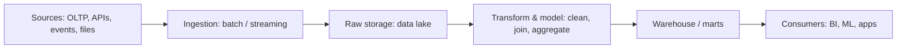
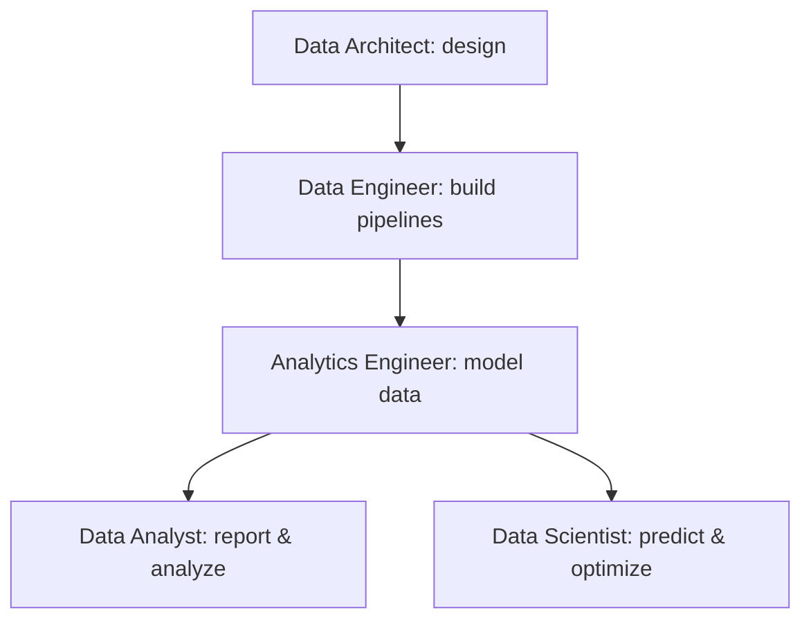

## 1. What is Data?

**Data** = raw facts, observations, and records that describe the world — numbers, text, images, clicks, sensor readings, transactions — on their own without meaning.

- **Information** = data processed, organized, and given context.
- **Knowledge** = information combined with experience and interpretation, used to make decisions.
- **Insight** = the actionable "aha" that drives business value.

> **Data → Information → Knowledge → Insight → Decision** (the DIKW pyramid in practice)

**Why data matters:** better decisions, operational efficiency, customer understanding, personalization, forecasting, and new revenue streams (data itself can be a product).

---

## 2. Structured, Semi-Structured &amp; Unstructured Data

| Type                | Definition                                           | Examples                                                                   | Storage                                |
| ------------------- | ---------------------------------------------------- | -------------------------------------------------------------------------- | -------------------------------------- |
| **Structured**      | Fixed schema — rows &amp; columns, predefined types  | Relational DBs, spreadsheets, CRM records                                  | SQL databases                          |
| **Semi-structured** | Self-describing, flexible tags/keys; no rigid schema | JSON, XML, CSV with headers, email (headers + body), logs, NoSQL documents | Data lakes, NoSQL (MongoDB, Cassandra) |
| **Unstructured**    | No predefined model or schema                        | Images, video, audio, free text, PDFs, social media posts                  | Data lakes, object storage (S3, Blob)  |

**Rule of thumb:** \~80% of enterprise data is unstructured or semi-structured. The less structure, the more flexible the storage must be — and the more work needed to extract meaning.

**Metadata** = data about data (schema, timestamps, author, lineage) — the glue that makes all three types discoverable and trustworthy.

---

## 3. Operational vs Analytical Systems: OLTP vs OLAP

| Dimension      | OLTP (Online Transaction Processing)                 | OLAP (Online Analytical Processing)                       |
| -------------- | ---------------------------------------------------- | --------------------------------------------------------- |
| **Purpose**    | Run the business (day-to-day operations)             | Understand the business (analysis, reporting)             |
| **Workload**   | Many short read/write transactions                   | Complex, long-running analytical queries                  |
| **Query type** | INSERT / UPDATE / DELETE single rows                 | Aggregations, GROUP BY, scans of millions of rows         |
| **Schema**     | Normalized (3NF) — avoids redundancy                 | Denormalized (star/snowflake) — fewer joins, faster reads |
| **Users**      | Applications, customers, staff                       | Analysts, data scientists, BI tools                       |
| **Metric**     | Transactions per second, latency                     | Query throughput, time-to-insight                         |
| **Examples**   | Bank transfers, e-commerce checkout, booking systems | Sales dashboards, churn analysis, financial reporting     |

**Key idea:** keep them separate. Running heavy analytics on the operational database would slow down customers checking out. Data flows **from OLTP systems into analytical platforms**.

**Analytical schema basics:**

- **Star schema** — central *fact* table (events, measures) surrounded by *dimension* tables (who/what/where/when). Most common.
- **Snowflake schema** — dimensions further normalized into sub-dimensions.

---

## 4. Data Warehouses, Data Lakes &amp; Lakehouses

### 🏢 Data Warehouse

- Central store of **cleaned, structured, modeled** data from many sources, optimized for SQL analytics and BI.
- Schema-on-**write** (define structure before loading).
- Examples: Snowflake, BigQuery, Amazon Redshift, Azure Synapse.
- Strengths: performance, data quality, governance. Weakness: rigid, costly for unstructured data.

### 🌊 Data Lake

- Central store of **raw data in any format** (structured, semi-structured, unstructured), usually cheap object storage.
- Schema-on-**read** (impose structure when you query).
- Examples: S3, Azure Data Lake, GCS + query engines (Spark, Presto/Athena).
- Strengths: cheap, flexible, holds everything. Risks: "data swamp" — poor governance, no catalog, unused data.

### 🏝️ Lakehouse (best of both)

- A data lake + warehouse-style **management layer**: ACID transactions, schema enforcement, catalog, and BI-grade SQL performance on top of open file formats (Delta Lake, Iceberg, Parquet).
- Examples: Databricks, Delta Lake on S3.
- Trend: one platform for raw storage *and* governed analytics + ML.

|            | Warehouse   | Lake         | Lakehouse               |
| ---------- | ----------- | ------------ | ----------------------- |
| Data types | Structured  | Any          | Any (with governance)   |
| Schema     | On write    | On read      | On read/write, enforced |
| Cost       | Higher      | Low          | Low–medium              |
| Users      | BI/analysts | Engineers/DS | All                     |

---

## 5. Batch vs Stream Processing; ETL vs ELT

### Batch vs Stream

|                     | Batch                                 | Stream (real-time)                                 |
| ------------------- | ------------------------------------- | -------------------------------------------------- |
| **Model**           | Process finite chunks on a schedule   | Process events continuously, as they arrive        |
| **Latency**         | Minutes–hours (or overnight)          | Milliseconds–seconds                               |
| **Cost/complexity** | Simpler, cheaper                      | More complex (ordering, late events, exactly-once) |
| **Examples**        | Nightly sales report, payroll         | Fraud detection, live dashboards, IoT alerts       |
| **Tools**           | Spark batches, Airflow-scheduled jobs | Kafka, Flink, Spark Streaming, Kinesis             |

> Most organizations use **both**: streams for real-time needs, batch for heavy history and backfills. **Lambda architecture** = batch + speed layer; **Kappa architecture** = stream-only.

### ETL vs ELT

- **ETL (Extract → Transform → Load):** transform data *before* loading into the warehouse (using a separate engine). Traditional; good when the target is limited.
- **ELT (Extract → Load → Transform):** load raw data first, transform *inside* the warehouse/lakehouse using its compute (e.g., dbt + Snowflake). Modern, scalable, keeps raw data for re-processing.

**Rule of thumb:** modern cloud warehouses (cheap elastic compute + separation of storage/compute) made ELT the default.

---

## 6. Data Pipelines &amp; Data Workflows

**Data pipeline** = the end-to-end set of steps that moves and transforms data from source to destination, reliably and repeatably.

A typical pipeline:

**Core pipeline stages:**

1. **Ingestion** — batch loads (APIs, files, CDC) or streaming (Kafka).
2. **Storage** — raw zone (immutable), staging, curated zone.
3. **Transformation** — cleaning, deduplication, standardizing, joins, business logic.
4. **Serving** — warehouse tables, marts, dashboards, ML features.

**Data workflow** = the *orchestration* of pipelines: dependencies, schedules, retries, alerts. Tools: **Airflow** (DAGs), Dagster, Prefect, dbt (transformation layer).

**What makes a pipeline production-grade:**

- Idempotency (re-runs don't corrupt data)
- Incremental loads vs full refreshes
- Data quality tests &amp; monitoring (freshness, nulls, row counts)
- Lineage &amp; documentation
- Observability: alerting on failures and SLAs

---

## 7. Roles in the Data World

| Role                   | Core Question                                 | Main Focus                                                                                   | Typical Tools                                     |
| ---------------------- | --------------------------------------------- | -------------------------------------------------------------------------------------------- | ------------------------------------------------- |
| **Data Analyst**       | *What happened, and why?*                     | Query and visualize data; reporting, dashboards, ad-hoc analysis                             | SQL, Excel, Power BI / Tableau / Looker           |
| **Analytics Engineer** | *How do we model data for reliable analysis?* | Transform and model data in the warehouse; bring software engineering rigor to analytics     | SQL, dbt, Git, warehouses (Snowflake, BigQuery)   |
| **Data Engineer**      | *How do we build reliable pipelines?*         | Ingest, pipeline, and store data at scale; infrastructure &amp; pipelines                    | Python, SQL, Airflow, Spark, Kafka, cloud         |
| **Data Architect**     | *What's the big-picture data design?*         | Design the organization's overall data architecture, standards, governance; choose platforms | Modeling tools, cloud architecture, data catalogs |
| **Data Scientist**     | *What will happen, and what should we do?*    | Statistics &amp; ML: prediction, experimentation, optimization                               | Python/R, scikit-learn, ML frameworks, notebooks  |

**How they fit together:**

- The **Architect** designs the blueprint.
- **Data Engineers** build and run the pipelines that deliver clean, trusted data.
- **Analytics Engineers** model that data into well-governed datasets.
- **Analysts** turn it into business insight; **Data Scientists** build predictive models on top.

**Cheat sheet:** Architect designs it → Engineer moves it → Analytics Engineer models it → Analyst explains it → Data Scientist predicts with it.

---

## ⚡ Quick Revision

- Data = raw facts; value comes from turning it into insight.
- Structured (SQL tables) / semi-structured (JSON, logs) / unstructured (images, text).
- OLTP runs the business, OLAP analyzes it; keep them separate.
- Warehouse = clean &amp; governed; Lake = raw &amp; cheap; Lakehouse = both.
- Batch = scheduled chunks; Stream = continuous events.
- ETL transforms before load; ELT transforms in the warehouse (modern default).
- Pipeline = source → ingest → store → transform → serve; workflow = orchestration of pipelines.
- Roles: Analyst (what happened) → Analytics Engineer (modeled data) → Data Engineer (pipelines) → Architect (blueprint) → Data Scientist (what's next).
