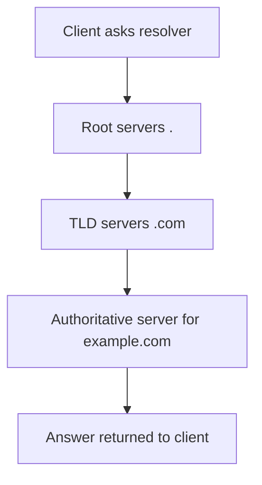
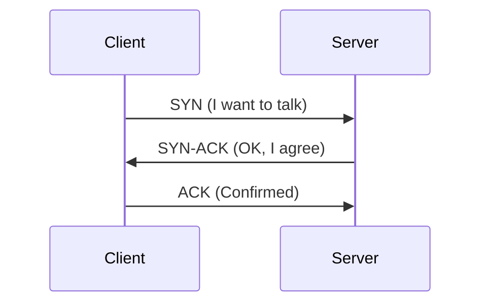
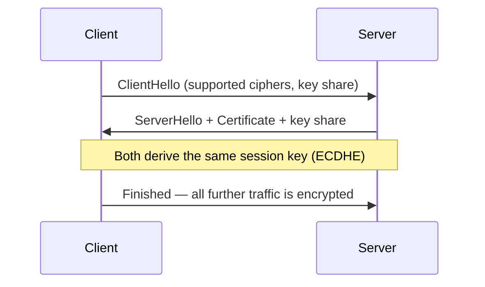
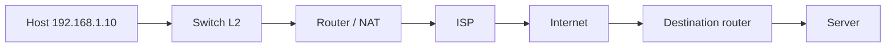
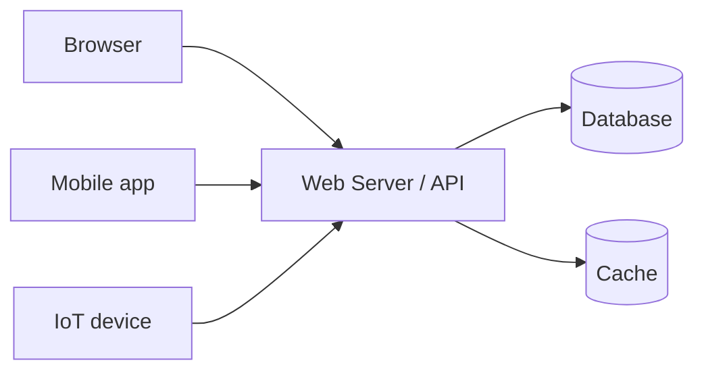
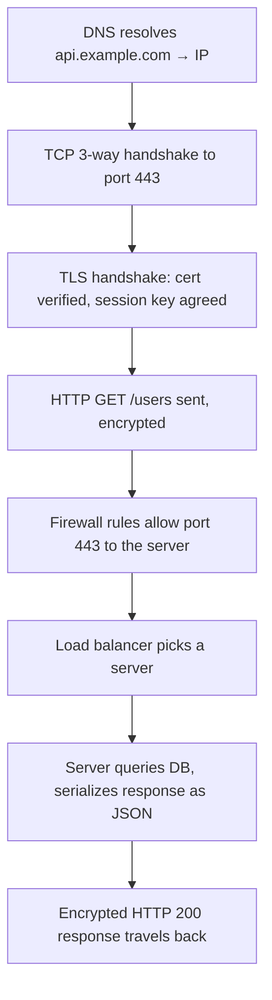

# Module 1.3 — Networking Fundamentals

> Complete study notes covering IP addressing, DNS, TCP/UDP, HTTP(S), REST/JSON, TLS, firewalls, routing, and client–server architecture.

---

## 1. IP Addresses, Subnet Masks and DNS

### 1.1 What is an IP address?

An **IP address** is a unique numeric label assigned to every device (more precisely, every network *interface*) on a network. It serves two purposes:

1. **Identification** — who the device is (host address).
2. **Location addressing** — where the device is (network portion).

**Two versions:**


| Feature       | IPv4                                         | IPv6                                            |
| ------------- | -------------------------------------------- | ----------------------------------------------- |
| Format        | 32-bit, dotted decimal (e.g. `192.168.1.10`) | 128-bit, hexadecimal (e.g. `2001:db8::1`)       |
| Address space | \~4.3 billion                                | \~340 undecillion (2¹²⁸)                        |
| Notation      | 4 octets, 0–255 each                         | 8 groups of 4 hex digits, `::` compresses zeros |
| Why it exists | Original standard                            | Solves IPv4 exhaustion                          |


**IPv4 address classes (legacy but exam-relevant):**


| Class | Range   | Default mask          | Typical use     |
| ----- | ------- | --------------------- | --------------- |
| A     | 1–126   | `/8` (255.0.0.0)      | Huge networks   |
| B     | 128–191 | `/16` (255.255.0.0)   | Medium networks |
| C     | 192–223 | `/24` (255.255.255.0) | Small networks  |
| D     | 224–239 | —                     | Multicast       |
| E     | 240–255 | —                     | Experimental    |


**Private (non-routable) IPv4 ranges (RFC 1918):**

- `10.0.0.0/8`
- `172.16.0.0/12` (172.16.0.0 – 172.31.255.255)
- `192.168.0.0/16`

Special addresses: `127.0.0.1` (loopback/localhost), `169.254.x.x` (APIPA / link-local), `0.0.0.0` (unspecified / "any").

### 1.2 Subnet masks and CIDR

An IP address = **network portion + host portion**. The **subnet mask** tells you where the split is.

- **Subnet mask**: a 32-bit value where network bits are `1`s and host bits are `0`s. Example: `255.255.255.0`.
- **CIDR notation**: `/n` = number of network bits. `192.168.1.0/24` means the first 24 bits are the network.

**Key formulas:**

```
Usable hosts = 2^(32 − n) − 2
```

(Subtract 2 for the *network address* — all host bits 0 — and the *broadcast address* — all host bits 1.)


| CIDR | Mask            | Usable hosts |
| ---- | --------------- | ------------ |
| /24  | 255.255.255.0   | 254          |
| /25  | 255.255.255.128 | 126          |
| /26  | 255.255.255.192 | 62           |
| /27  | 255.255.255.224 | 30           |
| /28  | 255.255.255.240 | 14           |
| /30  | 255.255.255.252 | 2            |


**Subnetting worked example** — subnet `192.168.10.0/24` into 4 equal subnets (borrow 2 bits → `/26`, block size = 256 − 192 = 64):


| Subnet            | Range       | Broadcast |
| ----------------- | ----------- | --------- |
| 192.168.10.0/26   | .1 – .62    | .63       |
| 192.168.10.64/26  | .65 – .126  | .127      |
| 192.168.10.128/26 | .129 – .190 | .191      |
| 192.168.10.192/26 | .193 – .254 | .255      |


**Why subnet?** Reduce broadcast traffic, improve security segmentation, efficient IP allocation, better performance.

**NAT (Network Address Translation):** maps private IPs to a public IP at the router — this is how millions of devices share scarce public IPv4 addresses.

### 1.3 DNS (Domain Name System)

**DNS** translates human-friendly names (`google.com`) into IP addresses (`142.250.4.100`). It's often called the "phonebook of the Internet."

**The DNS resolution chain:**



**Steps in a lookup:**

1. Client checks its **local cache**, then OS cache.
2. Query goes to a **recursive resolver** (usually your ISP's or 8.8.8.8 / 1.1.1.1).
3. Resolver asks a **root server** → pointed to the **TLD server** (`.com`).
4. TLD server points to the **authoritative name server** for the domain.
5. Authoritative server returns the IP; answer is cached at every hop for its **TTL** (time-to-live).

**Key record types:**


| Record | Purpose                             |
| ------ | ----------------------------------- |
| A      | Domain → IPv4                       |
| AAAA   | Domain → IPv6                       |
| CNAME  | Alias → another domain              |
| MX     | Mail server routing                 |
| TXT    | Free text: SPF, DKIM, verification  |
| NS     | Delegation to authoritative servers |
| SOA    | Zone metadata                       |
| SRV    | Service location (port + host)      |


**Port:** DNS uses **UDP port 53** (TCP port 53 for zone transfers and large responses). DNSSEC adds cryptographic signing to prevent spoofing.

---

## 2. TCP vs UDP; Ports and Sockets

### 2.1 TCP (Transmission Control Protocol)

**Connection-oriented, reliable, ordered.**

Before data flows, TCP establishes a connection with the **three-way handshake**:



**TCP features:**

- **Reliability** — every segment is ACKnowledged; lost segments are retransmitted.
- **Ordering** — sequence numbers reassemble data in the right order.
- **Flow control** — sliding window; receiver advertises how much it can absorb.
- **Congestion control** — slow start, AIMD (additive increase, multiplicative decrease).
- **Full-duplex** — data flows both directions simultaneously.
- Connection teardown with FIN/ACK (graceful) or RST (abortive).

### 2.2 UDP (User Datagram Protocol)

**Connectionless, fast, "best-effort."**

- No handshake, no ACKs, no retransmission, no ordering.
- Minimal overhead: 8-byte header vs TCP's 20+ bytes.
- If reliability is needed, the **application layer** must provide it (e.g., QUIC, RTP retransmission logic).

### 2.3 Head-to-head comparison


| Property                | TCP                              | UDP                                |
| ----------------------- | -------------------------------- | ---------------------------------- |
| Connection              | Connection-oriented (handshake)  | Connectionless                     |
| Reliability             | Guaranteed delivery + retransmit | Best-effort, may lose packets      |
| Ordering                | Ordered                          | No ordering guarantee              |
| Speed                   | Slower (overhead)                | Faster (lightweight)               |
| Header size             | 20–60 bytes                      | 8 bytes                            |
| Data unit               | Segment                          | Datagram                           |
| Congestion/flow control | Yes                              | No                                 |
| Use cases               | Web, email, file transfer        | Streaming, gaming, VoIP, DNS, DHCP |


**Rule of thumb:** TCP when *every byte matters* (web pages, downloads); UDP when *speed matters more than perfection* (live video, online games) — a lost frame is better than a delayed one.

### 2.4 Ports

A **port** is a 16-bit number (0–65535) identifying a specific process/service on a host.


| Range       | Name              | Use                                                                   |
| ----------- | ----------------- | --------------------------------------------------------------------- |
| 0–1023      | Well-known        | System services (HTTP 80, HTTPS 443, DNS 53, SSH 22, FTP 21, SMTP 25) |
| 1024–49151  | Registered        | Vendor applications (MySQL 3306, PostgreSQL 5432)                     |
| 49152–65535 | Dynamic/Ephemeral | Client-side temporary ports                                           |


**Well-known ports to memorize:** 20/21 FTP, 22 SSH, 23 Telnet, 25 SMTP, 53 DNS, 67/68 DHCP, 80 HTTP, 110 POP3, 143 IMAP, 161 SNMP, 443 HTTPS, 445 SMB, 3389 RDP.

### 2.5 Sockets

A **socket** is the endpoint of a connection, uniquely identified by:

```
IP address : port  →  e.g.  192.168.1.10:8080
```

A TCP connection is defined by the **4-tuple**:  
`{source IP, source port, destination IP, destination port}` — this is how a server (e.g., one listening on port 443) can maintain thousands of simultaneous connections.

**Typical flow:**

```mermaid
flowchart LR
    S[socket\(\)] --> B[bind\(\) to IP:port] --> L[listen\(\)] --> A[accept\(\)] --> R[read / write] --> C[close\(\)]
```

Server: `socket → bind → listen → accept → recv/send → close`.  
Client: `socket → connect → send/recv → close`.

---

## 3. HTTP, HTTPS, REST APIs and JSON

### 3.1 HTTP (HyperText Transfer Protocol)

An **application-layer, request–response, stateless** protocol — the foundation of the web. Client (usually browser) sends a **request**, server sends a **response**.

**Anatomy of an HTTP request:**

```http
POST /api/users HTTP/1.1
Host: example.com
Content-Type: application/json
Content-Length: 42

{"name": "Macphalen", "role": "admin"}
```

**Anatomy of an HTTP response:**

```http
HTTP/1.1 201 Created
Content-Type: application/json

{"id": 7, "name": "Macphalen", "role": "admin"}
```

**Key request methods:**


| Method | Purpose                     | Safe? | Idempotent? |
| ------ | --------------------------- | ----- | ----------- |
| GET    | Read a resource             | Yes   | Yes         |
| POST   | Create a resource           | No    | No          |
| PUT    | Replace a resource entirely | No    | Yes         |
| PATCH  | Partially update a resource | No    | No\*        |
| DELETE | Remove a resource           | No    | Yes         |
| HEAD   | Headers only (like GET)     | Yes   | Yes         |


- **Safe** = doesn't modify server state. **Idempotent** = repeating gives the same result.
- ¹ PATCH idempotency depends on implementation.

**Status code families:**


| Family | Meaning       | Famous examples                                                                        |
| ------ | ------------- | -------------------------------------------------------------------------------------- |
| 1xx    | Informational | 101 Switching Protocols (WebSockets)                                                   |
| 2xx    | Success       | 200 OK, 201 Created, 204 No Content                                                    |
| 3xx    | Redirection   | 301 Moved Permanently, 302 Found, 304 Not Modified                                     |
| 4xx    | Client error  | 400 Bad Request, 401 Unauthorized, 403 Forbidden, 404 Not Found, 429 Too Many Requests |
| 5xx    | Server error  | 500 Internal Server Error, 502 Bad Gateway, 503 Service Unavailable                    |


**Important headers:** `Host`, `Content-Type`, `Content-Length`, `Authorization`, `Cache-Control`, `Cookie`, `Set-Cookie`, `Accept`, `User-Agent`, `CORS` (`Access-Control-Allow-Origin`).

**HTTP versions:**

- **HTTP/1.1** (1997): persistent connections, pipelining issues (head-of-line blocking).
- **HTTP/2** (2015): binary framing, multiplexing, header compression, server push.
- **HTTP/3** (2022): runs on **QUIC over UDP** — faster handshakes, no TCP head-of-line blocking.

**Cookies &amp; state:** HTTP is stateless; servers use cookies/tokens (sessions, JWT) to "remember" clients.

### 3.2 HTTPS

**HTTPS = HTTP over TLS** (port 443). Same protocol, but the traffic is **encrypted, integrity-protected and authenticated**. Prevents eavesdropping, tampering, and man-in-the-middle attacks. (Strictly speaking the modern name is TLS — "SSL" is legacy terminology.)

### 3.3 REST APIs

**REST** (Representational State Transfer) is an architectural style for APIs that uses HTTP as intended. Six constraints:

1. **Client–server** separation.
2. **Statelessness** — each request contains all context; no server-side sessions required.
3. **Cacheability** — responses declare if they're cacheable.
4. **Uniform interface** — resource URIs, standard methods, HATEOAS (optionally).
5. **Layered system** — intermediaries (proxies, load balancers) are transparent.
6. **Code on demand** (optional).

**RESTful URL design (resources as nouns, methods as verbs):**

```
GET    /api/users          → list users
GET    /api/users/7        → get user 7
POST   /api/users          → create a user
PUT    /api/users/7        → replace user 7
PATCH  /api/users/7        → update part of user 7
DELETE /api/users/7        → delete user 7
GET    /api/users/7/orders → nested resource (user 7's orders)
```

**Versioning:** `/api/v1/...` via URL path, or a header. **Query parameters** for filtering/pagination: `?page=2&limit=20&sort=name`.

**Contrast:** REST vs GraphQL (client-defined queries, single endpoint) vs gRPC (binary Protobuf over HTTP/2, for service-to-service).

### 3.4 JSON

**JSON** (JavaScript Object Notation) — the standard data format for REST APIs: lightweight, human-readable, language-independent.

**Data types:** string, number, boolean, `null`, object, array.

```json
{
  "id": 7,
  "name": "Macphalen",
  "active": true,
  "balance": 1500.75,
  "roles": ["admin", "dev"],
  "manager": null,
  "address": {
    "city": "Nairobi",
    "country": "Kenya"
  }
}
```

**JSON rules:** keys must be double-quoted strings; no trailing commas; no comments; `Content-Type: application/json`.

**vs XML:** JSON is lighter, faster to parse, natively fits JavaScript. XML is heavier but has strong schema/validation tooling (SOAP). Typical auth pattern for APIs: `Authorization: Bearer <token>` (often a JWT — `header.payload.signature`).

---

## 4. TLS Certificates, Firewalls and Basic Routing

### 4.1 TLS (Transport Layer Security)

TLS sits between TCP and the application layer, giving three guarantees:

1. **Encryption** — confidentiality (nobody can read the traffic).
2. **Integrity** — tampering is detected (AEAD ciphers).
3. **Authentication** — the server proves its identity via a **certificate**.

**The TLS handshake (simplified, TLS 1.3):**



- They agree on a **cipher suite** and perform **ECDHE key exchange** so the session key is never sent over the wire (forward secrecy).
- The server's **certificate** binds its domain name to a **public key**.
- The client validates the chain: leaf → intermediate → **root CA** (trusted, pre-installed in the OS/browser).

**Certificates:**

- X.509 format, issued by a **Certificate Authority (CA)**.
- Contains: subject/domain, public key, issuer, validity dates, signature.
- **DV** (domain-validated, basic), **OV** (organization-validated), **EV** (extended validation, strictest).
- **Let's Encrypt** issues DV certs free via the **ACME** protocol — the reason HTTPS is now everywhere.
- Expired/invalid cert → browser shows a security warning.
- **mTLS**: client *and* server present certificates — common in service meshes.

### 4.2 Firewalls

A **firewall** filters traffic based on rules — the gatekeeper between trusted and untrusted networks.


| Type                    | How it decides               | Notes                                                      |
| ----------------------- | ---------------------------- | ---------------------------------------------------------- |
| Packet-filtering        | IP, port, protocol           | Fast, stateless, easy to evade                             |
| Stateful                | Tracks connection state      | Knows a reply belongs to your request — the modern default |
| Application-layer (WAF) | Inspects HTTP content        | Blocks SQLi, XSS, blocks bad bots                          |
| Next-gen (NGFW)         | Deep packet inspection + IPS | Adds identity, app awareness                               |


**Common rule logic:** allow/deny by source IP, destination IP, port, protocol. **Default-deny** (block everything, allow explicitly) is the safest posture. Related concepts: NAT, DMZ (public-facing servers in an isolated zone), stateless vs stateful rules, Web Application Firewalls in front of APIs.

### 4.3 Basic Routing

**Routing** = choosing the best path for packets between networks.

**Key devices:**


| Device  | Layer   | What it does                                |
| ------- | ------- | ------------------------------------------- |
| Hub     | Layer 1 | Repeats signal to all ports (obsolete)      |
| Switch  | Layer 2 | Forwards frames by MAC address within a LAN |
| Router  | Layer 3 | Forwards packets by IP between networks     |
| Gateway | —       | Router that is the "exit door" of your LAN  |


**How a router decides:** it matches the destination IP against its **routing table** using **longest-prefix match** (most specific route wins). If nothing matches → the **default route** (`0.0.0.0/0`, a.k.a. "default gateway").

**A packet's journey (LAN → Internet → LAN):**



1. Host compares destination to its own subnet (using the mask).
2. Same subnet → ARP for the MAC, send directly.
3. Different subnet → send to the **default gateway**.
4. Routers hop-by-hop (**next-hop routing**), each picking the best prefix match.
5. **TTL** decrements each hop (prevents infinite loops); TTL hits 0 → "Time exceeded" (this is how **traceroute** works).
6. Protocols: **OSPF** (interior link-state), **BGP** (the routing protocol *between* organizations/ISPs on the Internet).

---

## 5. Client–Server Architecture

### 5.1 The model

The **client** requests services; the **server** provides them. Clients are typically thin (browser, mobile app); servers centralize logic, data and security.



**Key characteristics:**

- **Separation of concerns** — presentation (client) vs logic/data (server).
- **Centralized data &amp; security** — one place to control, back up and protect.
- **Scalability** — one server serves many clients; servers can be scaled (see below).
- **Persistent availability** — the server is always on; clients come and go.

### 5.2 Request lifecycle (2-tier / 3-tier)

- **2-tier**: client ↔ database server directly (legacy desktop apps).
- **3-tier (the standard web pattern):** presentation tier (browser) → application tier (web/API server with business logic) → data tier (database). Each tier can scale and change independently.
- **N-tier / microservices**: application tier split into independent services communicating over APIs (REST/gRPC) or queues.

### 5.3 Client–server vs P2P


| Aspect                   | Client–Server                 | Peer-to-Peer                    |
| ------------------------ | ----------------------------- | ------------------------------- |
| Structure                | Centralized                   | Decentralized                   |
| Single point of failure? | Yes (mitigated by redundancy) | No                              |
| Data consistency         | Easy                          | Hard                            |
| Cost                     | Server infrastructure         | Cheap, uses peers' resources    |
| Examples                 | Web, email, banking           | BitTorrent, Bitcoin, blockchain |


### 5.4 Scalability patterns

- **Vertical scaling (scale-up):** bigger machine — simple, has a ceiling.
- **Horizontal scaling (scale-out):** more machines behind a **load balancer** — the standard cloud approach.
- **Load balancer**: distributes requests across servers (algorithms: round-robin, least-connections, IP hash); also performs health checks and can terminate TLS.
- **Caching &amp; CDNs**: serve content near the client, reduce server load.
- **Stateless design** (à la REST) is what makes horizontal scaling feasible — any server can answer any request.

### 5.5 Where the earlier topics fit together

When you open `https://api.example.com/users`:



---

## Quick Revision Cheat Sheet


| Concept            | One-liner                                                          |
| ------------------ | ------------------------------------------------------------------ |
| IP address         | Numeric ID of an interface: network part + host part               |
| Subnet mask / CIDR | Where the network/host split is; `/24` = 254 usable hosts          |
| Private ranges     | 10/8, 172.16/12, 192.168/16                                        |
| DNS                | Names → IPs via root → TLD → authoritative; UDP 53                 |
| TCP                | Connection-oriented, reliable, ordered, 3-way handshake            |
| UDP                | Connectionless, fast, best-effort, 8-byte header                   |
| Port               | 16-bit service identifier; 80/443/53/22 to memorize                |
| Socket             | `IP:port` endpoint; connection = 4-tuple                           |
| HTTP               | Stateless request–response protocol                                |
| Status codes       | 2xx success, 3xx redirect, 4xx your fault, 5xx server's fault      |
| HTTPS              | HTTP + TLS on port 443                                             |
| REST               | Resource URLs + HTTP methods; stateless, JSON payloads             |
| JSON               | Key–value data format for APIs                                     |
| TLS handshake      | Cert chain + key exchange → encrypted channel                      |
| Firewall           | Allow/deny traffic by rule; stateful beats stateless               |
| Routing            | Longest-prefix match; default gateway `0.0.0.0/0`; TTL/ traceroute |
| Client–server      | Thin clients request; server centralizes logic, data, security     |
| Scalability        | Vertical = bigger; horizontal = more behind a load balancer        |


---

*End of Module 1.3 notes — happy studying!* 
