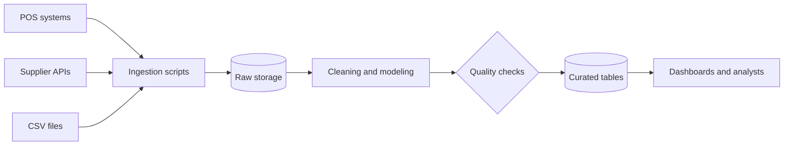

# Phase 01 · Part B — Hands-On Labs and Milestone Project

**The Foundations of Computing and Data** · Step-by-step procedures

> **How this file fits with Part A**
> - **Part A (`phase01_part-a_content-notes.md`):** the ideas and examples.
> - **Part B (this file):** do-it-yourself labs. Every lab names the section of Part A to read first.
>
> **Tip:** read the matching notes in Part A for 20–30 minutes, then come here and practise. Do not try to memorise commands; the labs are where they stick.

---

## Contents

- [Lab map and timing](#lab-map-and-timing)
- [Ground rules](#ground-rules)
- [Lab 0 — Set up your environment](#lab-0--set-up-your-environment)
- [Lab 0.5 — Write your concept notes](#lab-05--write-your-concept-notes)
- [Lab 1 — Inspect a retail sales CSV with Bash](#lab-1--inspect-a-retail-sales-csv-with-bash)
- [Lab 2A — Call a REST API with curl and jq](#lab-2a--call-a-rest-api-with-curl-and-jq)
- [Lab 2B — Troubleshooting ladder](#lab-2b--troubleshooting-ladder)
- [Lab 3 — Git and GitHub](#lab-3--git-and-github)
- [Milestone project — your first documented repository](#milestone-project--your-first-documented-repository)
- [Troubleshooting guide](#troubleshooting-guide)
- [Final checklist](#final-checklist)

---

## Lab map and timing

| Week | Lab | Read first (Part A) | Time |
| --- | --- | --- | --- |
| 1 | Lab 0: Environment setup | Sections 1–2 | 2 h |
| 1 | Lab 0.5: Concept notes | Module 1.1 | 3 h |
| 2 | Lab 1: Sales CSV and Bash profiler | Module 1.2 | 8–10 h |
| 3 | Lab 2A: REST API with curl | Module 1.3 | 1.5 h |
| 3 | Lab 2B: Troubleshooting ladder | Module 1.3 | 2 h |
| 3 | Lab 3: Git and GitHub | Module 1.4 | 4–5 h |
| 4 | Milestone project | Everything | 8–10 h |

## Ground rules

1. **Type, don't paste.** Typing builds muscle memory.
2. **Lines starting with `$`** are what you type (do not type the `$`). Other lines are example output; yours may differ slightly.
3. **Run `pwd` and `ls` before anything destructive** such as `rm`.
4. **Each lab ends with a "You are done when..." box.** Do not move on until you can tick every item.

---

## Lab 0 — Set up your environment

*Read first: Part A, sections 1–2.* Goal: a working Ubuntu terminal on Windows, with every tool this phase needs.

### Step 1 — Check requirements

You need Windows 10 (version 2004 or later) or Windows 11, with virtualization enabled. To check: **Task Manager → Performance → CPU → "Virtualization: Enabled"**.

(On Linux or macOS, skip to Step 6 and install the tools with your package manager.)

### Step 2 — Install Ubuntu on WSL2

Open **PowerShell as Administrator** and run:

```powershell
wsl --install -d Ubuntu
```

### Step 3 — Restart and create your Linux user

Restart when asked. Ubuntu opens and asks for a **username and password**. The password does not show as you type. That is normal.

### Step 4 — Confirm WSL version 2

In PowerShell:

```powershell
wsl -l -v
```

You should see Ubuntu with `VERSION 2`. If it shows 1, run `wsl --set-version Ubuntu 2`.

### Step 5 — Update the system

In the Ubuntu terminal:

```bash
$ sudo apt update && sudo apt upgrade -y
```

### Step 6 — Install the phase toolkit

```bash
$ sudo apt install -y build-essential curl wget git unzip jq tree \
    dnsutils iputils-ping traceroute netcat-openbsd openssh-client \
    python3 python3-venv python3-pip
```

### Step 7 — Install VS Code with the WSL extension

Install **VS Code** on Windows, then add the **WSL** extension. From the Ubuntu terminal, in any folder, run:

```bash
$ code .
```

VS Code opens connected to Linux.

> **Tip:** keep projects **inside the Linux filesystem** (for example `~/de-journey`), not under `/mnt/c/...`. File access is faster and permissions behave correctly.

### Step 8 — Quick health check

```bash
$ git --version
$ python3 --version
$ curl --version | head -n 1
$ jq --version
```

All four should print a version.

> ✅ **You are done when:** Ubuntu opens from the Start menu, `wsl -l -v` shows version 2, the four commands above print versions, and `code .` opens VS Code.

---

## Lab 0.5 — Write your concept notes

*Read first: Part A, Module 1.1.* Goal: prove you understood the data ecosystem by explaining it yourself.

1. Create `notes/01-data-ecosystem.md` (any folder for now; you will move it into your repo in Lab 3).
2. Write **one paragraph each, in your own words**, for:
   - OLTP vs OLAP
   - warehouse / lake / lakehouse
   - batch vs stream
   - ETL vs ELT
3. For each concept, add **one example from a Kenyan business**: a bank, M-Pesa-style mobile money, a supermarket, a matatu SACCO, a telecom or a county government.
4. Classify these as structured, semi-structured or unstructured:
   - a. A CSV of daily supermarket sales
   - b. A JSON response from a weather API
   - c. Customer voice recordings from a call centre
   - d. A PostgreSQL `orders` table
   - e. Web server logs in `key=value` format
5. Draw the **five-layer pipeline** for the supermarket example on paper or in [diagrams.net](https://www.diagrams.net/):
   *sources → ingestion → storage and transformation → reliability and governance → consumers*

<details>
<summary>Answers to step 4</summary>

a. Structured · b. Semi-structured · c. Unstructured · d. Structured · e. Semi-structured

</details>

> ✅ **You are done when:** you can answer without looking: *"Why can't we run the CEO's sales analysis on the shop's till database?"*

---

## Lab 1 — Inspect a retail sales CSV with Bash

*Read first: Part A, Module 1.2.*

**Scenario:** a store manager sends you a sales file. Before anyone loads it into a database, you must find its problems from the terminal and write a report. You will do it by hand first, then turn it into a reusable script.

### Part 1 — Build your workspace

**Step 1.** Create the project folders:

```bash
$ mkdir -p ~/de-journey/{data/raw,scripts,reports,notes,logs,sql,docs}
$ cd ~/de-journey
$ tree -L 2
```

**Step 2.** Create a sample file with deliberate problems, so everyone finds the same errors:

```bash
$ cat > data/raw/sales_sample.csv <<'EOF'
order_id,store,product,quantity,unit_price,sale_date
1001,Nairobi CBD,Maize Flour 2kg,3,185,2026-10-01
1002,Nairobi CBD,Cooking Oil 1L,2,320,2026-10-01
1003,Mombasa Nyali,Sugar 1kg,5,150,2026-10-01
1004,Kisumu Central,Rice 2kg,,420,2026-10-01
1005,Nakuru Town,Milk 500ml,10,60,2026-10-02
1006,Nairobi Westlands,Bread 400g,4,65,2026-10-02
1002,Nairobi CBD,Cooking Oil 1L,2,320,2026-10-01
1007,Eldoret Town,Tea Leaves 250g,2,
1008,Mombasa Nyali,Maize Flour 2kg,-1,185,2026-10-03
1009,Kisumu Central,Sugar 1kg,6,150,not-a-date
1010,Nairobi CBD,Rice 2kg,3,420,2026-10-03,EXTRA
1011,Nakuru Town,Cooking Oil 1L,1,320,2026-10-03
EOF
```

### Part 2 — Investigate by hand

**Step 3. Look before you analyse.**

```bash
$ wc -l data/raw/sales_sample.csv        # total lines (header + records)
$ head -n 5 data/raw/sales_sample.csv    # first lines
$ tail -n 3 data/raw/sales_sample.csv    # last lines
```

**Step 4. Find malformed rows** (they should have exactly 6 comma-separated fields):

```bash
$ awk -F, 'NR>1 && NF!=6 {print "line " NR ": " $0}' data/raw/sales_sample.csv
```

Expected: the rows for `1007` (too few fields) and `1010` (too many).

**Step 5. Find missing values** in `quantity` or `unit_price` on well-formed rows:

```bash
$ awk -F, 'NR>1 && NF==6 && ($4=="" || $5=="") {print "line " NR ": " $0}' data/raw/sales_sample.csv
```

Expected: the row for `1004`.

**Step 6. Find suspicious values** (zero or negative quantity, bad dates):

```bash
$ awk -F, 'NR>1 && NF==6 && $4!="" && $4<=0 {print "bad quantity, line " NR ": " $0}' data/raw/sales_sample.csv
$ grep -nEv ',[0-9]{4}-[0-9]{2}-[0-9]{2}$' data/raw/sales_sample.csv | tail -n +2
```

The second command prints data lines whose last field is not a `YYYY-MM-DD` date.

**Step 7. Find duplicate order IDs:**

```bash
$ cut -d, -f1 data/raw/sales_sample.csv | tail -n +2 | sort | uniq -d
```

Expected: `1002`.

**Step 8. Count records per store:**

```bash
$ cut -d, -f2 data/raw/sales_sample.csv | tail -n +2 | sort | uniq -c | sort -rn
```

**Step 9. Save your findings with redirection:**

```bash
$ {
  echo "Manual inspection $(date -Iseconds)"
  echo "Record lines: $(( $(wc -l < data/raw/sales_sample.csv) - 1 ))"
  echo "--- Duplicate IDs ---"
  cut -d, -f1 data/raw/sales_sample.csv | tail -n +2 | sort | uniq -d
} > reports/manual_inspection.txt
$ cat reports/manual_inspection.txt
```

### Part 3 — Turn it into a reusable script

**Step 10.** Create `scripts/profile_csv.sh` (open it in VS Code with `code scripts/profile_csv.sh`) and type this in:

```bash
#!/usr/bin/env bash
# Profile a 6-column sales CSV and write a text report.
set -euo pipefail

file="${1:?Usage: $0 path/to/file.csv}"
[ -f "$file" ] || { echo "File not found: $file" >&2; exit 1; }

base="$(cd "$(dirname "$0")/.." && pwd)"
mkdir -p "$base/reports"
report="$base/reports/profile_$(basename "$file" .csv)_$(date +%Y%m%d_%H%M%S).txt"

{
  echo "File: $file"
  echo "Generated: $(date -Iseconds)"
  echo "Data rows: $(( $(wc -l < "$file") - 1 ))"
  echo
  echo "== Malformed rows (field count != 6) =="
  awk -F, 'NR>1 && NF!=6 {print "  line " NR ": " $0}' "$file"
  echo
  echo "== Missing quantity or unit_price =="
  awk -F, 'NR>1 && NF==6 && ($4=="" || $5=="") {print "  line " NR ": " $0}' "$file"
  echo
  echo "== Non-positive quantity =="
  awk -F, 'NR>1 && NF==6 && $4!="" && $4<=0 {print "  line " NR ": " $0}' "$file"
  echo
  echo "== Duplicate order_id values =="
  cut -d, -f1 "$file" | tail -n +2 | sort | uniq -d | sed 's/^/  /'
  echo
  echo "== Records per store =="
  cut -d, -f2 "$file" | tail -n +2 | sort | uniq -c | sort -rn | sed 's/^/  /'
} > "$report"

echo "Report written to $report"
```

**Step 11. Run it and check the exit codes:**

```bash
$ chmod +x scripts/profile_csv.sh
$ ./scripts/profile_csv.sh data/raw/sales_sample.csv
$ echo "exit code: $?"
$ ./scripts/profile_csv.sh missing.csv; echo "exit code: $?"
$ cat reports/profile_sales_sample_*.txt
```

What you should see: the first run prints `Report written to ...` with exit code `0`. The `missing.csv` run prints `File not found` with a **non-zero** exit code. That failing loudly is exactly what schedulers rely on.

### Part 4 — Schedule it (optional)

**Step 12.** Start cron (WSL) and open your schedule:

```bash
$ sudo service cron start
$ crontab -e
```

Add this line (replace `amina` with your Linux username; cron needs **absolute paths**):

```
*/5 * * * * /home/amina/de-journey/scripts/profile_csv.sh /home/amina/de-journey/data/raw/sales_sample.csv >> /home/amina/de-journey/logs/cron.log 2>&1
```

Wait five minutes. Confirm new files appear in `reports/` and that `logs/cron.log` exists. Then **remove the cron line** with `crontab -e` so it does not run forever.

### Part 5 — Stretch challenges

- Extend the script to print **total revenue** (`quantity × unit_price`) using `awk` on well-formed rows with no missing values.
- Add a line that prints how many rows have a bad date.
- Run `ss -tulpn` and find which process listens on a port you recognise.

> ✅ **You are done when you can, without the guide:**
> - [ ] Navigate anywhere, list hidden files and read permissions.
> - [ ] Explain what `a | b > out.txt 2>&1` does.
> - [ ] Find the process using port 8000 and stop it.
> - [ ] Explain why `set -euo pipefail` is in the script.
> - [ ] Modify the script to report total revenue.

---

## Lab 2A — Call a REST API with curl and jq

*Read first: Part A, section 5.4.* We use a free practice API, `jsonplaceholder.typicode.com`.

**Step 1. See the status line and headers:**

```bash
$ curl -i https://jsonplaceholder.typicode.com/posts/1
```

**Step 2. Fetch JSON quietly and format it:**

```bash
$ curl -s https://jsonplaceholder.typicode.com/posts/1 | jq .
```

**Step 3. Extract a field and a list:**

```bash
$ curl -s https://jsonplaceholder.typicode.com/posts/1 | jq -r '.title'
$ curl -s https://jsonplaceholder.typicode.com/posts | jq 'length'
$ curl -s "https://jsonplaceholder.typicode.com/posts?userId=1" | jq '[.[].id]'
```

**Step 4. Save the raw response with a timestamp.** This is the habit behind "always preserve raw data":

```bash
$ mkdir -p ~/de-journey/data/raw
$ curl -s https://jsonplaceholder.typicode.com/posts \
    -o ~/de-journey/data/raw/posts_$(date +%Y%m%dT%H%M%S).json
$ ls -lh ~/de-journey/data/raw/
```

**Step 5. Capture only the status code** (useful inside scripts):

```bash
$ curl -s -o /dev/null -w "%{http_code}\n" https://jsonplaceholder.typicode.com/posts/99999
```

Expected: `404`.

> ✅ **You are done when:** you can pull one field out of a JSON API with `curl` and `jq`, and explain what `200` and `404` mean.

---

## Lab 2B — Troubleshooting ladder

*Read first: Part A, sections 5.6–5.7.* Goal: learn to name the layer that failed.

### Part 1 — Walk the ladder on a healthy site

Run each command in order against `example.com` and note what a *healthy* result looks like:

```bash
$ ping -c 3 1.1.1.1              # 1. local network
$ nslookup example.com           # 2. DNS
$ traceroute example.com         # 3. route (some hops may show * * *)
$ nc -zv example.com 443         # 4. port
$ curl -vI https://example.com   # 5. TLS and 6. application
```

### Part 2 — Break things on purpose

**Step 1. Start a local server.** In **terminal 1** (leave it running):

```bash
$ cd /tmp && python3 -m http.server 8000
```

**Step 2. Success case**, in **terminal 2**:

```bash
$ curl -I http://localhost:8000
$ ss -tulpn | grep 8000
```

**Step 3. Wrong port** (connection refused):

```bash
$ curl -I http://localhost:8001; echo "exit code: $?"
```

Expected: `Failed to connect ... Connection refused`, exit code **7**. *Meaning: the machine is reachable but nothing listens on that port.*

**Step 4. DNS failure:**

```bash
$ curl -I http://this-host-does-not-exist.invalid; echo "exit code: $?"
```

Expected: `Could not resolve host`, exit code **6**.

**Step 5. Timeout** (traffic silently dropped):

```bash
$ curl -I --max-time 5 http://10.255.255.1; echo "exit code: $?"
```

Expected: a timeout, exit code **28**.

**Step 6.** Stop the server with `Ctrl+C` in terminal 1.

### Part 3 — Write your troubleshooting log

Create `notes/02-networking-troubleshooting.md`. For each failure you simulated, record one row:

| Command run | What I saw | Exit code | Layer that failed | Likely cause | Fix |
| --- | --- | --- | --- | --- | --- |
| `curl -I http://localhost:8001` | Connection refused | 7 | Port | Nothing listening | Start service or use the right port |

This log becomes a personal reference for every later phase.

> ✅ **You are done when you can:**
> - [ ] Explain "connection refused" vs "timed out" and what each implies.
> - [ ] Explain why HTTPS is not "HTTP with a password".
> - [ ] Given an error message, name the layer to check first.

---

## Lab 3 — Git and GitHub

*Read first: Part A, Module 1.4.*

### Part 1 — One-time setup

**Step 1.** Create a free account at [github.com](https://github.com).

**Step 2. Configure Git** (use the email attached to your GitHub account, or its private "no-reply" address from GitHub settings):

```bash
$ git config --global user.name "Your Name"
$ git config --global user.email "you@example.com"
$ git config --global init.defaultBranch main
$ git config --list --show-origin | head
```

**Step 3. Create an SSH key:**

```bash
$ ssh-keygen -t ed25519 -C "you@example.com"    # Enter to accept defaults; set a passphrase
$ eval "$(ssh-agent -s)"
$ ssh-add ~/.ssh/id_ed25519
$ cat ~/.ssh/id_ed25519.pub                     # copy this output
```

**Step 4.** On GitHub go to **Settings → SSH and GPG keys → New SSH key**, paste the **public** key and save. (Never share the private one.)

**Step 5. Test it:**

```bash
$ ssh -T git@github.com
```

Expected: a greeting with your username. GitHub gives no shell access, so that message is normal.

### Part 2 — Create your repository

**Step 6.** On GitHub click **New repository**. Name it `data-engineering-journey`, add a short description, choose **Public**, and do **not** add any files.

**Step 7.** Initialise Git in your project:

```bash
$ cd ~/de-journey
$ git init
```

**Step 8. Create `.gitignore` before your first commit:**

```bash
$ cat > .gitignore <<'EOF'
# secrets and local config
.env
*.pem
*.key
id_*
# Python
__pycache__/
*.pyc
.venv/
venv/
# OS / editor
.DS_Store
.vscode/
# generated output
reports/
logs/
EOF
```

**Step 9. First commit and connect the remote:**

```bash
$ git add .gitignore
$ git commit -m "chore: add .gitignore"
$ git remote add origin git@github.com:<your-username>/data-engineering-journey.git
$ git branch -M main
$ git push -u origin main
```

### Part 3 — Practise the daily workflow

Use your Lab 1 work as the content.

```bash
$ git status
$ git switch -c feature/linux-exercises
$ git diff
$ git add scripts/profile_csv.sh data/raw/sales_sample.csv
$ git commit -m "feat: add CSV profiling script and sample data"
$ git push -u origin feature/linux-exercises
```

Now on GitHub:

1. Open a **pull request** for that branch. Describe *what* and *why*.
2. Read your own diff.
3. **Merge** the PR.

Then locally:

```bash
$ git switch main
$ git pull
$ git branch -d feature/linux-exercises
$ git log --oneline --graph --decorate
```

### Part 4 — Create and resolve a merge conflict

Conflicts are normal. Practise once so they stop being scary.

**Step 1.** Create and commit a file on `main`:

```bash
$ echo "Preferred editor: nano" > notes/preferences.txt
$ git add notes/preferences.txt && git commit -m "docs: add preferences note"
```

**Step 2.** Make two branches that change the **same line** differently:

```bash
$ git switch -c branch-a
$ echo "Preferred editor: VS Code" > notes/preferences.txt
$ git commit -am "docs: prefer VS Code"

$ git switch main
$ git switch -c branch-b
$ echo "Preferred editor: Vim" > notes/preferences.txt
$ git commit -am "docs: prefer Vim"
```

**Step 3.** Merge both into `main`:

```bash
$ git switch main
$ git merge branch-a        # succeeds
$ git merge branch-b        # CONFLICT
```

**Step 4.** Open `notes/preferences.txt`. You will see:

```
<<<<<<< HEAD
Preferred editor: VS Code
=======
Preferred editor: Vim
>>>>>>> branch-b
```

**Step 5. Resolve it.** Edit the file to the final text you want (delete the three marker lines), then:

```bash
$ git add notes/preferences.txt
$ git commit -m "merge: resolve editor preference conflict"
$ git log --oneline --graph --decorate
```

**Step 6.** Clean up: `git branch -d branch-a branch-b`

### Part 5 — Secrets drill (read, then check)

1. Create `.env.example` with placeholders only:

   ```
   DB_HOST=localhost
   DB_PORT=5432
   DB_USER=your_user_here
   DB_PASSWORD=your_password_here
   API_KEY=your_api_key_here
   ```

2. Prove `.env` is ignored:

   ```bash
   $ touch .env && git status
   ```

   `.env` must **not** appear in the output.

3. Write one line in your notes answering: *"If I push an API key, what do I do first?"* (Answer: revoke or rotate it immediately; deleting the file does not remove it from history.)

> ✅ **You are done when you can, without notes:**
> - [ ] Create a branch, commit, push, open a PR and merge it.
> - [ ] Resolve a merge conflict.
> - [ ] Explain why `.env` is ignored but `.env.example` is committed.
> - [ ] Explain what to do first if you push an API key.

---

## Milestone project — your first documented repository

**Time:** about 8–10 hours (Week 4).

**Goal:** publish a repository that proves your environment works and shows good habits: documentation, small commits, safe handling of secrets.

### Target structure

```
data-engineering-journey/
├── README.md
├── .gitignore
├── .env.example
├── data/
│   └── raw/
│       └── sales_sample.csv
├── scripts/
│   ├── profile_csv.sh
│   └── profile_csv.py
├── sql/
│   └── exploration_queries.sql
├── notes/
│   ├── 01-data-ecosystem.md
│   ├── 02-networking-troubleshooting.md
│   └── 03-environment-setup.md
└── docs/
    └── pipeline_architecture.md   (and the diagram image)
```

`reports/` and `logs/` are generated locally and ignored by Git.

### Step 1 — Document your environment

Create `notes/03-environment-setup.md` listing:

- Windows version
- WSL version (`wsl --version`)
- Ubuntu version (`lsb_release -a`)
- Git version (`git --version`)
- Python version (`python3 --version`)
- Any problem you solved during setup, and how

### Step 2 — Add the `.env.example`

Already created in Lab 3, Part 5. Confirm it is committed and `.env` is not.

### Step 3 — Write the Python profiler

Create `scripts/profile_csv.py`. This is your first Python script; reading it carefully prepares you for Phase 02.

```python
"""Profile a sales CSV: count rows, malformed rows, missing values and duplicate IDs."""
import csv
import sys
from collections import Counter


def profile(path: str) -> None:
    malformed, missing, ids = [], Counter(), Counter()
    rows = 0
    with open(path, newline="", encoding="utf-8") as f:
        reader = csv.reader(f)
        header = next(reader)
        for line_no, row in enumerate(reader, start=2):
            if len(row) != len(header):
                malformed.append((line_no, row))
                continue
            rows += 1
            ids[row[0]] += 1
            for col, value in zip(header, row):
                if value.strip() == "":
                    missing[col] += 1

    print(f"File: {path}")
    print(f"Well-formed rows: {rows}")
    print(f"Malformed rows: {len(malformed)}")
    for line_no, row in malformed:
        print(f"  line {line_no}: {row}")
    print(f"Missing values by column: {dict(missing)}")
    print(f"Duplicate order_ids: {[k for k, v in ids.items() if v > 1]}")


if __name__ == "__main__":
    if len(sys.argv) != 2:
        sys.exit("Usage: python3 scripts/profile_csv.py path/to/file.csv")
    profile(sys.argv[1])
```

Run it:

```bash
$ python3 scripts/profile_csv.py data/raw/sales_sample.csv
```

Compare its findings with the Bash report. Do they agree? Write one line in your notes about any differences.

### Step 4 — Add the SQL questions

Create `sql/exploration_queries.sql`. You will run these in Phase 03 once you have a database; for now they document the questions you want answered.

```sql
-- Questions to answer once sales_sample.csv is loaded into a table named sales.

-- 1. Revenue by store
SELECT store, SUM(quantity * unit_price) AS revenue
FROM sales
GROUP BY store
ORDER BY revenue DESC;

-- 2. Duplicate order IDs
SELECT order_id, COUNT(*) AS occurrences
FROM sales
GROUP BY order_id
HAVING COUNT(*) > 1;

-- 3. Rows with missing quantity or price
SELECT *
FROM sales
WHERE quantity IS NULL OR unit_price IS NULL;
```

### Step 5 — Draw the pipeline architecture

1. In [diagrams.net](https://www.diagrams.net/), draw: *sources → ingestion → raw storage → transformation → quality checks → consumers* for the supermarket example.
2. Export as PNG to `docs/pipeline_architecture.png`.
3. In `docs/pipeline_architecture.md`, embed the image and write 5–8 sentences explaining each stage.
4. Optionally add this text diagram:



### Step 6 — Write the README

Include: title and purpose · folder map · environment setup · exact run commands · sample output (trimmed) · learning log · next steps. (Details in Part A, section 6.7.)

### Step 7 — Commit in small, meaningful steps

Aim for **at least 8–10 commits** on branches, merged through pull requests. An example history:

```
docs: add README skeleton
feat: add sample sales CSV
feat: add Bash CSV profiling script
feat: add Python CSV profiling script
docs: add environment setup notes
docs: add networking troubleshooting log
docs: add pipeline architecture diagram
feat: add SQL exploration questions
```

### Step 8 — Verify like a stranger

Clone your repo into a fresh folder and follow your own README from scratch:

```bash
$ cd /tmp && git clone git@github.com:<your-username>/data-engineering-journey.git test-clone
$ cd test-clone && ls -la && cat README.md
```

If any step fails or is unclear, fix the README. This habit separates documentation from decoration.

### Step 9 — Final security check

```bash
$ git log --oneline | head
$ grep -rniE "password|secret|token|api[_-]?key" --exclude-dir=.git . | head
```

Placeholders in `.env.example` are fine. Real values are not.

### Milestone acceptance checklist

- [ ] Repository is public on GitHub with a clear README
- [ ] Sample data plus a Bash script that produces a report
- [ ] A Python script that profiles the same data
- [ ] A SQL file with questions you will answer in Phase 03
- [ ] Notes on the data ecosystem and on networking troubleshooting
- [ ] Environment setup documented, including problems you solved
- [ ] Pipeline architecture diagram and explanation
- [ ] At least one merged pull request, and the resolved-conflict exercise done
- [ ] `.gitignore` and `.env.example` present; no secrets in history
- [ ] README instructions work from a fresh clone

---

## Troubleshooting guide

| Problem | Likely cause | Fix |
| --- | --- | --- |
| `wsl --install` fails, or WSL2 says virtualization is required | Virtualization disabled | Enable virtualization (SVM/VT-x) in BIOS/UEFI; enable the Windows features "Virtual Machine Platform" and "Windows Subsystem for Linux"; restart |
| `Permission denied` running a script | Not executable | `chmod +x script.sh` |
| `bad interpreter: ^M` or odd script errors | Windows (CRLF) line endings | `sudo apt install dos2unix`, then `dos2unix script.sh`; in VS Code set line ending to **LF** |
| `command not found` | Tool not installed or not on `PATH` | `sudo apt install <package>`; check spelling; `which <command>` |
| `Permission denied (publickey)` with Git | SSH key not added to GitHub or the agent | Re-run `ssh-add`, confirm the public key is in GitHub settings, `ssh -T git@github.com` |
| `Permissions 0644 for key are too open` | Private key readable by others | `chmod 600 ~/.ssh/id_ed25519` |
| `fatal: not a git repository` | Wrong folder | `pwd`; `cd` into the repo or run `git init` |
| `rejected ... non-fast-forward` on push | Remote has commits you do not | `git pull --rebase` (or `git pull`), resolve conflicts, push again |
| Slow file operations in WSL | Working under `/mnt/c` | Move the project to `~` inside Linux |
| Cron job never runs | Cron service stopped, or relative paths | `sudo service cron start`; use absolute paths; log output |
| `curl` works in the browser but not in the terminal | Proxy/VPN or certificates | Check proxy settings, `curl -v`, system date/time |
| Disk or memory feels tight | Many heavy tools running | Close unused apps; later phases add Docker, so plan resources early |

---

## Final checklist

Before moving to Phase 02, confirm:

- [ ] Lab 0: environment works (WSL2, VS Code, Git, Python)
- [ ] Lab 0.5: concept notes written in your own words
- [ ] Lab 1: Bash profiler runs and reports the planted errors
- [ ] Lab 2A and 2B: you can call an API and name the failing layer
- [ ] Lab 3: PR merged, conflict resolved, secrets handled safely
- [ ] Milestone: every box in the acceptance checklist ticked
- [ ] Self-rating of 2 or higher in all four areas (see Part A, section 9)

Well done. Your repository is now the home for Phase 02: **Python for professional data engineering**.
