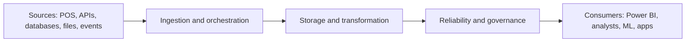

# Phase 01 · Part A — Content Notes and Examples

**The Foundations of Computing and Data** · Month 1 · about 35–45 hours in total (this part: roughly 12–15 hours of reading and note-making)

> **How the two parts fit together**
> - **Part A (this file):** the ideas, explained plainly with examples. Read it.
> - **Part B (`phase01_part-b_hands-on-labs.md`):** the step-by-step labs and the milestone project. Do it.
>
> Each section below ends with a **"Go do it"** pointer that tells you exactly which lab in Part B turns the idea into skill. Read a little, then practise straight away.

---

## Contents

1. [Before you start](#1-before-you-start)
2. [Your four-week map](#2-your-four-week-map)
3. [Module 1.1 — The data ecosystem](#3-module-11--the-data-ecosystem)
4. [Module 1.2 — Linux and the command line](#4-module-12--linux-and-the-command-line)
5. [Module 1.3 — Networking fundamentals](#5-module-13--networking-fundamentals)
6. [Module 1.4 — Git and GitHub](#6-module-14--git-and-github)
7. [Self-check quiz](#7-self-check-quiz)
8. [Glossary](#8-glossary)
9. [Exit criteria and what comes next](#9-exit-criteria-and-what-comes-next)
10. [Resources](#10-resources)

---

## 1. Before you start

### What this phase is for

Data tools (Airflow, Spark, Kafka, Docker, cloud platforms) all assume you are comfortable in three places: **the command line, the network, and version control**. This phase builds that comfort, and also gives you the big-picture vocabulary of the data world so later tools make sense.

By the end you will have:

- a working Linux environment,
- a documented GitHub repository you can show employers,
- and the ability to work out *why* a pipeline cannot reach its data, instead of guessing.

### Three rules that make learning stick

1. **Type commands yourself.** Typos and fixing them teach more than copy-paste ever will.
2. **Explain in your own words.** After each module, write a short note (in your `notes/` folder) without looking at this guide.
3. **Read the whole error message.** Most beginner problems are solved by reading the last line of the error and the line before it.

### Assumed setup

A Windows 10/11 laptop with **WSL2 (Ubuntu)**. If you already use Linux or macOS, skip the WSL steps in Part B; everything else applies with minor differences.

### How commands are shown

In code blocks, lines starting with `$` are what **you type**. Other lines are example output (yours may differ slightly). Do not type the `$` itself.

---

## 2. Your four-week map

### Learning outcomes

By the end you can:

- Explain OLTP vs OLAP, warehouse vs lake vs lakehouse, batch vs streaming, and ETL vs ELT using your own examples.
- Move around Linux, manage files and permissions, chain commands with pipes, and write a small Bash script.
- Diagnose a failed connection layer by layer: DNS, network path, port, TLS, authentication.
- Call a REST API with `curl` and read the JSON it returns.
- Use Git daily: commit, branch, merge, resolve a conflict, open a pull request.
- Keep secrets out of version control.

### Suggested plan (about 41 hours)

| Week | Read (Part A) | Do (Part B) | Hours | You finish with |
| --- | --- | --- | --- | --- |
| 1 | Module 1.1 | Lab 0: install WSL2, VS Code, Git | 9 | Working environment, first concept notes |
| 2 | Module 1.2 | Lab 1: sales CSV report with Bash | 12 | A Bash script that produces a report |
| 3 | Modules 1.3 and 1.4 | Labs 2 and 3: networking and Git | 10 | Troubleshooting log, repo with a merged pull request |
| 4 | Review and quiz | Milestone project | 10 | Documented repository, pipeline diagram |

**A healthy weekly rhythm:** three sessions of reading and practice, one session of building, one short review session.

---

## 3. Module 1.1 — The data ecosystem

*Before learning tools, understand the problems they solve.* About 6–7 hours.

### 3.1 What is data?

| Type | What it looks like | Examples |
| --- | --- | --- |
| **Structured** | Fixed rows and columns with a defined schema | A sales table, an M-Pesa transaction log in a relational database, a CSV with consistent columns |
| **Semi-structured** | Has structure, but it is flexible or nested; fields can vary per record | JSON from an API, XML, server logs with key-value pairs |
| **Unstructured** | No predefined structure | Emails, PDFs, images, audio, free-text customer feedback |

Most data engineering starts with structured and semi-structured data. Unstructured data usually needs extra processing before it can be analysed.

### 3.2 Two kinds of systems: OLTP and OLAP

Think of a **shop till** and a **head-office report**. The till must record each sale in a blink. The head office wants to know how sales changed across all shops over five years. Different jobs, different systems.

| | **OLTP** (Online Transaction Processing) | **OLAP** (Online Analytical Processing) |
| --- | --- | --- |
| Purpose | Run the business: record each event quickly | Understand the business: answer questions over lots of history |
| Typical operation | Insert or update one or a few rows | Scan and aggregate millions of rows |
| Data shape | Normalised tables, current state | Denormalised or dimensional models, history kept |
| Users | Applications, cashiers, customers | Analysts, dashboards, data scientists |
| Example | A bank recording a transfer | "How did transaction volumes change across counties over five years?" |
| Optimised for | Fast writes, consistency, many small queries | Fast reads of large volumes, aggregation |

**Why both exist:** a system tuned to record one transfer in milliseconds is the wrong tool for scanning five years of transfers. Data engineering moves data from the first kind of system into the second.

### 3.3 Where analytical data lives

| Approach | Stores | Strengths | Watch out for |
| --- | --- | --- | --- |
| **Data warehouse** | Cleaned, modelled, structured data | Fast, consistent analytics; agreed business definitions | Less flexible for raw or unstructured data |
| **Data lake** | Raw data in any format, usually in object storage | Cheap, flexible, keeps everything | Can turn into a "data swamp" without governance |
| **Lakehouse** | Lake storage plus table management (open table formats) | Warehouse-like reliability on lake storage | More moving parts; newer ecosystem |

A warehouse, a lake and a lakehouse are **architectural approaches**, not three names for the same thing.

### 3.4 Batch vs stream

- **Batch:** process data collected over an interval (hourly, nightly). Simpler and cheaper. The right answer for most reporting.
- **Stream:** process events continuously as they arrive. Needed when freshness matters (fraud detection, live monitoring). More complex to build and run.

> **Rule of thumb:** start with batch. Use streaming only when the business truly needs the freshness.

### 3.5 ETL vs ELT

| | **ETL** | **ELT** |
| --- | --- | --- |
| Order | Extract → Transform → Load | Extract → Load → Transform |
| Where transformation runs | In a separate tool, before loading | Inside the destination (warehouse/database), after loading |
| Typical today | Older systems, limited destinations | Cloud warehouses and tools like dbt |
| Key benefit | Only clean data lands in the destination | Raw data is kept; transformations can be changed and re-run |

### 3.6 Pipelines and workflows

- A **data pipeline** moves data from sources to destinations, usually transforming it on the way.
- A **workflow** coordinates the steps: order, schedule, retries.

Every later phase is about making these two things reliable.



### 3.7 The roles around data

| Role | The question they answer | Typical tools |
| --- | --- | --- |
| **Data Analyst** | "What happened, and why?" | SQL, Excel, Power BI |
| **Analytics Engineer** | "How do we model data so analysts can trust it?" | SQL, dbt, warehouses |
| **Data Engineer** | "How do we reliably move, store and prepare data at scale?" | Python, SQL, Airflow, Spark, cloud |
| **Data Architect** | "How should the whole data landscape be designed?" | Architecture, modelling, governance |
| **Data Scientist** | "What can we predict or learn from the data?" | Python, statistics, ML libraries |

The roles overlap, especially in small teams.

### 3.8 Worked example: the supermarket chain

A chain with 50 stores in Kenya produces POS sales, stock movements, supplier deliveries, website interactions and accounting records. Management asks: *Which products sell fastest? Which branches lose money? When should we restock? Can we forecast demand?*

Problems the engineer must solve:

1. Data is scattered across systems and formats.
2. Some records are duplicated, late or wrong.
3. Different systems define "sale" differently.

The data engineer builds a **pipeline**: extract from each system, store a raw copy, clean and model the data, check its quality, then serve it to dashboards.

### 3.9 Quick practice (do this in your notes)

Classify each as structured, semi-structured or unstructured:

- a. A CSV of daily supermarket sales
- b. A JSON response from a weather API
- c. Customer voice recordings from a call centre
- d. A PostgreSQL `orders` table
- e. Web server logs in `key=value` format

<details>
<summary>Answers</summary>

a. Structured · b. Semi-structured · c. Unstructured · d. Structured · e. Semi-structured

</details>

### Checkpoint 1.1

Without looking, explain to a friend: *"Why can't we just run the CEO's sales analysis on the shop's till database?"*

A good answer mentions OLTP vs OLAP, the extra load on the operational system, scattered sources, and data quality.

> **Go do it:** Part B → **Lab 0** (set up your tools) and **Lab 0.5** (write your concept notes).

---

## 4. Module 1.2 — Linux and the command line

About 12 hours. This is the most hands-on module, so do not rush it.

### 4.1 Why Linux?

Most servers, containers, cloud machines and data tools (Airflow, Spark, Kafka, Docker) run on Linux. Terminal fluency is a daily skill, not an optional extra.

### 4.2 The filesystem

| Path | Meaning |
| --- | --- |
| `/` | Root of the whole filesystem |
| `~` or `/home/<you>` | Your home directory |
| `/etc` | System configuration files |
| `/var/log` | System logs |
| `/tmp` | Temporary files |
| `/usr/bin`, `/bin` | Programs |

- **Absolute path:** starts with `/`, for example `/home/amina/data/sales.csv`.
- **Relative path:** starts from where you are now, for example `data/sales.csv` or `../notes`.
- `.` means "here". `..` means "the parent folder".

### 4.3 Core commands

| Command | What it does | Example |
| --- | --- | --- |
| `pwd` | Print current directory | `pwd` |
| `ls` | List files | `ls -lah` (long, all, human-readable sizes) |
| `cd` | Change directory | `cd ~/de-journey`, `cd ..`, `cd -` |
| `mkdir` | Make a directory | `mkdir -p data/raw` |
| `cp` | Copy | `cp a.csv backup/`, `cp -r dir1 dir2` |
| `mv` | Move or rename | `mv old.csv new.csv` |
| `rm` | Remove (**no recycle bin**) | `rm file.txt`, `rm -r folder` |
| `cat` | Print a whole file | `cat notes.txt` |
| `less` | Scroll through a file (`q` quits) | `less big.log` |
| `head` / `tail` | First / last lines | `head -n 5 file.csv`, `tail -f app.log` |
| `grep` | Search text | `grep -i "error" app.log` |
| `find` | Find files | `find . -name "*.csv"` |
| `sort` | Sort lines | `sort -n numbers.txt` |
| `cut` | Pick columns | `cut -d, -f2 file.csv` |
| `wc` | Count lines or words | `wc -l file.csv` |
| `man`, `--help` | Read the manual | `man grep`, `grep --help` |

> **Safety habits:** run `pwd` and `ls` before `rm`. Never run `rm -rf` on a path you have not printed first. Use `rm -i` while learning.

### 4.4 Permissions and ownership

`ls -l` shows permissions:

```
-rwxr-xr-- 1 amina amina 1024 Oct 21 09:00 script.sh
```

- First character: file type (`-` file, `d` directory).
- Next nine characters: three groups of `rwx` for **owner**, **group** and **others**.
- `r` = read (4), `w` = write (2), `x` = execute (1).
- So `rwxr-xr--` is owner 7 (4+2+1), group 5 (4+1), others 4 → **754**.

| Command | Meaning |
| --- | --- |
| `chmod +x script.sh` | Make a script executable |
| `chmod 644 file.txt` | Owner read/write; others read-only |
| `chmod 600 ~/.ssh/id_ed25519` | Private key readable only by you (SSH requires this) |
| `chown user:group file` | Change owner (usually needs `sudo`) |
| `sudo <command>` | Run as administrator. Use sparingly. |

### 4.5 Pipes, redirection and exit codes

- **Pipe `|`** sends the output of one command into the next:
  `cut -d, -f2 sales.csv | sort | uniq -c`
- **Redirection:** `>` overwrites a file, `>>` appends, `2>` sends errors to a file, `2>&1` combines errors with normal output.
- **Exit code:** every command returns a number. `0` means success; anything else means failure. Check the last one with `echo $?`. Scripts and schedulers (and later Airflow) depend on this.
- `&&` runs the next command only if the previous one succeeded. `||` runs it only if the previous one failed.

```bash
$ ls /nonexistent
ls: cannot access '/nonexistent': No such file or directory
$ echo $?
2
```

**Reading a pipeline aloud:** `a | b > out.txt 2>&1` means "run `a`, feed its output to `b`, and write everything `b` prints (normal output and errors) into `out.txt`."

### 4.5b Environment variables, processes, ports, logs

| Topic | Commands and ideas |
| --- | --- |
| **Environment variables** | `echo $HOME`, `export API_URL="https://example.com"`, `env`. They configure programs without hard-coding values. Persist them in `~/.bashrc`. |
| **Shell configuration** | `~/.bashrc` runs for each new terminal. After editing, run `source ~/.bashrc`. |
| **Processes** | `ps aux`, `top` (or `htop`), `kill <PID>`, `Ctrl+C` stops a foreground program, `command &` runs in the background, `jobs` lists them. |
| **Ports and services** | `ss -tulpn` lists listening ports and the process behind each. |
| **Logs** | App logs: `tail -f app.log`. System: `journalctl -xe` (if systemd is enabled), `dmesg`. Build the habit of reading logs first. |
| **Packages** | `sudo apt update`, `sudo apt install <pkg>`, `apt search <term>`, `apt list --installed` |

### 4.6 Bash scripting essentials

A script is just a text file of commands. Good scripts **fail loudly**:

```bash
#!/usr/bin/env bash
set -euo pipefail   # stop on errors, unset variables, and pipeline failures
```

| Idea | Syntax |
| --- | --- |
| Variable | `name="Amina"`, used as `"$name"` (always quote) |
| Argument | `$1` is the first argument; `${1:?message}` makes it required |
| Command output | `today=$(date +%F)` |
| Condition | `if [ -f "$file" ]; then ... fi` |
| Loop | `for f in data/*.csv; do echo "$f"; done` |
| Function | `log() { echo "[$(date -Iseconds)] $*"; }` |

**Why `set -euo pipefail`?** Without it, a script keeps running after something breaks, and you may only notice bad results days later. With it, the script stops at the first problem, which is exactly what a scheduler needs.

### 4.7 Scheduling with cron

`cron` runs commands on a schedule. Edit your schedule with `crontab -e`.

```
# m   h   dom mon dow   command
*/5   *   *   *   *     /home/amina/de-journey/scripts/profile_csv.sh /home/amina/de-journey/data/raw/sales_sample.csv >> /home/amina/de-journey/logs/cron.log 2>&1
```

Two golden rules: use **absolute paths**, and **redirect output to a log**. In WSL the cron service may need starting: `sudo service cron start`.

**Why do cron jobs fail when the same command works by hand?** Cron runs with a minimal environment: a different `PATH`, none of your shell variables, and a different working directory.

### 4.8 SSH and remote servers

SSH lets you log in to a remote machine securely using a **key pair**:

- a **private key** (never shared), and
- a **public key** (placed on the server or on GitHub).

```bash
ssh-keygen -t ed25519 -C "you@example.com"   # creates ~/.ssh/id_ed25519 and .pub
ssh user@server-address                      # connect
scp file.csv user@server-address:/tmp/       # copy a file over SSH
```

You will use SSH again in Module 1.4 to talk to GitHub.

### Checkpoint 1.2

You are ready to move on when you can, without this guide:

- [ ] Navigate to any folder, list hidden files and read permissions.
- [ ] Explain what `a | b > out.txt 2>&1` does.
- [ ] Find the process using port 8000 and stop it.
- [ ] Explain why `set -euo pipefail` is in a script.
- [ ] Modify the profiling script to also report total revenue (`quantity × unit_price`) using `awk`.

> **Go do it:** Part B → **Lab 1** (inspect a retail sales CSV and build your Bash profiler).

---

## 5. Module 1.3 — Networking fundamentals

About 5 hours.

### 5.1 Why a data engineer needs networking

A pipeline that cannot reach a database might have a **credential** problem, a **DNS** problem, a **firewall** restriction, or a service listening on the **wrong port**. A good engineer finds the real layer of failure instead of randomly changing code.

### 5.2 Addresses, subnets and DNS

- **IP address:** identifies a device on a network. IPv4 looks like `192.168.1.25`.
- **Private ranges** (not routable on the public internet): `10.0.0.0/8`, `172.16.0.0/12`, `192.168.0.0/16`. Home and cloud private networks use these.
- **Subnet mask / CIDR:** says which part of the address is the network. `/24` (mask `255.255.255.0`) gives 256 addresses (254 usable hosts). `/16` gives 65,536.
- **DNS:** the internet's phone book. It turns names (`api.example.com`) into IP addresses. Common records: **A** (name → IPv4), **AAAA** (name → IPv6), **CNAME** (alias), **MX** (mail).
- **localhost / 127.0.0.1:** "this machine".

### 5.3 TCP, UDP, ports and sockets

| Protocol | Behaviour | Used for |
| --- | --- | --- |
| **TCP** | Connection-oriented, reliable, ordered | Databases, HTTP(S), SSH, Kafka |
| **UDP** | Connectionless, fast, no delivery guarantee | DNS queries, streaming media, some telemetry |

A **port** (0–65535) identifies a service on a machine. A **socket** is IP address + port + protocol.

Ports you will meet in this roadmap:

| Port | Service |
| --- | --- |
| 22 | SSH |
| 53 | DNS |
| 80 / 443 | HTTP / HTTPS |
| 5432 | PostgreSQL |
| 8080 | Airflow web UI (default) |
| 9092 | Kafka broker (default) |
| 9000 / 9001 | MinIO API / console (default) |
| 4040 | Spark application UI (default) |
| 8888 | Jupyter |

### 5.4 HTTP, HTTPS, REST and JSON

- **HTTP** is request and response. A request has a **method**, a **URL**, **headers** and sometimes a **body**.
- **HTTPS** is HTTP over **TLS**: encryption plus identity checking using certificates. It is *not* "HTTP with a password".
- A **REST API** exposes resources at URLs and uses standard methods:

| Method | Meaning | Example |
| --- | --- | --- |
| `GET` | Read | `GET /posts/1` |
| `POST` | Create | `POST /posts` with a JSON body |
| `PUT` / `PATCH` | Replace / partially update | `PATCH /posts/1` |
| `DELETE` | Remove | `DELETE /posts/1` |

| Status code | Meaning | Typical cause |
| --- | --- | --- |
| `200` | OK | Success |
| `201` | Created | Successful `POST` |
| `400` | Bad request | Malformed input |
| `401` / `403` | Unauthorised / Forbidden | Missing or invalid credentials / no permission |
| `404` | Not found | Wrong URL or ID |
| `429` | Too many requests | Rate limit hit; back off and retry later |
| `500` / `502` / `503` | Server-side errors | Source system problem; retry carefully |

**JSON** is the standard API data format: objects `{}`, arrays `[]`, strings, numbers, booleans and `null`.

```json
{ "order_id": 1001, "store": "Nairobi CBD", "items": [{ "sku": "MF2", "qty": 3 }], "paid": true }
```

### 5.5 TLS, firewalls and routing

- **TLS certificate:** proves a server's identity and enables encryption. Failures appear as certificate errors (expired, wrong hostname, untrusted issuer).
- **Firewall:** allows or blocks traffic by address, port and protocol. A blocked port often shows up as a **timeout** rather than an instant error.
- **Routing:** how packets find a path between networks. `traceroute` shows the hops.
- **Client-server:** a client (your pipeline) opens a connection to a server (database, API) that is **listening** on a port.

### 5.6 The troubleshooting ladder

Work through the layers **in order** and stop at the first one that fails. That is your problem.

| Layer | Question | Command | Healthy sign |
| --- | --- | --- | --- |
| 1. Local network | Is my machine online? | `ping -c 3 1.1.1.1` | Replies received |
| 2. DNS | Does the name resolve? | `nslookup example.com` or `dig +short example.com` | An IP address is returned |
| 3. Route | Is there a path? | `traceroute example.com` | Hops reach the destination (some may show `* * *`) |
| 4. Port | Is the port open? | `nc -zv example.com 443` | `succeeded` / `open` |
| 5. TLS | Is the certificate valid? | `curl -vI https://example.com` | `SSL certificate verify ok` |
| 6. Application | Does the service respond correctly? | `curl -i https://example.com/path` | Expected status code |
| 7. Authentication | Are credentials accepted? | Look for `401` / `403` | `200` with valid credentials |

### 5.7 Symptom-to-cause cheat sheet

| What you see | Most likely cause | What to check |
| --- | --- | --- |
| `Could not resolve host` / `Name or service not known` | DNS, or a typo in the hostname | `nslookup`, spelling, network/VPN |
| `Connection refused` | Nothing listening on that port, or wrong port | `ss -tulpn` on the server, port number, is the service running |
| Hangs, then `timed out` | Firewall, security group or wrong IP | `nc -zv`, firewall rules, routing |
| `certificate verify failed` | Expired, untrusted or wrong-name certificate | `curl -vI`, system date/time, hostname |
| `401 Unauthorized` | Missing or wrong credentials/token | Environment variables, token expiry |
| `403 Forbidden` | Authenticated but not permitted | Roles, policies, IP allow-list |
| `404 Not Found` | Wrong path or ID | API docs, URL |
| `429 Too Many Requests` | Rate limit | Add a delay or backoff; read rate-limit headers |
| `5xx` | Server-side issue | Retry later, check service status and logs |

**The key contrast:** *Connection refused* means you reached the machine but nothing is listening (or it actively said no). *Timed out* means nobody answered at all, which usually points to a firewall, wrong address or routing problem.

### Checkpoint 1.3

- [ ] Explain the difference between "connection refused" and "timed out", and what each implies.
- [ ] Explain why HTTPS is not the same as "HTTP with a password".
- [ ] Use `curl` and `jq` to pull one field from a JSON API.
- [ ] Given an error message, name the layer to investigate first.

> **Go do it:** Part B → **Lab 2A** (call a REST API) and **Lab 2B** (simulate failures and write your troubleshooting log).

---

## 6. Module 1.4 — Git and GitHub

About 5–6 hours.

### 6.1 Why version control?

Git records every change to your project, lets you undo mistakes, work on features in isolation and collaborate. Employers read GitHub repositories as evidence of how you work.

### 6.2 Core concepts

| Term | Meaning |
| --- | --- |
| **Repository (repo)** | A project folder tracked by Git (it has a hidden `.git` directory) |
| **Commit** | A saved snapshot with a message and author |
| **Staging area** | Where you choose what goes into the next commit (`git add`) |
| **Branch** | An independent line of work (`main` is the default) |
| **Merge** | Combine one branch into another |
| **Remote / origin** | The copy of the repo on GitHub |
| **Pull request (PR)** | A proposal to merge a branch, with review and discussion |
| **Clone / fork** | Copy a repo to your machine / to your own account |

**The three areas:**

```
working directory --(git add)--> staging area --(git commit)--> local repository --(git push)--> GitHub
```

### 6.3 The daily workflow

Use this loop for everything from now on:

1. `git status`: what changed?
2. `git switch -c feature/<topic>`: new branch for the task.
3. Do the work. Check with `git diff`.
4. `git add <files>`
5. `git commit -m "feat: short message"`
6. `git push -u origin feature/<topic>`
7. Open a **pull request** on GitHub (say *what* and *why*). Review your own diff.
8. Merge the PR, then `git switch main`, `git pull`, and delete the finished branch.

**Useful inspection commands:** `git log --oneline --graph --decorate`, `git diff`, `git diff --staged`, `git show <commit>`, `git restore <file>` (discard unstaged edits), `git restore --staged <file>` (unstage).

### 6.4 Writing good commits

- One logical change per commit.
- A short imperative subject (about 50 characters), with an optional body explaining *why*.
- A simple prefix convention keeps history readable:

| Prefix | Use |
| --- | --- |
| `feat:` | New capability |
| `fix:` | Bug fix |
| `docs:` | Documentation |
| `chore:` | Housekeeping (ignore files, config) |
| `refactor:` | Restructure without changing behaviour |
| `test:` | Add or change tests |

**Good:** `fix: handle rows with missing unit_price in profile script`
**Bad:** `update`, `stuff`, `final2`

### 6.5 Merge conflicts are normal

A conflict happens when two branches change the **same lines** differently and Git cannot choose for you. Git marks the file like this:

```
<<<<<<< HEAD
Preferred editor: VS Code
=======
Preferred editor: Vim
>>>>>>> branch-b
```

To resolve: edit the file to the final text you want (delete the three marker lines), `git add` it, and commit. Practising once makes conflicts far less frightening.

### 6.6 Secrets and credentials (critical)

Never commit passwords, API keys, tokens, private keys or connection strings.

**Prevent it:**

1. Keep secrets in environment variables or an untracked `.env` file.
2. Commit a **`.env.example`** containing placeholder names only:

   ```
   DB_HOST=localhost
   DB_PORT=5432
   DB_USER=your_user_here
   DB_PASSWORD=your_password_here
   API_KEY=your_api_key_here
   ```

3. Keep `.env` in `.gitignore`. Check `git status` before every commit.

**If a secret is committed by mistake:**

1. **Revoke or rotate the credential immediately.** Assume it is compromised. This is the only step that truly fixes the problem.
2. Deleting the file in a new commit does **not** remove it from history. Clean the history afterwards with a tool such as `git filter-repo` or BFG Repo-Cleaner, then force-push.
3. Check where else the secret may have leaked: logs, screenshots, forks.

### 6.7 What a good README contains

Your `README.md` is the front door of the repo. Include:

1. Title and a one-sentence purpose
2. What is inside (a folder map)
3. Environment setup (WSL2, tools, versions)
4. How to run the scripts (exact commands)
5. Sample output (a trimmed report)
6. Learning log (what you learned, what was hard)
7. Next steps

### Checkpoint 1.4

- [ ] Create a branch, commit, push, open a PR and merge it without notes.
- [ ] Resolve a conflict.
- [ ] Explain why `.env` is ignored but `.env.example` is committed.
- [ ] Explain what to do first if you push an API key.

> **Go do it:** Part B → **Lab 3** (set up Git and GitHub, practise a conflict) and then the **Milestone project**.

---

## 7. Self-check quiz

Try each question before opening the answers.

1. Name three differences between OLTP and OLAP systems.
2. When would you choose a lakehouse over a pure data lake?
3. Why is ELT popular with cloud warehouses?
4. What does `0` mean as an exit code, and why does it matter for schedulers?
5. What do `>`, `>>`, `2>` and `|` each do?
6. What numeric permission is `rwxr-x---`?
7. A script run by cron works manually but fails on schedule. Give two likely reasons.
8. What does "connection refused" tell you compared with "timed out"?
9. What is the difference between `401` and `403`?
10. Why should raw API responses be saved with a timestamp?
11. You committed an API key and pushed. What do you do first, and why is deleting the file not enough?
12. What is the difference between `git add`, `git commit` and `git push`?

<details>
<summary>Answers</summary>

1. OLTP: many small writes, normalised, current state, runs the application. OLAP: large scans and aggregations, dimensional/denormalised, history kept, serves analysis.
2. When you want cheap, flexible lake storage but also table features such as reliable updates, schema evolution and warehouse-like queries.
3. Cloud warehouses have the compute to transform data after loading, so raw data is kept and transformations can be changed and re-run in SQL.
4. `0` means success. Schedulers and orchestrators use the exit code to decide whether a task succeeded, failed or should retry.
5. `>` overwrites a file with output; `>>` appends; `2>` redirects error output; `|` feeds one command's output into the next.
6. 750 (owner 7 = rwx, group 5 = r-x, others 0).
7. Cron has a minimal environment (different `PATH`, none of your shell's variables) and a different working directory, so scripts using relative paths or unset variables fail. The cron service may also not be running.
8. "Refused": the host was reached but nothing listens on that port (or it actively rejected). "Timed out": packets are getting no reply, often a firewall, wrong address or routing problem.
9. `401`: not authenticated (missing or invalid credentials). `403`: authenticated but not allowed to do that.
10. It preserves exactly what the source returned and when, so you can reprocess, audit, compare versions and recover from transformation bugs.
11. Revoke or rotate the key immediately, because anyone could have copied it from history, forks or caches. Deleting the file only affects the latest commit, not history. Then clean the history and review where else it leaked.
12. `git add` stages changes, `git commit` records a snapshot locally, `git push` uploads commits to the remote.

</details>

---

## 8. Glossary

| Term | Definition |
| --- | --- |
| **ACID** | Properties of reliable transactions: Atomicity, Consistency, Isolation, Durability (studied in Phase 03) |
| **API** | Interface through which programs request data or actions from another system |
| **Batch processing** | Processing data collected over an interval |
| **CIDR** | Notation such as `/24` describing the size of a network |
| **Data lake** | Storage for raw data in many formats, typically in object storage |
| **Data pipeline** | Automated flow that moves and transforms data between systems |
| **Data warehouse** | Central store of cleaned, modelled data for analytics |
| **DNS** | System that translates names to IP addresses |
| **ELT / ETL** | Extract-Load-Transform / Extract-Transform-Load |
| **Environment variable** | Named value available to programs, used for configuration |
| **Exit code** | Number returned by a command: 0 success, non-zero failure |
| **Idempotent** | Safe to run more than once with the same result (studied from Phase 02) |
| **JSON** | Text format for structured, nested data |
| **Lakehouse** | Lake storage with warehouse-style table management |
| **OLAP / OLTP** | Analytical / transactional processing |
| **Port** | Number identifying a service on a machine |
| **Pull request** | Proposal to merge a branch, with review |
| **REST** | Style of web API built on URLs and HTTP methods |
| **SSH** | Secure remote login and file transfer using key pairs |
| **Stream processing** | Processing events continuously as they arrive |
| **TLS** | Encryption and identity layer behind HTTPS |
| **WSL2** | Windows Subsystem for Linux, version 2; runs a real Linux kernel on Windows |

---

## 9. Exit criteria and what comes next

### Exit criteria

You can move to Phase 02 when you can:

- [ ] Work comfortably in a Linux terminal.
- [ ] Diagnose a connection failure by layer instead of guessing.
- [ ] Publish a documented Git repository without committing secrets.
- [ ] Explain the data ecosystem concepts in your own words with local examples.
- [ ] Complete the milestone checklist at the end of Part B.

### Self-rating

Rate yourself 0–3 on each area (0 = cannot yet, 1 = with guidance, 2 = independently, 3 = independently and can explain trade-offs):

- Linux and shell
- Networking and troubleshooting
- Git workflow
- Data ecosystem concepts

Aim for **2 or higher** in every area before moving on. Anything lower deserves another week.

### What comes next

**Phase 02: Python for professional data engineering** builds directly on this work. You will turn the Bash and Python profilers into reusable, tested code, call real APIs with pagination and retries, and build a pipeline that saves raw JSON and produces a cleaned dataset. The repository you create here becomes the home for those projects.

---

## 10. Resources

- [The Missing Semester of Your CS Education](https://missing.csail.mit.edu/): free course on the shell, scripting, Git and tooling
- [GitHub Skills](https://skills.github.com/): interactive Git and GitHub lessons
- [Ubuntu documentation](https://help.ubuntu.com/)
- [VS Code](https://code.visualstudio.com/)
- [WSL documentation](https://learn.microsoft.com/en-us/windows/wsl/)
- [Git](https://git-scm.com/)
- [diagrams.net](https://www.diagrams.net/)
