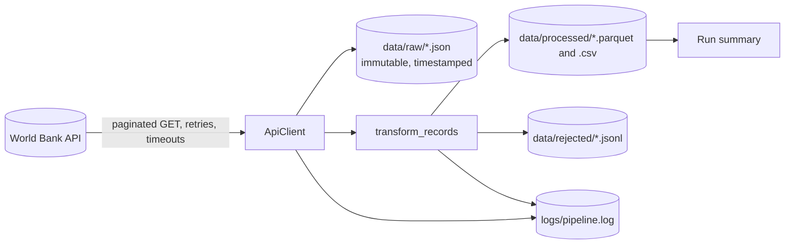

# Phase 02 · Part A — Content Notes and Examples

**Python for Professional Data Engineering** · Month 2 · about 45–55 hours in total (this part: roughly 15–18 hours of reading and note-making)

> **How the two parts fit together**
> - **Part A (this file):** the ideas, explained plainly with short examples. Read it.
> - **Part B (`phase02_part-b_hands-on-labs.md`):** environment setup, practice labs, the sales CSV cleaner and Project 1, step by step. Do it.
>
> Every section below ends with a **"Go do it"** pointer telling you which lab in Part B turns the idea into skill. Read a little, then practise straight away.
>
> This phase continues from the repository and habits you built in Phase 01.

---

## Contents

1. [Before you start](#1-before-you-start)
2. [Your four-week map](#2-your-four-week-map)
3. [Module 2.1 — Python fundamentals](#3-module-21--python-fundamentals)
4. [Module 2.2 — Intermediate Python](#4-module-22--intermediate-python)
5. [Module 2.3 — Data processing](#5-module-23--data-processing)
6. [Module 2.4 — The thinking behind Project 1](#6-module-24--the-thinking-behind-project-1)
7. [Tools used in this phase](#7-tools-used-in-this-phase)
8. [Self-check quiz](#8-self-check-quiz)
9. [Glossary](#9-glossary)
10. [Exit criteria and what comes next](#10-exit-criteria-and-what-comes-next)
11. [Resources](#11-resources)

---

## 1. Before you start

### What this phase is for

Python is your main automation and pipeline language. The goal is **not** to memorise syntax. It is to write software that **stays understandable when datasets grow, inputs break or systems fail**.

You finish with a tested, documented **API-to-dataset pipeline (Project 1)** that:

- fails clearly,
- preserves previously collected data,
- and logs enough to diagnose problems.

### Working rules for the whole phase

1. **Type the code.** Typing, mistyping and fixing teaches far more than pasting.
2. **Run everything.** If a snippet shows output, reproduce it on your machine before reading on.
3. **Test as you go.** From Module 2.2 onward, every function you write gets at least one `pytest` test.
4. **Commit small and often.** One logical change per commit, on a branch, merged through a pull request (your Phase 01 habit).
5. **Do not skip the practice exercises** in Part B. Reading code is not the same as being able to write it.

### How code is shown

- Lines starting with `$` are typed in the **terminal** (do not type the `$`).
- Lines starting with `>>>` are typed in the **Python REPL** (start it with `python3`, leave with `exit()`).
- Other lines are example output. Yours may differ slightly (timestamps, timings).

---

## 2. Your four-week map

### Learning outcomes

By the end of Phase 02 you can:

- Write, run and debug Python scripts using variables, control flow, functions, collections and exceptions.
- Read and write CSV, JSON, JSON Lines and Parquet files safely.
- Use generators, context managers, dataclasses, decorators and `logging` appropriately.
- Manage configuration, dependencies and virtual environments.
- Test code with `pytest`, including fixtures, parametrisation and failure cases.
- Handle dates, time zones and timestamps correctly (store in UTC).
- Call REST APIs with timeouts, pagination, rate-limit handling and retries.
- Process data with `pandas` and `pyarrow`, and explain when streaming beats loading everything into memory.
- Build incremental, idempotent scripts and prove it with a test.

### Suggested plan (about 51 hours)

| Week | Read (Part A) | Do (Part B) | Hours | You finish with |
| --- | --- | --- | --- | --- |
| 1 | Module 2.1 | Lab 0 setup, Lab 1 fundamentals, Lab 2 CSV cleaner | 13 | `clean_sales.py` working on the Phase 01 sample data |
| 2 | Module 2.2 | Lab 3 intermediate Python | 13 | Retry decorator, generator and dataclass exercises, first `pytest` suite |
| 3 | Module 2.3 | Lab 4 data processing | 13 | Performance comparison; incremental loader with a passing idempotency test |
| 4 | Module 2.4 + review | Project 1, quiz | 12 | Published repository with README, tests, logs and sample output |

A healthy weekly rhythm: about 4 hours learning, 5 practice, 4 building, 2 reviewing. If you fall behind, **shorten the exercises, not the testing**.

---

## 3. Module 2.1 — Python fundamentals

About 10 hours (Week 1). Learn these in order.

### 3.1 Variables, types, operators, strings and input/output

| Type | Example | Notes |
| --- | --- | --- |
| `int` | `3`, `-1` | Whole numbers, unlimited size |
| `float` | `185.0`, `0.5` | Binary floating point, **not exact** |
| `str` | `"Nairobi CBD"` | Text, immutable |
| `bool` | `True`, `False` | Conditions |
| `None` | `None` | "No value"; used for missing data |

Operators: `+ - * /` (true division), `//` (floor division), `%` (remainder), `**` (power), comparisons `== != < <= > >=`, logic `and or not`.

```python
store = "Nairobi CBD"
quantity = 3
unit_price = 185.0
line_total = quantity * unit_price
print(f"{store}: {quantity} x {unit_price:.2f} = {line_total:,.2f}")
```

```
Nairobi CBD: 3 x 185.00 = 555.00
```

```python
>>> 7 // 2, 7 % 2, 2 ** 10
(3, 1, 1024)
>>> 0.1 + 0.2
0.30000000000000004
>>> from decimal import Decimal
>>> Decimal("0.1") + Decimal("0.2") == Decimal("0.3")
True
```

> **Why this matters for data engineering:** floats cannot represent every decimal exactly. For money, use integers of the smallest unit (cents) or `Decimal`. Never compare floats with `==`.

String essentials:

```python
>>> "  Nairobi CBD ".strip().upper()
'NAIROBI CBD'
>>> "1004,Kisumu Central,Rice 2kg,,420".split(",")
['1004', 'Kisumu Central', 'Rice 2kg', '', '420']
>>> "Maize Flour 2kg".startswith("Maize")
True
>>> "Maize Flour 2kg"[:5]
'Maize'
```

`print()` writes text. `input()` reads text and **always returns a string**, so convert it (`int(input(...))`). Real pipelines read from files, arguments (`sys.argv`) or environment variables instead of `input()`.

> **Go do it:** Part B → Lab 1, Exercise 1 (receipt script).

### 3.2 Conditions, loops and comprehensions

- `if` / `elif` / `else` choose a path. Indentation (4 spaces) defines blocks.
- `for` iterates over a sequence; `while` repeats until a condition changes. Prefer `for`.
- Helpers: `range(n)`, `enumerate(items, start=1)`, `zip(a, b)`, `break`, `continue`.
- A **comprehension** builds a collection in one expression. Great when short, harmful when long and nested.

```python
def size_band(quantity: int) -> str:
    if quantity <= 0:
        return "invalid"
    elif quantity < 5:
        return "small"
    elif quantity < 20:
        return "medium"
    return "large"

quantities = [3, 10, 0, 25, 4]
bands = [size_band(q) for q in quantities]
print(bands)
```

```
['small', 'medium', 'invalid', 'large', 'small']
```

```python
>>> squares_of_even = [n * n for n in range(10) if n % 2 == 0]
>>> squares_of_even
[0, 4, 16, 36, 64]
>>> prices = {"Sugar 1kg": 150, "Rice 2kg": 420}
>>> with_vat = {name: round(p * 1.16, 2) for name, p in prices.items()}
>>> with_vat
{'Sugar 1kg': 174.0, 'Rice 2kg': 487.2}
>>> for i, name in enumerate(prices, start=1):
...     print(i, name)
1 Sugar 1kg
2 Rice 2kg
```

> **Go do it:** Part B → Lab 1, Exercise 2.

### 3.3 Lists, tuples, sets and dictionaries

| Structure | Mutable? | Ordered? | Duplicates? | Use it for |
| --- | --- | --- | --- | --- |
| `list` | Yes | Yes | Yes | Sequences of records |
| `tuple` | No | Yes | Yes | Fixed groups such as `(lat, lon)`; dictionary keys |
| `set` | Yes | No | No | Fast membership tests, de-duplication |
| `dict` | Yes | Yes (insertion order) | Unique keys | Lookups, records, counting |

```python
from collections import Counter, defaultdict

sales = [
    {"store": "Nairobi CBD", "amount": 555.0},
    {"store": "Nakuru Town", "amount": 600.0},
    {"store": "Nairobi CBD", "amount": 640.0},
]

by_store = defaultdict(float)
for s in sales:
    by_store[s["store"]] += s["amount"]

print(dict(by_store))
print(Counter(s["store"] for s in sales))
```

```
{'Nairobi CBD': 1195.0, 'Nakuru Town': 600.0}
Counter({'Nairobi CBD': 2, 'Nakuru Town': 1})
```

Nested data (typical of JSON from APIs):

```python
record = {"country": {"id": "KE", "value": "Kenya"}, "date": "2023", "value": None}
print(record["country"]["value"])     # Kenya
print(record.get("unit", "n/a"))      # n/a  (missing key -> default, no error)
print(record["unit"])                 # KeyError: 'unit'
```

> **Habit:** use `record["key"]` when the key **must** exist (fail loudly). Use `record.get("key")` when it is optional.

Sets are handy for comparing ID lists:

```python
>>> ids_a = {"1001", "1002", "1003"}
>>> ids_b = {"1002", "1003", "1004"}
>>> ids_a & ids_b, ids_a - ids_b
({'1002', '1003'}, {'1001'})
```

> **Go do it:** Part B → Lab 1, Exercise 3 (count stores with a dict, then `Counter`).

### 3.4 Functions, parameters, return values and scope

- A function takes parameters and **returns** a value. Prefer small functions that do one thing.
- Parameters can be positional, keyword or have defaults: `def f(a, b=10)`.
- A **pure** function depends only on its inputs and has no side effects. Pure functions are the easiest to test.
- **Scope:** names created inside a function exist only there. Avoid changing global variables.

```python
def line_total(quantity: int, unit_price: float, discount: float = 0.0) -> float:
    """Return the line total after an optional fractional discount (0.1 = 10%)."""
    return round(quantity * unit_price * (1 - discount), 2)

print(line_total(3, 185))
print(line_total(3, 185, discount=0.1))
```

```
555.0
499.5
```

Returning several values uses a tuple:

```python
def split_valid(rows):
    valid = [r for r in rows if r["quantity"] > 0]
    invalid = [r for r in rows if r["quantity"] <= 0]
    return valid, invalid

valid, invalid = split_valid([{"quantity": 3}, {"quantity": -1}])
```

**The mutable default argument trap**

```python
def add_item(item, basket=[]):      # BUG: the same list is reused on every call
    basket.append(item)
    return basket

add_item("a")    # ['a']
add_item("b")    # ['a', 'b']   <- surprising

def add_item_safe(item, basket=None):
    basket = [] if basket is None else basket
    basket.append(item)
    return basket
```

> **Go do it:** Part B → Lab 1, Exercise 4 (`parse_price`).

### 3.5 Exceptions and error handling

An exception is Python's way of saying "this cannot continue". **Handle** the ones you can recover from and let the rest surface.

| Block | Purpose |
| --- | --- |
| `try` | Code that might fail |
| `except SomeError` | Handle a **specific** error type |
| `else` | Runs only if `try` succeeded |
| `finally` | Always runs (cleanup) |
| `raise` | Signal an error yourself; `raise X from err` keeps the original cause |

```python
def parse_quantity(text: str) -> int:
    try:
        quantity = int(text)
    except ValueError as exc:
        raise ValueError(f"quantity is not a whole number: {text!r}") from exc
    if quantity <= 0:
        raise ValueError(f"quantity must be positive: {quantity}")
    return quantity

for raw in ["3", "", "-1", "abc"]:
    try:
        print(raw, "->", parse_quantity(raw))
    except ValueError as err:
        print(raw, "-> rejected:", err)
```

```
3 -> 3
 -> rejected: quantity is not a whole number: ''
-1 -> rejected: quantity must be positive: -1
abc -> rejected: quantity is not a whole number: 'abc'
```

Create your own exception types for meaningful pipeline failures:

```python
class ApiError(Exception):
    """The remote API failed in a way we cannot recover from."""
```

> **Anti-pattern that causes silent data loss:**
>
> ```python
> try:
>     process(row)
> except:          # bare except hides every bug, even Ctrl+C
>     pass         # the record just disappears
> ```
>
> A reliable pipeline either **handles** an error (and records what happened) or **fails loudly**. It never swallows one.

> **Go do it:** Part B → Lab 1, Exercise 5 (`safe_ratio`).

### 3.6 Reading and writing CSV, JSON and text files

- Always use `with open(...)`: it closes the file even if an error occurs.
- Always give `encoding="utf-8"`. For CSV also pass `newline=""`.
- Use `pathlib.Path` instead of gluing paths together from strings.

**CSV**

```python
import csv
from pathlib import Path

src = Path.home() / "de-journey" / "data" / "raw" / "sales_sample.csv"

with open(src, newline="", encoding="utf-8") as f:
    reader = csv.DictReader(f)
    for line_no, row in enumerate(reader, start=2):   # line 1 is the header
        print(line_no, row["order_id"], row["store"])
        if line_no == 4:
            break
```

```
2 1001 Nairobi CBD
3 1002 Nairobi CBD
4 1003 Mombasa Nyali
```

**JSON and JSON Lines**

```python
import json

payload = {"run_id": "20261021T080000Z", "records": [{"id": 1}, {"id": 2}]}

with open("payload.json", "w", encoding="utf-8") as f:
    json.dump(payload, f, indent=2)

with open("payload.json", encoding="utf-8") as f:
    loaded = json.load(f)

# JSON Lines: one JSON object per line (easy to append and stream)
with open("records.jsonl", "w", encoding="utf-8") as f:
    for rec in loaded["records"]:
        f.write(json.dumps(rec) + "\n")
```

**pathlib**

```python
from pathlib import Path

out_dir = Path("data") / "processed"
out_dir.mkdir(parents=True, exist_ok=True)      # create folders, no error if they exist
print(out_dir.exists(), sorted(p.name for p in Path("data").glob("*")))
```

> **Go do it:** Part B → Lab 1, Exercise 6 (`read_json_file`).

### 3.7 Modules, packages, imports and virtual environments

- A **module** is a `.py` file. A **package** is a folder of modules with an `__init__.py`.
- `import math`, `from pathlib import Path`, `import pandas as pd`.
- `if __name__ == "__main__":` runs code only when the file is executed directly, not when imported.
- Run packages with `python -m package_name` so imports resolve correctly.
- Record dependencies with `pip freeze > requirements.txt`; recreate them elsewhere with `pip install -r requirements.txt`.
- A **virtual environment** is an isolated copy of Python and its packages for one project, so projects never fight over versions.

```
my_project/
├── pyproject.toml
├── src/
│   └── my_package/
│       ├── __init__.py
│       ├── cleaning.py
│       └── __main__.py
└── tests/
    └── test_cleaning.py
```

```python
# src/my_package/cleaning.py
def normalize_store(name: str) -> str:
    return " ".join(name.split()).title()

if __name__ == "__main__":
    print(normalize_store("  nairobi   cbd "))     # Nairobi Cbd
```

> **Go do it:** Part B → Lab 1, Exercise 7 (build a tiny package).

### 3.8 Type hints, docstrings and debugging

Type hints do not change how code runs. They document intent and let editors and tools catch mistakes.

```python
def revenue_by_store(rows: list[dict[str, str]]) -> dict[str, float]:
    """Sum quantity * unit_price per store.

    Args:
        rows: parsed CSV rows with 'store', 'quantity', 'unit_price'.

    Returns:
        Mapping of store name to total revenue.
    """
    totals: dict[str, float] = {}
    for r in rows:
        amount = int(r["quantity"]) * float(r["unit_price"])
        totals[r["store"]] = totals.get(r["store"], 0.0) + amount
    return totals

def find_store(name: str, stores: list[str]) -> str | None:   # None means "not found"
    return name if name in stores else None
```

**A debugging procedure you can always follow**

1. **Read the traceback from the bottom up.** The last line is the error; the lines above show where it came from.
2. **Reproduce it with the smallest input** that still fails.
3. **Inspect values**, not assumptions: `print(repr(value), type(value))`, or better `logging.debug(...)`.
4. **Use the debugger** when printing gets messy: put `breakpoint()` where you want to stop, run the script, then use `n` (next line), `s` (step into), `c` (continue), `p variable` (print), `l` (list code), `q` (quit). VS Code's debugger offers the same visually.
5. **Change one thing at a time** and re-run.
6. **Write a test** that fails because of the bug, then fix the code until it passes. The bug can never silently return.

> **Go do it:** Part B → Lab 1, Exercise 8 (find two bugs).

### Checkpoint 2.1

- [ ] I can explain the difference between `None`, `0`, `""` and `[]`.
- [ ] I can read a CSV with `csv.DictReader` and write a cleaned file.
- [ ] I can explain why a bare `except: pass` is dangerous in a pipeline.
- [ ] I can create and activate a virtual environment and install packages.
- [ ] I can find a bug using a traceback and `breakpoint()`.

> **Go do it next:** Part B → Lab 2 (the sales CSV cleaner). It is the warm-up for Project 1: validate each row, split data into *clean* and *rejected* with a reason, and never lose a record silently.

---

## 4. Module 2.2 — Intermediate Python

About 13 hours (Week 2). *Do not rush into advanced Python features before you can write and test ordinary functions reliably.*

### 4.1 Iterators and generators

An **iterator** produces values one at a time. A **generator function** uses `yield` to do this lazily: each value is computed only when requested, so you can process files far larger than memory.

```python
import csv
from collections.abc import Iterator


def read_rows(path: str) -> Iterator[dict]:
    """Yield CSV rows one at a time; nothing is loaded up front."""
    with open(path, newline="", encoding="utf-8") as f:
        yield from csv.DictReader(f)


def valid_rows(rows: Iterator[dict]) -> Iterator[dict]:
    for row in rows:
        if row.get("quantity"):
            yield row


pipeline = valid_rows(read_rows("data/raw/sales_sample.csv"))   # nothing has run yet
first = next(pipeline)                                           # runs just enough to produce one row
print(first["order_id"])
total = sum(1 for _ in pipeline)                                 # consumes the rest
```

Generator expressions look like comprehensions in parentheses: `(len(line) for line in f)` uses constant memory, whereas `[len(line) for line in f]` builds the whole list.

> **Go do it:** Part B → Lab 3, Exercise 1 (`batched`).

### 4.2 Context managers

A context manager guarantees setup **and** cleanup around a block (`with`). You already use `open()`. Write your own for timers, temporary directories, database transactions and locks.

```python
import time
from contextlib import contextmanager


@contextmanager
def timer(label: str):
    start = time.perf_counter()
    try:
        yield
    finally:
        elapsed = time.perf_counter() - start
        print(f"{label}: {elapsed:.3f}s")


with timer("sum of squares"):
    total = sum(n * n for n in range(1_000_000))
```

```
sum of squares: 0.071s
```

> **Go do it:** Part B → Lab 3, Exercise 2 (`working_directory`).

### 4.3 Object-oriented programming where useful

Use a class when you need to bundle **state with behaviour**, for example an API client holding a session, a base URL and retry settings. Do **not** create classes just to hold functions; plain functions are often clearer.

| Prefer functions for | Prefer a class for |
| --- | --- |
| Stateless transformations (`clean_record`) | Objects with configuration and resources (`ApiClient`) |
| One-off scripts | Things with a lifecycle (open → use → close) |
| Pure calculations | Several methods sharing the same state |

```python
class Counter:
    def __init__(self) -> None:
        self.count = 0

    def add(self, n: int = 1) -> None:
        self.count += n

    def __repr__(self) -> str:
        return f"Counter(count={self.count})"
```

### 4.4 Decorators and higher-order functions

A **higher-order function** takes or returns functions. A **decorator** wraps a function to add behaviour (retry, timing, logging) without changing its code.

**A retry decorator**

```python
import functools
import time


def retry(times: int = 3, delay: float = 0.5, exceptions: tuple = (Exception,)):
    def decorator(func):
        @functools.wraps(func)            # keep the original name and docstring
        def wrapper(*args, **kwargs):
            for attempt in range(1, times + 1):
                try:
                    return func(*args, **kwargs)
                except exceptions as exc:
                    if attempt == times:
                        raise
                    wait = delay * 2 ** (attempt - 1)
                    print(f"attempt {attempt} failed ({exc}); retrying in {wait:.1f}s")
                    time.sleep(wait)
        return wrapper
    return decorator


calls = {"n": 0}


@retry(times=3, delay=0.01, exceptions=(ConnectionError,))
def flaky():
    calls["n"] += 1
    if calls["n"] < 3:
        raise ConnectionError("temporary failure")
    return "ok"


print(flaky())
```

```
attempt 1 failed (temporary failure); retrying in 0.0s
attempt 2 failed (temporary failure); retrying in 0.0s
ok
```

Note the **exponential backoff**: each wait doubles. Retry only errors that are genuinely temporary. Retrying a `ValueError` caused by bad data would just repeat the same failure.

> **Go do it:** Part B → Lab 3, Exercise 3 (log + test the decorator).

### 4.5 Dataclasses

`@dataclass` generates `__init__`, `__repr__` and equality for classes that mainly hold data. Use `frozen=True` for immutable settings and records.

```python
from dataclasses import dataclass, field, replace


@dataclass(frozen=True)
class Settings:
    country: str = "KEN"
    per_page: int = 100
    tags: tuple[str, ...] = ()


@dataclass
class RunSummary:
    run_id: str
    extracted: int = 0
    rejected_reasons: dict[str, int] = field(default_factory=dict)   # never use a bare {} default


s = Settings()
s2 = replace(s, per_page=50)       # frozen objects are changed by copying
print(s2)
```

```
Settings(country='KEN', per_page=50, tags=())
```

### 4.6 Logging

`print` is for the user of a program; **logging** is for the operator of a system. Logs tell you what happened, when, how bad it was and where.

| Level | Use for |
| --- | --- |
| `DEBUG` | Detailed diagnostics for developers |
| `INFO` | Normal milestones ("extracted 120 records") |
| `WARNING` | Something unexpected but handled (a retry, a rejected record) |
| `ERROR` | An operation failed |
| `CRITICAL` | The program cannot continue |

```python
import logging

logging.basicConfig(
    level=logging.INFO,
    format="%(asctime)s %(levelname)s %(name)s %(message)s",
)
log = logging.getLogger(__name__)          # one logger per module

log.info("extracted %d records from %s", 120, "worldbank")
log.warning("rejected %d records", 3)
try:
    1 / 0
except ZeroDivisionError:
    log.exception("calculation failed")     # includes the traceback at ERROR level
```

Rules of thumb:

- Never log secrets or personal data.
- Use `%s`-style arguments rather than f-strings inside log calls.
- Include identifiers (run id, file name, page number) so one run can be traced end to end.
- In production scripts, send logs to both the console and a file.

### 4.7 Configuration management

Separate **code** from **configuration** so the same code runs on your laptop, in tests and in production.

| Mechanism | Good for | Notes |
| --- | --- | --- |
| Environment variables | Secrets, URLs, per-environment values | `os.getenv("API_KEY")`; never commit real values |
| `.env` file (git-ignored) | Local development | Load with a helper such as `python-dotenv`, or export manually |
| YAML/JSON config file | Non-secret structured settings | Commit a sample, not real secrets |
| Command-line arguments | Per-run choices | `argparse` |

```python
import os
from dataclasses import dataclass


@dataclass(frozen=True)
class Config:
    base_url: str
    timeout_s: float

    @classmethod
    def from_env(cls) -> "Config":
        return cls(
            base_url=os.getenv("API_BASE_URL", "https://api.worldbank.org/v2"),
            timeout_s=float(os.getenv("API_TIMEOUT_S", "10")),
        )
```

Fail early on missing required settings (`os.environ["API_KEY"]` raises `KeyError` immediately) instead of discovering the problem hours into a run. Commit `.env.example` with placeholder names only.

### 4.8 Dependency management

- List direct dependencies in `pyproject.toml` (or `requirements.txt`). Once your project works, pin exact versions with `pip freeze > requirements.lock` so a rebuild next month installs the same versions.
- Upgrade deliberately: change one dependency, run the tests, commit.
- Separate runtime dependencies from development ones (`pytest`, `ruff`) using optional dependency groups, as in Project 1.
- Never run `pip install` outside an activated virtual environment.

### 4.9 Unit testing with pytest

A test is code that checks your code. A good unit test is **small**, **fast**, **independent** and **deterministic**.

| Concept | Meaning | Example |
| --- | --- | --- |
| Assertion | The check | `assert parse_price("1,250.50") == 1250.5` |
| `pytest.raises` | Assert that an error happens | `with pytest.raises(ValueError): ...` |
| `parametrize` | Run one test with many inputs | `@pytest.mark.parametrize("raw, expected", [...])` |
| Fixture | Reusable setup/teardown | `@pytest.fixture def sample_rows(): ...` |
| `tmp_path` | A temporary folder pytest creates for you | Test file output without touching real data |
| `monkeypatch` | Temporarily change environment variables or attributes | `monkeypatch.setenv("API_KEY", "x")` |

```python
# test_prices.py
import pytest


def parse_price(text: str) -> float:
    return float(text.replace(",", ""))


@pytest.mark.parametrize(
    "raw, expected",
    [("1,250.50", 1250.5), ("185", 185.0), ("0.99", 0.99)],
)
def test_parse_price_valid(raw, expected):
    assert parse_price(raw) == expected


def test_parse_price_rejects_text():
    with pytest.raises(ValueError):
        parse_price("free")


def test_output_written(tmp_path):
    target = tmp_path / "out.txt"
    target.write_text("hello", encoding="utf-8")
    assert target.read_text(encoding="utf-8") == "hello"
```

Run: `pytest -v` (verbose), `pytest -x` (stop at first failure), `pytest -k price` (select by name).

> **The testing habit for data code:** for every transformation, write tests for (1) the normal case, (2) each type of bad input, (3) empty input, (4) a boundary value, (5) the output shape and types.

> **Go do it:** Part B → Lab 3, Exercise 4 (`parse_quantity` tests).

### 4.10 Dates, time zones and timestamps

Time bugs are among the most expensive bugs in data engineering. Follow these rules:

1. **Store and exchange timestamps in UTC**, in ISO 8601 format (`2026-10-21T14:30:00+00:00`).
2. Convert to local time (for example `Africa/Nairobi`, UTC+3, no daylight saving) **only for display**.
3. Prefer **timezone-aware** datetimes. A "naive" datetime has no zone and is easy to misread.
4. Record **when** you extracted data (`extracted_at`) separately from **when** the event happened (`event_time`).

```python
from datetime import datetime, timedelta, timezone
from zoneinfo import ZoneInfo

nairobi = ZoneInfo("Africa/Nairobi")

local = datetime(2026, 10, 21, 17, 30, tzinfo=nairobi)
utc = local.astimezone(timezone.utc)
print(local.isoformat())
print(utc.isoformat())

parsed = datetime.fromisoformat("2026-10-21T14:30:00+00:00")
print(parsed == utc)

now = datetime.now(timezone.utc)                              # aware "now" in UTC
print((now - timedelta(days=1)).strftime("%Y%m%dT%H%M%SZ"))   # filesystem-safe timestamp
```

```
2026-10-21T17:30:00+03:00
2026-10-21T14:30:00+00:00
True
(a timestamp from yesterday, in the form 20261020T...)
```

Common traps:

- `datetime.utcnow()` returns a *naive* value. Avoid it.
- Comparing naive with aware datetimes raises an error.
- "End of day" depends on the time zone.
- Sources that give dates without zones need a documented assumption.

> **Go do it:** Part B → Lab 3, Exercise 5 (`to_utc_iso`).

### 4.11 API requests, pagination, rate limits and retries

Calling an API reliably needs more than `requests.get(url)`.

**Seven rules for a reliable API client**

1. **Always set a timeout.** Without one, `requests` can wait forever.
2. **Check the status code** before using the body (`resp.raise_for_status()` or your own handling).
3. **Retry only temporary failures:** connection errors, timeouts, `429`, `500`, `502`, `503`, `504`. Never retry `400`, `401`, `403` or `404`; they will not fix themselves.
4. **Back off exponentially** (1 s, 2 s, 4 s, ...) and add a little random jitter so many clients do not retry in lockstep.
5. **Respect rate limits.** On `429`, honour the `Retry-After` header if present.
6. **Validate the response shape** before trusting it. APIs sometimes return `200` with an error message inside.
7. **Reuse a `requests.Session`** for connection pooling.

**Pagination styles you will meet**

| Style | How it works | Stop condition |
| --- | --- | --- |
| Page number | `?page=2&per_page=100` | `page >= total_pages` or an empty page |
| Offset/limit | `?offset=200&limit=100` | Fewer results than `limit` |
| Cursor/token | Response includes `next_cursor`; send it back | No cursor returned |
| Link headers | `Link: <...>; rel="next"` | No `next` link |

**A single request, done properly**

```python
import requests

resp = requests.get(
    "https://api.worldbank.org/v2/country/KEN/indicator/NY.GDP.MKTP.CD",
    params={"format": "json", "per_page": 5},
    timeout=10,
)
resp.raise_for_status()
meta, rows = resp.json()
print(meta["pages"], meta["total"], rows[0]["date"], rows[0]["value"])
```

The World Bank API answers with a **two-element JSON list**: pagination metadata first (`page`, `pages`, `per_page`, `total`), then the records. This shape is why Project 1 validates the response before using it.

> **Why practise against a mock API?** Real APIs rate-limit you, change and go offline at random, which makes them poor places to *learn* failure handling. In Project 1 you will build a tiny local server with the same shape that can fail on demand.

### Checkpoint 2.2

- [ ] I can explain why a generator uses less memory than a list.
- [ ] I can write a context manager and a decorator and explain what each does.
- [ ] I can explain when a class is justified and when a function is better.
- [ ] I configure logging with levels and never use `print` for operational messages.
- [ ] I keep secrets out of code and configuration files in version control.
- [ ] I write tests with `parametrize`, `pytest.raises` and `tmp_path`.
- [ ] I store timestamps in UTC and can convert from `Africa/Nairobi`.
- [ ] I can list the rules for a reliable API client from memory.

---

## 5. Module 2.3 — Data processing

About 13 hours (Week 3).

### 5.1 Data formats: CSV, JSON, JSON Lines and Parquet

| Format | Layout | Strengths | Weaknesses | Typical use |
| --- | --- | --- | --- | --- |
| **CSV** | Text, rows | Human-readable, universal | No types, no nesting; delimiters/quotes cause bugs | Exchange with spreadsheets and people |
| **JSON** | Text, nested | Keeps API structure | Whole file must usually be parsed at once | Raw API responses |
| **JSON Lines** | Text, one JSON object per line | Streamable, appendable | Larger than binary formats | Logs, event records, rejected records |
| **Parquet** | Binary, **columnar** | Typed, compressed, fast to read selected columns | Not human-readable | Analytical datasets |

**Row-oriented vs columnar:** CSV stores whole rows together; Parquet stores each column together. A query needing two columns out of fifty reads only those two from Parquet, and similar values within one column compress very well.

### 5.2 pandas for exploratory and moderate-sized tabular work

pandas holds a table in memory as a **DataFrame**. It is excellent for data that fits comfortably in RAM.

```python
import pandas as pd

df = pd.read_csv(
    "data/processed/sales_clean.csv",
    dtype={"order_id": "string", "store": "string", "product": "string"},
    parse_dates=["sale_date"],
)

print(df.shape)                      # rows, columns
print(df.dtypes)
print(df.head(3))

# add a column, filter, group and aggregate
df["line_total"] = df["quantity"] * df["unit_price"]
by_store = (
    df.groupby("store", as_index=False)["line_total"]
      .sum()
      .sort_values("line_total", ascending=False)
)
print(by_store)

# join with a small lookup table
regions = pd.DataFrame({"store": ["Nairobi CBD", "Nakuru Town"], "region": ["Nairobi", "Rift Valley"]})
joined = df.merge(regions, on="store", how="left")
print(joined["region"].isna().sum(), "rows have no region")
```

Frequently used operations: `df.info()`, `df.describe()`, `df["col"].value_counts()`, `df.isna().sum()`, `df.drop_duplicates(subset=[...])`, `df.sort_values(...)`, `df.rename(columns=...)`, `df.astype(...)`, `df.to_csv(...)`, `df.to_parquet(...)`.

> **Habit:** after every transformation, check `df.shape` and a few rows. Many silent data bugs are accidental row multiplication in a join or rows dropped by a filter.

### 5.3 PyArrow and columnar storage basics

```python
import pyarrow as pa
import pyarrow.parquet as pq

table = pa.Table.from_pydict({
    "store": ["Nairobi CBD", "Nakuru Town"],
    "revenue": [1195.0, 600.0],
})
pq.write_table(table, "revenue.parquet", compression="snappy")

pf = pq.ParquetFile("revenue.parquet")
print(pf.schema_arrow)                                    # column names and types
print(pq.read_table("revenue.parquet", columns=["revenue"]).to_pydict())   # read ONE column
```

Parquet files carry their **schema** (column names and types), can be compressed, and let you read only the columns you need. pandas uses PyArrow under the hood: `df.to_parquet("x.parquet", index=False)` and `pd.read_parquet("x.parquet", columns=[...])`.

### 5.4 Data types, nulls, duplicates and malformed inputs

| Problem | Detect | Handle |
| --- | --- | --- |
| Wrong types (`"12"` instead of `12`) | `df.dtypes`, `pd.to_numeric(..., errors="coerce")` | Convert; reject rows that fail |
| Nulls/missing | `df.isna().sum()` | Decide per column: reject, default, or keep as null **and document it** |
| Duplicates | `df.duplicated(subset=key).sum()` | Define the **business key** and a rule (keep latest/first) |
| Malformed lines | `pd.read_csv(..., on_bad_lines="warn")` or a row-by-row parser | Quarantine to a rejected file with a reason |
| Mixed encodings | `UnicodeDecodeError` | Read with the correct encoding; do not guess silently |
| Out-of-range values | Rules: `quantity > 0`, date in plausible range | Reject with a reason |

**Coercion that surfaces problems instead of hiding them**

```python
import pandas as pd

raw = pd.DataFrame({"quantity": ["3", "", "abc", "7"], "unit_price": ["185", "320", "150", "420"]})
raw["quantity_num"] = pd.to_numeric(raw["quantity"], errors="coerce")
bad = raw[raw["quantity_num"].isna()]
print(f"{len(bad)} rows failed conversion")
print(bad)
```

```
2 rows failed conversion
  quantity unit_price  quantity_num
1                 320           NaN
2      abc        150           NaN
```

`errors="coerce"` turns bad values into `NaN`. The important step is that you **look at what was coerced** and route it to the rejected output, rather than letting `NaN` flow into your totals unnoticed.

### 5.5 Streaming instead of loading everything into memory

When a file is larger than comfortable memory, **process it in pieces**.

**Option 1: a generator over rows (constant memory)**

```python
import csv
from collections import defaultdict


def revenue_by_store(path: str) -> dict[str, float]:
    totals: dict[str, float] = defaultdict(float)
    with open(path, newline="", encoding="utf-8") as f:
        for row in csv.DictReader(f):
            totals[row["store"]] += int(row["quantity"]) * float(row["unit_price"])
    return dict(totals)
```

**Option 2: pandas in chunks**

```python
import pandas as pd

totals = pd.Series(dtype="float64")
for chunk in pd.read_csv("big.csv", chunksize=100_000, usecols=["store", "quantity", "unit_price"]):
    chunk["line_total"] = chunk["quantity"] * chunk["unit_price"]
    totals = totals.add(chunk.groupby("store")["line_total"].sum(), fill_value=0)
print(totals.sort_values(ascending=False))
```

Chunked processing works for operations you can **combine across chunks** (sums, counts, min/max). Operations needing all the data at once (a global sort, a median) need other techniques: a database, DuckDB, or Spark later in the roadmap.

### 5.6 Memory and runtime profiling

**Measure first, optimise second.**

| Need | Tool |
| --- | --- |
| Wall-clock time | `time.perf_counter()` |
| Python memory peak | `tracemalloc` |
| DataFrame size | `df.memory_usage(deep=True).sum()` |
| Where time goes | `python -m cProfile -s cumtime script.py` |
| Cheaper dtypes | `category` for repeated strings, `int32` instead of `int64`, `usecols` to read fewer columns |

> **Go do it:** Part B → Lab 4, Parts 1–2 (compare four ways to process 200,000 rows).

### 5.7 Incremental processing and idempotent scripts

- **Incremental processing** handles only new or changed data (for example "everything since the last run") instead of reprocessing all history.
- A **watermark** (high-water mark) records how far you have processed: the latest `sale_date` or `updated_at` seen. Store it durably (a small JSON file or a table).
- A script is **idempotent** if running it twice with the same input leaves the same final result, with no duplicates and no corruption.

**Techniques that make a script idempotent**

| Technique | How |
| --- | --- |
| **Upsert by key** | Combine old and new rows, keep one row per business key (the latest) |
| **Overwrite a partition** | Re-running a day replaces that day's output completely |
| **Deterministic output paths** | The same input always writes to the same file name |
| **Atomic writes** | Write to a temporary file, then rename; readers never see half a file |
| **Immutable raw data** | Never edit raw files; write new ones with timestamps |
| **Reconciliation** | Compare counts before and after to prove nothing was lost or duplicated |

**An idempotent upsert**

```python
# labs/upsert.py
import pandas as pd

KEY = ["order_id"]


def upsert(existing: pd.DataFrame, new: pd.DataFrame) -> pd.DataFrame:
    """Combine and keep the last occurrence per key; same inputs always give the same output."""
    combined = pd.concat([existing, new], ignore_index=True)
    return (
        combined.drop_duplicates(subset=KEY, keep="last")
        .sort_values(KEY)
        .reset_index(drop=True)
    )
```

**A watermark file**

```python
import json
from pathlib import Path

STATE = Path("state/watermark.json")


def load_watermark(default: str = "1970-01-01") -> str:
    if STATE.exists():
        return json.loads(STATE.read_text(encoding="utf-8"))["last_sale_date"]
    return default


def save_watermark(value: str) -> None:
    STATE.parent.mkdir(parents=True, exist_ok=True)
    STATE.write_text(json.dumps({"last_sale_date": value}), encoding="utf-8")
```

> **Rule:** advance the watermark **only after** the write succeeds. If you move it first and the write fails, those rows are skipped forever.

> **Go do it:** Part B → Lab 4, Parts 3–4 (idempotency test and incremental loader).

### 5.8 Worked example: the 100,000-record API pipeline

The roadmap's practical example is an API returning 100,000 sales records. Map each requirement to a design decision **before** you write code:

| # | Requirement | Design decision | Where it appears in Project 1 |
| --- | --- | --- | --- |
| 1 | Request the data from the API | `ApiClient` with timeout, retries, backoff, pagination | `client.py` |
| 2 | Check response status and structure | Raise on bad status; validate the `[meta, rows]` shape | `client.py` |
| 3 | Validate required fields | `clean_record` raises with a reason for each failure | `transform.py` |
| 4 | Normalise timestamps and numbers | Parse year to `int`, value to `float`; UTC `extracted_at` | `transform.py`, `pipeline.py` |
| 5 | Handle missing or malformed records | Reject with reason into a quarantine file; never drop silently | `transform.py` |
| 6 | Write to a durable destination | Atomic writes of Parquet/CSV; immutable raw JSON | `pipeline.py` |
| 7 | Record how many rows succeeded or failed | A run summary with counts and reject reasons | `pipeline.py` |
| 8 | Log enough to diagnose later | One log line per page, retry and run milestone, with a run id | `logging_setup.py` |

> **A script that completes the first five steps but silently loses records is not a reliable pipeline.** Steps 5–8 are what make it one.

### Checkpoint 2.3

- [ ] I can choose between CSV, JSON, JSON Lines and Parquet for a given task and justify it.
- [ ] I can load, clean, group, join and save data with pandas, and I check row counts after each step.
- [ ] I can read only selected columns from Parquet and explain why it is faster.
- [ ] I can process a file in chunks and explain which operations cannot be chunked.
- [ ] I can measure time and memory instead of guessing.
- [ ] I can make a script idempotent and prove it with a test.

---

## 6. Module 2.4 — The thinking behind Project 1

About 12 hours (Week 4), almost all of it hands-on in Part B. Read this section first so the code makes sense.

### 6.1 The brief

Build a small, production-style pipeline that:

1. Calls a public API (the **World Bank Indicators API**, key-free and paginated) to fetch an economic indicator for Kenya.
2. Saves the raw JSON, untouched, with an extraction timestamp.
3. Validates and cleans the records, separating **clean** from **rejected** rows with reasons.
4. Writes a clean **Parquet** and **CSV** dataset.
5. Logs enough to diagnose problems and prints a run summary.
6. Has automated tests, including failure cases.
7. Ships with a README that a stranger can follow.

### 6.2 The completion test

> If the API is temporarily unavailable, the script **fails clearly, preserves previously collected data and provides enough logs to diagnose the issue.**

That single sentence drives every design decision below.

### 6.3 Architecture



### 6.4 What each file is for

| File | Job | Key ideas from Part A |
| --- | --- | --- |
| `config.py` | Read settings from environment variables | Configuration management (4.7) |
| `logging_setup.py` | Log to console and file | Logging (4.6) |
| `client.py` | HTTP client, retries, backoff, pagination | Reliable API rules (4.11) |
| `transform.py` | Validate and clean; keep reasons for rejects | Exceptions (3.5), nulls and duplicates (5.4) |
| `pipeline.py` | Extract → raw → transform → load → summary | Atomic writes, idempotency (5.7) |
| `__main__.py` | Command-line entry point | Modules and `-m` (3.7) |
| `tests/mock_api.py` | Local World Bank-shaped server that can fail on demand | Testing failure (4.9) |

### 6.5 Design decisions worth explaining to an interviewer

| Decision | Why |
| --- | --- |
| **Raw JSON is saved untouched, one file per run** | It is the source of truth. If your transformation has a bug, you re-run from raw without calling the API again. |
| **Writes are atomic** (temp file, then rename) | A crash mid-write never leaves a half-written file; the previous good file survives. |
| **Only temporary errors are retried** | Retrying a 404 or bad data repeats the same failure. Retrying a 503 often succeeds. |
| **Backoff has jitter and honours `Retry-After`** | Politeness to the API and fewer synchronised retry storms. |
| **Every rejected record keeps a reason** | You can show exactly where every record went. |
| **Reconciliation: clean + rejected = extracted** | Proof that nothing was silently lost. |
| **The API's reported total is compared with what you received** | Catches truncated pagination early. |
| **The sleep function is injectable** | Tests run instantly instead of really waiting. |
| **Duplicates: last record per business key wins** | A deterministic rule makes reruns produce identical output. |
| **Nothing is written until extraction succeeds** | A failed run cannot corrupt earlier outputs. |

### 6.6 Using another API

You may use any open, key-free API (weather, transport, economic data). Keep the same architecture: **client → raw → transform → load → summary**. The code in Part B expects the World Bank `[meta, rows]` shape, so change `fetch_all_pages` and `clean_record` if you pick a different API.

> **Go do it:** Part B → Project 1.

---

## 7. Tools used in this phase

| Task | Recommended tool | Free alternative / cost |
| --- | --- | --- |
| Python runtime | Python 3 | Free |
| Python environments | `venv` + `pip` | Free |
| Alternative environment manager | Miniforge | Free and open source |
| Data manipulation | pandas | Free |
| Columnar data processing | PyArrow | Free |
| Unit testing | pytest | Free |
| Linting and formatting | Ruff | Free |
| API requests | Requests | Free |
| API exploration | Postman | Free plan, or `curl` |
| Interactive notebooks | JupyterLab | Free |

**Paid options to avoid:** you do not need a paid Python IDE, notebook platform or data-cleaning subscription. Local Python and Jupyter are enough.

---

## 8. Self-check quiz

Try each question before opening the answers.

1. Why should money not be stored as a `float`?
2. What is the difference between `record["x"]` and `record.get("x")`, and when do you use each?
3. What does a generator give you that a list does not?
4. Why is a bare `except: pass` dangerous in a pipeline?
5. Which HTTP status codes should a client retry, and which should it not?
6. What is exponential backoff, and why add jitter?
7. Why store timestamps in UTC?
8. Name three advantages of Parquet over CSV for analytics.
9. What does "idempotent" mean, and how would you test it?
10. Why write output to a temp file and then rename it?
11. Why keep raw API responses unchanged and timestamped?
12. Your pipeline extracted 1,000 records but the clean output has 960 rows. What must you be able to show?

<details>
<summary>Answers</summary>

1. Floats cannot represent many decimal fractions exactly (`0.1 + 0.2 != 0.3`). Use integers of the smallest unit (cents) or `Decimal`.
2. `record["x"]` raises `KeyError` if missing; use it when the field must exist. `record.get("x")` returns `None` (or a default); use it for optional fields.
3. Lazy, one-at-a-time evaluation with constant memory, so you can process data larger than RAM and stop early.
4. It hides every error, including bugs, and records can disappear without a trace, which causes silent data loss.
5. Retry temporary failures: connection errors, timeouts, 429, 500, 502, 503, 504. Do not retry 400, 401, 403, 404; repeating the request cannot fix them.
6. Waiting longer after each failure (1 s, 2 s, 4 s, ...). Jitter adds randomness so many clients do not retry at the same instant.
7. UTC is unambiguous, has no daylight-saving shifts, and sorts and compares correctly across systems. Convert to local time only when displaying.
8. Columnar layout (read only needed columns), compression (smaller files), embedded schema/types, and faster analytical reads.
9. Running it multiple times with the same input produces the same final result without duplicates. Test by running twice and asserting the outputs are equal, as in `test_rerun_is_idempotent`.
10. Readers never see a half-written file, and a crash during writing leaves the previous good file intact.
11. It is the source of truth for audits and reprocessing: if your transformation has a bug you can rerun from the raw data without calling the API again.
12. A reconciliation: 40 rejected rows with a reason for each (clean + rejected = extracted), so you can explain exactly where every record went.

</details>

---

## 9. Glossary

| Term | Definition |
| --- | --- |
| **Atomic write** | Writing to a temp file then renaming, so output is never half-written |
| **Backoff** | Increasing the wait between retries |
| **Business key** | The field(s) that uniquely identify a real-world record |
| **Columnar storage** | Storing each column together (Parquet), efficient for analytics |
| **Context manager** | An object used with `with` that guarantees setup and cleanup |
| **Dataclass** | A class generated for holding data, with `__init__` and `__repr__` for free |
| **Decorator** | A function that wraps another function to add behaviour |
| **DataFrame** | pandas' in-memory table |
| **Dead-letter / rejected output** | A place for records that failed validation, kept with reasons |
| **Fixture** | Reusable test setup provided by pytest |
| **Generator** | A function using `yield` that produces values lazily |
| **Idempotent** | Safe to run repeatedly with the same result |
| **ISO 8601** | Standard text format for dates and times |
| **JSON Lines** | One JSON object per line; streamable |
| **Pagination** | An API returning large results in pages |
| **Parquet** | Compressed, typed, columnar file format |
| **Rate limit** | A cap on how many requests you may make in a period |
| **Raw layer** | Unmodified copy of source data |
| **Reconciliation** | Proving counts and totals add up (extracted = clean + rejected) |
| **Type hint** | Annotation describing expected types |
| **Virtual environment** | Isolated Python installation per project |
| **Watermark** | Marker of how far incremental processing has progressed |

---

## 10. Exit criteria and what comes next

### Exit criteria

You can move to Phase 03 when you can:

- [ ] Build a Python data extraction program from scratch.
- [ ] Test it with `pytest`, including bad input, empty input and failure cases.
- [ ] Explain its failure-handling strategy: what is retried, what fails immediately, what is rejected and what is preserved.
- [ ] Show that a rerun does not duplicate or corrupt data.
- [ ] Complete the Project 1 acceptance checklist in Part B, including the completion test.

### Self-rating

Rate yourself 0–3 on each (0 = cannot yet, 1 = with guidance, 2 = independently, 3 = independently and can explain trade-offs):

- Python fundamentals
- Testing
- API handling
- File formats and pandas
- Idempotency and failure handling

Aim for **2 or higher** everywhere. A 0 or 1 in testing or failure handling deserves another week; those habits carry through the whole roadmap.

### What comes next

**Phase 03: SQL and database engineering** takes the cleaned datasets you produce here and puts them into PostgreSQL. You will design a retail database, write analytical SQL, read execution plans and answer business questions about branches, products and revenue. The `sql/exploration_queries.sql` file from Phase 01 finally gets run. In Phase 04 you will replace "write a Parquet file" with "load PostgreSQL incrementally", reusing the client, validation and testing habits from this phase.

---

## 11. Resources

- [Python official tutorial](https://docs.python.org/3/tutorial/): the authoritative free tutorial
- [Automate the Boring Stuff with Python](https://automatetheboringstuff.com/): free online book with practical exercises
- [pandas documentation](https://pandas.pydata.org/docs/)
- [PyArrow documentation](https://arrow.apache.org/docs/python/)
- [pytest documentation](https://docs.pytest.org/)
- [Requests documentation](https://requests.readthedocs.io/)
- [Ruff documentation](https://docs.astral.sh/ruff/)
- [Jupyter](https://jupyter.org/)
- [World Bank Indicators API documentation](https://datahelpdesk.worldbank.org/knowledgebase/topics/125589)
