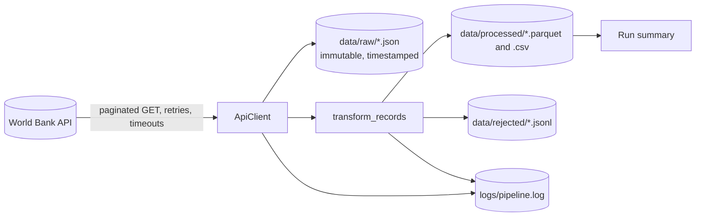

# Phase 02 — Python for Professional Data Engineering

**Study notes, worked examples and step-by-step procedures** | Month 2 | Estimated effort: 45–55 hours | Stage: Foundation

> **Goal of this phase:** Python is your primary automation and pipeline language. The aim is not to memorize syntax. It is to write software that **stays understandable when datasets grow, inputs break or systems fail**.
>
> **You finish with:** a tested, documented API-to-dataset pipeline (Project 1) that fails clearly, preserves previously collected data and logs enough to diagnose problems.

This guide follows Phase 02 of the *Data Engineering Mastery Roadmap* and continues from the repository and habits you built in [Phase 01](Phase_01_Foundations_Study_Guide.md).

---

## Contents

1. [How to use this guide](#1-how-to-use-this-guide)
2. [Learning outcomes and four-week plan](#2-learning-outcomes-and-four-week-plan)
3. [Environment setup](#3-environment-setup)
4. [Module 2.1 — Python fundamentals](#4-module-21--python-fundamentals)
5. [Mini-project 2.1 — a sales CSV cleaner](#5-mini-project-21--a-sales-csv-cleaner)
6. [Module 2.2 — Intermediate Python](#6-module-22--intermediate-python)
7. [Module 2.3 — Data processing](#7-module-23--data-processing)
8. [Module 2.4 — Project 1: Public API to structured dataset](#8-module-24--project-1-public-api-to-structured-dataset)
9. [Tools used in this phase](#9-tools-used-in-this-phase)
10. [Troubleshooting guide](#10-troubleshooting-guide)
11. [Self-check quiz](#11-self-check-quiz)
12. [Glossary](#12-glossary)
13. [Exit criteria and what comes next](#13-exit-criteria-and-what-comes-next)
14. [Resources](#14-resources)

---

## 1. How to use this guide

Every topic follows the same pattern:

- **Notes:** the concept in plain language.
- **Example:** a short, runnable snippet with its expected output.
- **Try it:** an exercise you must do yourself before moving on.
- **Checkpoint:** a quick self-test at the end of each module.

Working rules for the whole phase:

1. **Type the code.** Copy-pasting teaches far less than typing, mistyping and fixing.
2. **Run everything.** If a snippet shows output, reproduce that output on your machine before reading on.
3. **Test as you go.** From Module 2.2 onward, every function you write gets at least one `pytest` test.
4. **Commit small and often.** One logical change per commit, on a branch, merged through a pull request (Phase 01 habits).
5. **Do not skip the "Try it" boxes.** Reading code is not the same as being able to write it.

> **Code conventions in this guide:** lines starting with `$` are typed in the terminal. Lines starting with `>>>` are typed in the Python REPL (start it with `python3`, exit with `exit()`). Other lines are example output. Yours may differ slightly (for example, timestamps and timings).

---

## 2. Learning outcomes and four-week plan

### Learning outcomes

By the end of Phase 02 you can:

- Write, run and debug Python scripts using variables, control flow, functions, collections and exceptions.
- Read and write CSV, JSON, JSON Lines and Parquet files safely.
- Use generators, context managers, dataclasses, decorators and `logging` appropriately.
- Manage configuration, dependencies and virtual environments.
- Test your code with `pytest`, including fixtures, parametrization and failure cases.
- Handle dates, time zones and timestamps correctly (store in UTC).
- Call REST APIs with timeouts, pagination, rate-limit handling and retries.
- Process data with `pandas` and `pyarrow` and explain when streaming is better than loading everything into memory.
- Build incremental, idempotent scripts and prove it with a test.

### Suggested four-week plan (about 51 hours)

| Week | Focus | Hours | Deliverable |
| --- | --- | --- | --- |
| 1 | Environment setup + Module 2.1 + Mini-project 2.1 | 13 | `clean_sales.py` working on the Phase 01 sample data |
| 2 | Module 2.2 intermediate Python, testing, logging, APIs | 13 | Retry decorator, generator and dataclass exercises, first `pytest` suite |
| 3 | Module 2.3 data processing (pandas, PyArrow, streaming, profiling, idempotency) | 13 | Performance comparison lab; incremental loader with a passing idempotency test |
| 4 | Module 2.4 Project 1 + review + quiz | 12 | Published repository with README, tests, logs and sample output |

A good weekly rhythm (from the roadmap): 4 hours learning, 5 practice, 4 building, 2 reviewing. If you fall behind, shorten the exercises, not the testing.

---

## 3. Environment setup

**Time:** about 1 hour. Do this at the start of Week 1.

### 3.1 Procedure — set up Python in WSL2 (or Linux/macOS)

1. Confirm Python 3.10 or newer is installed (Ubuntu 24.04 ships Python 3.12):

   ```bash
   python3 --version
   which python3
   ```

2. Make sure the venv and pip packages are available:

   ```bash
   sudo apt update && sudo apt install -y python3-venv python3-pip
   ```

3. Create a practice folder and a **virtual environment**. A virtual environment is an isolated copy of Python and its packages for one project, so projects never fight over versions.

   ```bash
   mkdir -p ~/de-journey/python-practice && cd ~/de-journey/python-practice
   python3 -m venv .venv
   source .venv/bin/activate
   python --version
   ```

   The prompt now starts with `(.venv)`. Run `deactivate` to leave it. **Activate it every time** you open a new terminal for this project.

4. Install the practice tools:

   ```bash
   pip install --upgrade pip
   pip install pandas pyarrow requests pytest ruff jupyterlab
   pip list
   ```

5. Open the folder in VS Code (`code .`), install the **Python** extension, and select the interpreter: `Ctrl+Shift+P` → "Python: Select Interpreter" → choose `.venv`.

6. Add a `.gitignore` entry so the environment is never committed:

   ```bash
   echo ".venv/" >> ~/de-journey/.gitignore
   ```

### 3.2 Alternative — Miniforge (conda-style environments)

If you prefer conda-style environments (useful for packages with heavy native dependencies), install **Miniforge** from its GitHub releases page, then:

```bash
conda create -n de python=3.12 -y
conda activate de
pip install pandas pyarrow requests pytest ruff
```

Use **one** approach per project. This guide uses `venv` + `pip`.

### 3.3 Checkpoint

```bash
$ python -c "import pandas, pyarrow, requests; print(pandas.__version__, pyarrow.__version__)"
$ pytest --version
$ ruff --version
```

All three commands must work inside the activated environment before you continue.

---

## 4. Module 2.1 — Python fundamentals

**Time:** about 10 hours (Week 1). Learn these in sequence.

### 4.1 Variables, types, operators, strings and input/output

**Notes**

| Type | Example | Notes |
| --- | --- | --- |
| `int` | `3`, `-1` | Whole numbers, unlimited size |
| `float` | `185.0`, `0.5` | Binary floating point, **not exact** |
| `str` | `"Nairobi CBD"` | Text, immutable |
| `bool` | `True`, `False` | Conditions |
| `None` | `None` | "No value"; used for missing data |

Operators: `+ - * /` (true division), `//` (floor division), `%` (remainder), `**` (power), comparison `== != < <= > >=`, logical `and or not`.

**Example**

```python
store = "Nairobi CBD"
quantity = 3
unit_price = 185.0
line_total = quantity * unit_price
print(f"{store}: {quantity} x {unit_price:.2f} = {line_total:,.2f}")
```

```
Nairobi CBD: 3 x 185.00 = 555.00
```

```python
>>> 7 // 2, 7 % 2, 2 ** 10
(3, 1, 1024)
>>> 0.1 + 0.2
0.30000000000000004
>>> from decimal import Decimal
>>> Decimal("0.1") + Decimal("0.2") == Decimal("0.3")
True
```

> **Why this matters for data engineering:** floats cannot represent every decimal exactly. For money, use integers of the smallest unit (cents) or `Decimal`, never floats you compare with `==`.

String essentials:

```python
>>> "  Nairobi CBD ".strip().upper()
'NAIROBI CBD'
>>> "1004,Kisumu Central,Rice 2kg,,420".split(",")
['1004', 'Kisumu Central', 'Rice 2kg', '', '420']
>>> "Maize Flour 2kg".startswith("Maize")
True
>>> "Maize Flour 2kg"[:5]
'Maize'
```

Input and output: `print()` writes text; `input()` reads text and **always returns a string**, so convert it (`int(input(...))`). Real pipelines read from files, arguments (`sys.argv`) or environment variables rather than `input()`.

**Try it:** write `receipt.py` that stores three items (name, quantity, unit price) in variables, prints one formatted line per item and a total with thousands separators. Then change the numbers and check the total by hand.

### 4.2 Conditions, loops and comprehensions

**Notes**

- `if` / `elif` / `else` choose a path. Indentation (4 spaces) defines blocks.
- `for` iterates over a sequence; `while` repeats until a condition changes. Prefer `for`.
- Useful helpers: `range(n)`, `enumerate(items, start=1)`, `zip(a, b)`, `break`, `continue`.
- A **comprehension** builds a collection in one expression: readable when it is short, harmful when nested and long.

**Example**

```python
def size_band(quantity: int) -> str:
    if quantity <= 0:
        return "invalid"
    elif quantity < 5:
        return "small"
    elif quantity < 20:
        return "medium"
    return "large"

quantities = [3, 10, 0, 25, 4]
bands = [size_band(q) for q in quantities]
print(bands)
```

```
['small', 'medium', 'invalid', 'large', 'small']
```

```python
>>> squares_of_even = [n * n for n in range(10) if n % 2 == 0]
>>> squares_of_even
[0, 4, 16, 36, 64]
>>> prices = {"Sugar 1kg": 150, "Rice 2kg": 420}
>>> with_vat = {name: round(p * 1.16, 2) for name, p in prices.items()}
>>> with_vat
{'Sugar 1kg': 174.0, 'Rice 2kg': 487.2}
>>> for i, name in enumerate(prices, start=1):
...     print(i, name)
1 Sugar 1kg
2 Rice 2kg
```

**Try it:** given `quantities = [3, 10, 0, 25, 4]`, build (a) a list of only the valid quantities, (b) the total of valid quantities, (c) a dictionary mapping each valid quantity to its band.

### 4.3 Lists, tuples, sets and dictionaries

| Structure | Mutable? | Ordered? | Duplicates? | Use it for |
| --- | --- | --- | --- | --- |
| `list` | Yes | Yes | Yes | Sequences of records |
| `tuple` | No | Yes | Yes | Fixed groups such as `(lat, lon)`; dictionary keys |
| `set` | Yes | No | No | Fast membership tests, de-duplication |
| `dict` | Yes | Yes (insertion order) | Unique keys | Lookups, records, counting |

**Example**

```python
from collections import Counter, defaultdict

sales = [
    {"store": "Nairobi CBD", "amount": 555.0},
    {"store": "Nakuru Town", "amount": 600.0},
    {"store": "Nairobi CBD", "amount": 640.0},
]

by_store = defaultdict(float)
for s in sales:
    by_store[s["store"]] += s["amount"]

print(dict(by_store))
print(Counter(s["store"] for s in sales))
```

```
{'Nairobi CBD': 1195.0, 'Nakuru Town': 600.0}
Counter({'Nairobi CBD': 2, 'Nakuru Town': 1})
```

Working with nested data (typical of JSON from APIs):

```python
record = {"country": {"id": "KE", "value": "Kenya"}, "date": "2023", "value": None}
print(record["country"]["value"])     # Kenya
print(record.get("unit", "n/a"))      # n/a  (missing key -> default, no error)
print(record["unit"])                 # KeyError: 'unit'
```

> **Habit:** use `record["key"]` when the key **must** exist (fail loudly), and `record.get("key")` when it is optional.

Sets for de-duplication and comparison:

```python
>>> ids_a = {"1001", "1002", "1003"}
>>> ids_b = {"1002", "1003", "1004"}
>>> ids_a & ids_b, ids_a - ids_b
({'1002', '1003'}, {'1001'})
```

**Try it:** using the Phase 01 `sales_sample.csv`, read the file with `str.split(",")` (no libraries) and count records per store with a dictionary, then again with `Counter`.

### 4.4 Functions, parameters, return values and scope

**Notes**

- A function takes parameters and **returns** a value. Prefer small functions that do one thing.
- Parameters can be positional, keyword or have defaults: `def f(a, b=10)`.
- A **pure** function depends only on its inputs and has no side effects. Pure functions are the easiest to test.
- **Scope:** names created inside a function exist only there. Avoid changing global variables.

**Example**

```python
def line_total(quantity: int, unit_price: float, discount: float = 0.0) -> float:
    """Return the line total after an optional fractional discount (0.1 = 10%)."""
    return round(quantity * unit_price * (1 - discount), 2)

print(line_total(3, 185))
print(line_total(3, 185, discount=0.1))
```

```
555
499.5
```

Returning several values uses a tuple:

```python
def split_valid(rows):
    valid = [r for r in rows if r["quantity"] > 0]
    invalid = [r for r in rows if r["quantity"] <= 0]
    return valid, invalid

valid, invalid = split_valid([{"quantity": 3}, {"quantity": -1}])
```

**The mutable default argument trap**

```python
def add_item(item, basket=[]):      # BUG: the same list is reused on every call
    basket.append(item)
    return basket

add_item("a")    # ['a']
add_item("b")    # ['a', 'b']   <- surprising

def add_item_safe(item, basket=None):
    basket = [] if basket is None else basket
    basket.append(item)
    return basket
```

**Try it:** write `parse_price(text: str) -> float` that accepts `"1,250.50"` (with a thousands separator) and returns `1250.5`. Then write three examples you can use as test cases later.

### 4.5 Exceptions and error handling

**Notes**

An exception is Python's way of saying "this cannot continue". Handle the ones you can **recover from** and let the rest surface.

| Block | Purpose |
| --- | --- |
| `try` | Code that might fail |
| `except SomeError` | Handle a **specific** error type |
| `else` | Runs only if `try` succeeded |
| `finally` | Always runs (cleanup) |
| `raise` | Signal an error yourself; `raise X from err` keeps the original cause |

**Example**

```python
def parse_quantity(text: str) -> int:
    try:
        quantity = int(text)
    except ValueError as exc:
        raise ValueError(f"quantity is not a whole number: {text!r}") from exc
    if quantity <= 0:
        raise ValueError(f"quantity must be positive: {quantity}")
    return quantity

for raw in ["3", "", "-1", "abc"]:
    try:
        print(raw, "->", parse_quantity(raw))
    except ValueError as err:
        print(raw, "-> rejected:", err)
```

```
3 -> 3
 -> rejected: quantity is not a whole number: ''
-1 -> rejected: quantity must be positive: -1
abc -> rejected: quantity is not a whole number: 'abc'
```

Create your own exception types for meaningful pipeline failures:

```python
class ApiError(Exception):
    """The remote API failed in a way we cannot recover from."""
```

> **Anti-patterns that cause silent data loss:**
>
> ```python
> try:
>     process(row)
> except:          # bare except hides every bug, even Ctrl+C
>     pass         # the record just disappears
> ```
>
> A reliable pipeline either **handles** an error (and records what happened) or **fails loudly**. It never swallows one.

**Try it:** write `safe_ratio(a, b)` that returns `None` when `b == 0` without using a bare `except`, then explain in one sentence why returning `None` might itself hide a problem in a pipeline.

### 4.6 Reading and writing CSV, JSON and text files

**Notes**

- Always use `with open(...)`; it closes the file even if an error occurs.
- Always specify `encoding="utf-8"`. For CSV also pass `newline=""`.
- Use `pathlib.Path` instead of building paths from strings.

**Example — CSV**

```python
import csv
from pathlib import Path

src = Path.home() / "de-journey" / "data" / "raw" / "sales_sample.csv"

with open(src, newline="", encoding="utf-8") as f:
    reader = csv.DictReader(f)
    for line_no, row in enumerate(reader, start=2):   # line 1 is the header
        print(line_no, row["order_id"], row["store"])
        if line_no == 4:
            break
```

```
2 1001 Nairobi CBD
3 1002 Nairobi CBD
4 1003 Mombasa Nyali
```

**Example — JSON and JSON Lines**

```python
import json

payload = {"run_id": "20261021T080000Z", "records": [{"id": 1}, {"id": 2}]}

with open("payload.json", "w", encoding="utf-8") as f:
    json.dump(payload, f, indent=2)

with open("payload.json", encoding="utf-8") as f:
    loaded = json.load(f)

# JSON Lines: one JSON object per line (easy to append and stream)
with open("records.jsonl", "w", encoding="utf-8") as f:
    for rec in loaded["records"]:
        f.write(json.dumps(rec) + "\n")
```

**Example — pathlib**

```python
from pathlib import Path

out_dir = Path("data") / "processed"
out_dir.mkdir(parents=True, exist_ok=True)      # create folders, no error if they exist
print(out_dir.exists(), sorted(p.name for p in Path("data").glob("*")))
```

**Try it:** write `read_json_file(path)` that returns the parsed content and raises a clear error (with the path in the message) if the file is missing or contains invalid JSON.

### 4.7 Modules, packages, imports and virtual environments

**Notes**

- A **module** is a `.py` file. A **package** is a folder of modules with an `__init__.py`.
- `import math`, `from pathlib import Path`, `import pandas as pd`.
- `if __name__ == "__main__":` runs code only when the file is executed directly, not when imported.
- Run packages with `python -m package_name` so imports resolve correctly.
- Record dependencies: `pip freeze > requirements.txt`; recreate them elsewhere with `pip install -r requirements.txt`.

**Example layout**

```
my_project/
├── pyproject.toml
├── src/
│   └── my_package/
│       ├── __init__.py
│       ├── cleaning.py
│       └── __main__.py
└── tests/
    └── test_cleaning.py
```

```python
# src/my_package/cleaning.py
def normalize_store(name: str) -> str:
    return " ".join(name.split()).title()

if __name__ == "__main__":
    print(normalize_store("  nairobi   cbd "))     # Nairobi Cbd
```

**Try it:** create a package with two modules, import a function from one into the other, and run it with `python -m`. Then run `pip freeze` and note which packages appear that you did not install directly (transitive dependencies).

### 4.8 Type hints, docstrings and debugging

**Notes**

Type hints do not change how code runs; they document intent and let editors and tools catch mistakes.

```python
def revenue_by_store(rows: list[dict[str, str]]) -> dict[str, float]:
    """Sum quantity * unit_price per store.

    Args:
        rows: parsed CSV rows with 'store', 'quantity', 'unit_price'.

    Returns:
        Mapping of store name to total revenue.
    """
    totals: dict[str, float] = {}
    for r in rows:
        amount = int(r["quantity"]) * float(r["unit_price"])
        totals[r["store"]] = totals.get(r["store"], 0.0) + amount
    return totals

def find_store(name: str, stores: list[str]) -> str | None:   # None means "not found"
    return name if name in stores else None
```

**A debugging procedure you can always follow**

1. **Read the traceback from the bottom up.** The last line is the error; the lines above show where it came from.
2. **Reproduce it with the smallest input** that still fails.
3. **Inspect values**, not assumptions: `print(repr(value), type(value))`, or better, `logging.debug(...)`.
4. **Use the debugger** when printing gets messy: put `breakpoint()` where you want to stop, run the script, then use `n` (next line), `s` (step into), `c` (continue), `p variable` (print), `l` (list code), `q` (quit). VS Code's debugger offers the same with a visual interface.
5. **Change one thing at a time** and re-run.
6. **Write a test** that fails because of the bug, then fix the code until it passes. The bug can never silently return.

**Try it:** the following code has two bugs. Find and fix them using the steps above.

```python
def average(values):
    total = 0
    for v in values:
        total += v
    return total / len(values)

print(average([]))            # bug 1: what happens?
print(average(["3", "4"]))    # bug 2: what happens?
```

### Checkpoint 2.1

- [ ] I can explain the difference between `None`, `0`, `""` and `[]`.
- [ ] I can read a CSV with `csv.DictReader` and write a cleaned file.
- [ ] I can explain why a bare `except: pass` is dangerous in a pipeline.
- [ ] I can create and activate a virtual environment and install packages.
- [ ] I can find a bug using a traceback and `breakpoint()`.

---

## 5. Mini-project 2.1 — a sales CSV cleaner

**Time:** about 3 hours (end of Week 1). This is a warm-up for Project 1: validate each row, split data into *clean* and *rejected* with a reason, and never lose a record silently.

**Input:** the `sales_sample.csv` from Phase 01 (12 data rows with deliberate errors).

### 5.1 Procedure

1. Copy the sample into your practice folder:

   ```bash
   cd ~/de-journey/python-practice
   mkdir -p data/raw data/processed data/rejected scripts
   cp ~/de-journey/data/raw/sales_sample.csv data/raw/
   ```

2. Create `scripts/clean_sales.py`:

```python
# scripts/clean_sales.py
"""Clean the Phase 01 sales CSV: validate each row and split clean from rejected."""
import csv
import sys
from datetime import date
from pathlib import Path

EXPECTED = ["order_id", "store", "product", "quantity", "unit_price", "sale_date"]


def validate(row: dict) -> str | None:
    """Return a rejection reason, or None if the row is valid."""
    # DictReader puts extra fields under the key None and gives None for missing fields.
    if None in row or any(value is None for value in row.values()):
        return "wrong_field_count"
    if row["quantity"].strip() == "":
        return "missing_quantity"
    try:
        quantity = int(row["quantity"])
    except ValueError:
        return "bad_quantity"
    if quantity <= 0:
        return "non_positive_quantity"
    try:
        float(row["unit_price"])
    except ValueError:
        return "bad_unit_price"
    try:
        date.fromisoformat(row["sale_date"])
    except ValueError:
        return "bad_date"
    return None


def clean_file(src: Path, out_dir: Path) -> dict:
    seen_ids: set[str] = set()
    clean, rejected = [], []

    with open(src, newline="", encoding="utf-8") as f:
        for line_no, row in enumerate(csv.DictReader(f), start=2):
            reason = validate(row)
            if reason is None and row["order_id"] in seen_ids:
                reason = "duplicate_order_id"
            if reason:
                rejected.append({"line": line_no, "reason": reason, "order_id": row.get("order_id")})
                continue
            seen_ids.add(row["order_id"])
            row["line_total"] = round(int(row["quantity"]) * float(row["unit_price"]), 2)
            clean.append(row)

    out_dir.mkdir(parents=True, exist_ok=True)
    with open(out_dir / "sales_clean.csv", "w", newline="", encoding="utf-8") as f:
        writer = csv.DictWriter(f, fieldnames=EXPECTED + ["line_total"])
        writer.writeheader()
        writer.writerows(clean)
    with open(out_dir / "sales_rejected.csv", "w", newline="", encoding="utf-8") as f:
        writer = csv.DictWriter(f, fieldnames=["line", "reason", "order_id"])
        writer.writeheader()
        writer.writerows(rejected)

    return {"read": len(clean) + len(rejected), "clean": len(clean), "rejected": len(rejected)}


if __name__ == "__main__":
    if len(sys.argv) != 3:
        sys.exit("Usage: python scripts/clean_sales.py INPUT.csv OUTPUT_DIR")
    summary = clean_file(Path(sys.argv[1]), Path(sys.argv[2]))
    print(summary)
    if summary["read"] != summary["clean"] + summary["rejected"]:
        sys.exit("Reconciliation failed: records were lost")
```

3. Run it and inspect the outputs:

   ```bash
   python scripts/clean_sales.py data/raw/sales_sample.csv data/processed
   cat data/processed/sales_rejected.csv
   ```

   Expected summary: `{'read': 12, 'clean': 6, 'rejected': 6}`. Expected rejection reasons: `missing_quantity` (1004), `duplicate_order_id` (1002, second occurrence), `wrong_field_count` (1007 and 1010), `non_positive_quantity` (1008), `bad_date` (1009).

4. **Reconcile:** read count = clean + rejected. The script checks this itself. This is the first appearance of a principle you will use in every phase: *account for every record*.

5. Extension tasks:
   - Add a `--strict` option (using `argparse`) that exits with an error if any row was rejected.
   - Write the rejected rows to a `.jsonl` file that includes the original raw values.
   - Add a revenue-by-store summary from the clean rows and compare it with your Phase 01 Bash report.

6. Commit your work on a branch (`feat: add sales CSV cleaner`) and open a pull request.

---

## 6. Module 2.2 — Intermediate Python

**Time:** about 13 hours (Week 2). *Do not rush into advanced Python features before you can write and test ordinary functions reliably.*

### 6.1 Iterators and generators

**Notes**

An **iterator** produces values one at a time. A **generator function** uses `yield` to do this lazily: each value is computed only when requested, so you can process files far larger than memory.

**Example**

```python
import csv
from collections.abc import Iterator


def read_rows(path: str) -> Iterator[dict]:
    """Yield CSV rows one at a time; nothing is loaded up front."""
    with open(path, newline="", encoding="utf-8") as f:
        yield from csv.DictReader(f)


def valid_rows(rows: Iterator[dict]) -> Iterator[dict]:
    for row in rows:
        if row.get("quantity"):
            yield row


pipeline = valid_rows(read_rows("data/raw/sales_sample.csv"))   # nothing has run yet
first = next(pipeline)                                           # runs just enough to produce one row
print(first["order_id"])
total = sum(1 for _ in pipeline)                                 # consumes the rest
```

Generator expressions look like comprehensions in parentheses: `(len(line) for line in f)`. They use constant memory; `[len(line) for line in f]` builds the whole list.

**Try it:** write a generator `batched(iterable, size)` that yields lists of up to `size` items (useful for batch inserts). Test it with 10 items and batch size 4: expect lengths 4, 4, 2.

### 6.2 Context managers

**Notes**

A context manager guarantees setup and cleanup around a block (`with`). You already use `open()`. Write your own for timers, temporary directories, database transactions and locks.

**Example**

```python
import time
from contextlib import contextmanager


@contextmanager
def timer(label: str):
    start = time.perf_counter()
    try:
        yield
    finally:
        elapsed = time.perf_counter() - start
        print(f"{label}: {elapsed:.3f}s")


with timer("sum of squares"):
    total = sum(n * n for n in range(1_000_000))
```

```
sum of squares: 0.071s
```

**Try it:** write a context manager `working_directory(path)` that changes the current directory inside the block and **always** restores it, even if the block raises an error. Prove the restore with a test.

### 6.3 Object-oriented programming where useful

**Notes**

Use a class when you need to bundle **state with behaviour**, for example an API client that holds a session, a base URL and retry settings. Do **not** create classes just to hold functions; plain functions are often clearer.

| Prefer functions for | Prefer a class for |
| --- | --- |
| Stateless transformations (`clean_record`) | Objects with configuration and resources (`ApiClient`) |
| One-off scripts | Things with a lifecycle (open → use → close) |
| Pure calculations | Several methods sharing the same state |

```python
class Counter:
    def __init__(self) -> None:
        self.count = 0

    def add(self, n: int = 1) -> None:
        self.count += n

    def __repr__(self) -> str:
        return f"Counter(count={self.count})"
```

### 6.4 Decorators and higher-order functions

**Notes**

A **higher-order function** takes or returns functions. A **decorator** wraps a function to add behaviour (retry, timing, logging) without changing its code.

**Example — a retry decorator**

```python
import functools
import time


def retry(times: int = 3, delay: float = 0.5, exceptions: tuple = (Exception,)):
    def decorator(func):
        @functools.wraps(func)            # keep the original name and docstring
        def wrapper(*args, **kwargs):
            for attempt in range(1, times + 1):
                try:
                    return func(*args, **kwargs)
                except exceptions as exc:
                    if attempt == times:
                        raise
                    wait = delay * 2 ** (attempt - 1)
                    print(f"attempt {attempt} failed ({exc}); retrying in {wait:.1f}s")
                    time.sleep(wait)
        return wrapper
    return decorator


calls = {"n": 0}


@retry(times=3, delay=0.01, exceptions=(ConnectionError,))
def flaky():
    calls["n"] += 1
    if calls["n"] < 3:
        raise ConnectionError("temporary failure")
    return "ok"


print(flaky())
```

```
attempt 1 failed (temporary failure); retrying in 0.0s
attempt 2 failed (temporary failure); retrying in 0.0s
ok
```

Note the **exponential backoff**: each wait doubles. Retry only errors that are genuinely temporary. Retrying a `ValueError` caused by bad data would repeat the same failure.

**Try it:** extend `retry` so it logs with `logging.warning` instead of `print`, and add a test showing that a function that always fails is called exactly `times` times and then raises.

### 6.5 Dataclasses

**Notes**

`@dataclass` generates `__init__`, `__repr__` and equality for classes that mainly hold data. Use `frozen=True` for immutable settings and records.

```python
from dataclasses import dataclass, field, replace


@dataclass(frozen=True)
class Settings:
    country: str = "KEN"
    per_page: int = 100
    tags: tuple[str, ...] = ()


@dataclass
class RunSummary:
    run_id: str
    extracted: int = 0
    rejected_reasons: dict[str, int] = field(default_factory=dict)   # never use a bare {} default


s = Settings()
s2 = replace(s, per_page=50)       # frozen objects are changed by copying
print(s2)
```

```
Settings(country='KEN', per_page=50, tags=())
```

### 6.6 Logging

**Notes**

`print` is for the user of a program; **logging** is for the operator of a system. Logs tell you what happened, when, how bad it was and where. Use levels deliberately:

| Level | Use for |
| --- | --- |
| `DEBUG` | Detailed diagnostics for developers |
| `INFO` | Normal milestones ("extracted 120 records") |
| `WARNING` | Something unexpected but handled (a retry, a rejected record) |
| `ERROR` | An operation failed |
| `CRITICAL` | The program cannot continue |

**Example**

```python
import logging

logging.basicConfig(
    level=logging.INFO,
    format="%(asctime)s %(levelname)s %(name)s %(message)s",
)
log = logging.getLogger(__name__)          # one logger per module

log.info("extracted %d records from %s", 120, "worldbank")
log.warning("rejected %d records", 3)
try:
    1 / 0
except ZeroDivisionError:
    log.exception("calculation failed")     # includes the traceback at ERROR level
```

Rules of thumb: never log secrets or personal data; use `%s`-style arguments rather than f-strings inside log calls; include identifiers (run id, file name, page number) so one run can be traced end to end; send logs to both console and a file in production scripts.

### 6.7 Configuration management

**Notes**

Separate **code** from **configuration** so the same code runs on your laptop, in tests and in production.

| Mechanism | Good for | Notes |
| --- | --- | --- |
| Environment variables | Secrets, URLs, per-environment values | `os.getenv("API_KEY")`; never commit real values |
| `.env` file (git-ignored) | Local development | Load with a helper such as `python-dotenv`, or export manually |
| YAML/JSON config file | Non-secret structured settings | Commit a sample, not real secrets |
| Command-line arguments | Per-run choices | `argparse` |

```python
import os
from dataclasses import dataclass


@dataclass(frozen=True)
class Config:
    base_url: str
    timeout_s: float

    @classmethod
    def from_env(cls) -> "Config":
        return cls(
            base_url=os.getenv("API_BASE_URL", "https://api.worldbank.org/v2"),
            timeout_s=float(os.getenv("API_TIMEOUT_S", "10")),
        )
```

Fail early on missing required settings (`os.environ["API_KEY"]` raises `KeyError` immediately) instead of discovering the problem hours into a run. Commit `.env.example` with placeholder names only.

### 6.8 Dependency management

- List direct dependencies in `pyproject.toml` (or `requirements.txt`). Pin exact versions with `pip freeze > requirements.lock` once your project works, so a rebuild next month installs the same versions.
- Upgrade deliberately: change one dependency, run the tests, commit.
- Separate runtime dependencies from development ones (`pytest`, `ruff`) using optional dependency groups, as in the Project 1 `pyproject.toml`.
- Never run `pip install` outside an activated virtual environment.

### 6.9 Unit testing with pytest

**Notes**

A test is code that checks your code. A good unit test is **small**, **fast**, **independent** and **deterministic**.

| Concept | Meaning | Example |
| --- | --- | --- |
| Assertion | The check | `assert parse_price("1,250.50") == 1250.5` |
| `pytest.raises` | Assert that an error happens | `with pytest.raises(ValueError): ...` |
| `parametrize` | Run one test with many inputs | `@pytest.mark.parametrize("raw, expected", [...])` |
| Fixture | Reusable setup/teardown | `@pytest.fixture def sample_rows(): ...` |
| `tmp_path` | A temporary folder pytest creates for you | Test file output without touching real data |
| `monkeypatch` | Temporarily change environment variables or attributes | `monkeypatch.setenv("API_KEY", "x")` |

**Example — `test_prices.py`**

```python
import pytest


def parse_price(text: str) -> float:
    return float(text.replace(",", ""))


@pytest.mark.parametrize(
    "raw, expected",
    [("1,250.50", 1250.5), ("185", 185.0), ("0.99", 0.99)],
)
def test_parse_price_valid(raw, expected):
    assert parse_price(raw) == expected


def test_parse_price_rejects_text():
    with pytest.raises(ValueError):
        parse_price("free")


def test_output_written(tmp_path):
    target = tmp_path / "out.txt"
    target.write_text("hello", encoding="utf-8")
    assert target.read_text(encoding="utf-8") == "hello"
```

Run: `pytest -v` (verbose), `pytest -x` (stop at first failure), `pytest -k price` (select by name).

**The testing habit for data code:** for every transformation write tests for (1) the normal case, (2) each type of bad input, (3) empty input, (4) a boundary value, (5) the output shape and types.

**Try it:** write `parse_quantity` tests covering `"3"`, `""`, `"-1"`, `"abc"`, `" 7 "` and `"3.5"`. Decide what the correct behaviour is for each and let the tests document it.

### 6.10 Dates, time zones and timestamps

**Notes**

Time bugs are among the most expensive bugs in data engineering. Follow these rules:

1. **Store and exchange timestamps in UTC**, in ISO 8601 format (`2026-10-21T14:30:00+00:00`).
2. Convert to local time (for example `Africa/Nairobi`, UTC+3, no daylight saving) only for display.
3. Prefer **timezone-aware** datetimes. A "naive" datetime has no zone and is easy to misread.
4. Record **when** you extracted data (`extracted_at`) separately from **when** the event happened (`event_time`).

**Example**

```python
from datetime import datetime, timedelta, timezone
from zoneinfo import ZoneInfo

nairobi = ZoneInfo("Africa/Nairobi")

local = datetime(2026, 10, 21, 17, 30, tzinfo=nairobi)
utc = local.astimezone(timezone.utc)
print(local.isoformat())
print(utc.isoformat())

parsed = datetime.fromisoformat("2026-10-21T14:30:00+00:00")
print(parsed == utc)

now = datetime.now(timezone.utc)                    # aware "now" in UTC
print((now - timedelta(days=1)).strftime("%Y%m%dT%H%M%SZ"))   # filesystem-safe timestamp
```

```
2026-10-21T17:30:00+03:00
2026-10-21T14:30:00+00:00
True
20261020T...
```

Common traps: `datetime.utcnow()` returns a *naive* value (avoid it); comparing naive with aware datetimes raises an error; "end of day" depends on the time zone; sources that give dates without zones need documented assumptions.

**Try it:** write `to_utc_iso(local_text: str, tz_name: str) -> str` converting `"2026-10-21 17:30"` in `Africa/Nairobi` to UTC ISO format, with a test.

### 6.11 API requests, pagination, rate limits and retries

**Notes**

Calling an API reliably needs more than `requests.get(url)`.

**Rules for a reliable API client**

1. **Always set a timeout.** Without one, `requests` can wait forever.
2. **Check the status code** before using the body (`resp.raise_for_status()` or your own handling).
3. **Retry only temporary failures**: connection errors, timeouts, `429`, `500`, `502`, `503`, `504`. Never retry `400`, `401`, `403` or `404`; they will not fix themselves.
4. **Back off exponentially** (wait 1 s, 2 s, 4 s, ...) and add a little random jitter so many clients do not retry in lockstep.
5. **Respect rate limits.** On `429`, honour the `Retry-After` header if present.
6. **Validate the response shape** before trusting it. APIs sometimes return `200` with an error message inside.
7. **Reuse a `requests.Session`** for connection pooling.

**Pagination styles you will meet**

| Style | How it works | Stop condition |
| --- | --- | --- |
| Page number | `?page=2&per_page=100` | `page >= total_pages` or an empty page |
| Offset/limit | `?offset=200&limit=100` | Fewer results than `limit` |
| Cursor/token | Response includes `next_cursor`; send it back | No cursor returned |
| Link headers | `Link: <...>; rel="next"` | No `next` link |

**Example — a single request, done properly**

```python
import requests

resp = requests.get(
    "https://api.worldbank.org/v2/country/KEN/indicator/NY.GDP.MKTP.CD",
    params={"format": "json", "per_page": 5},
    timeout=10,
)
resp.raise_for_status()
meta, rows = resp.json()
print(meta["pages"], meta["total"], rows[0]["date"], rows[0]["value"])
```

The World Bank API answers with a **two-element JSON list**: pagination metadata first (`page`, `pages`, `per_page`, `total`), then the records. This shape is why the pipeline in Project 1 validates the response before using it.

### 6.12 Lab — practise against an offline mock API

Real APIs rate-limit you and fail at random times, which makes them poor places to *practise* failure handling. In Project 1 you will create `tests/mock_api.py`, a tiny local server with the same shape as the World Bank API that can fail on demand. Once you have it (Step 5 of the project), run it by hand:

```bash
python tests/mock_api.py --port 8099 --fail-first 2
```

In a second terminal:

```bash
curl -i "http://127.0.0.1:8099/v2/country/KEN/indicator/NY.GDP.MKTP.CD?format=json&per_page=10&page=1"
```

The first two calls return `503` with a `Retry-After` header, then the API recovers. Watch how your client behaves, change `--fail-first`, and add a `--fail-status 429` run. **Everything you learn here is what Project 1 turns into code and tests.**

### Checkpoint 2.2

- [ ] I can explain why a generator uses less memory than a list.
- [ ] I can write a context manager and a decorator and explain what each does.
- [ ] I can explain when a class is justified and when a function is better.
- [ ] I configure logging with levels and never use `print` for operational messages.
- [ ] I keep secrets out of code and configuration files in version control.
- [ ] I write tests with `parametrize`, `pytest.raises` and `tmp_path`.
- [ ] I store timestamps in UTC and can convert from `Africa/Nairobi`.
- [ ] I can list the rules for a reliable API client from memory.

---

## 7. Module 2.3 — Data processing

**Time:** about 13 hours (Week 3).

### 7.1 Data formats: CSV, JSON, JSON Lines and Parquet

| Format | Layout | Strengths | Weaknesses | Typical use |
| --- | --- | --- | --- | --- |
| **CSV** | Text, rows | Human-readable, universal | No types, no nesting; delimiters/quotes cause bugs | Exchange with spreadsheets and people |
| **JSON** | Text, nested | Keeps API structure | Whole file must usually be parsed at once | Raw API responses |
| **JSON Lines** | Text, one JSON object per line | Streamable, appendable | Larger than binary formats | Logs, event records, rejected records |
| **Parquet** | Binary, **columnar** | Typed, compressed, fast to read selected columns | Not human-readable | Analytical datasets |

**Row-oriented vs columnar:** CSV stores whole rows together; Parquet stores each column together. A query needing two columns of fifty reads only those two from Parquet, and similar values in one column compress very well.

### 7.2 pandas for exploratory and moderate-sized tabular work

pandas holds a table in memory as a **DataFrame**. It is excellent for data that fits comfortably in RAM.

**Example**

```python
import pandas as pd

df = pd.read_csv(
    "data/processed/sales_clean.csv",
    dtype={"order_id": "string", "store": "string", "product": "string"},
    parse_dates=["sale_date"],
)

print(df.shape)                      # rows, columns
print(df.dtypes)
print(df.head(3))

# add a column, filter, group and aggregate
df["line_total"] = df["quantity"] * df["unit_price"]
by_store = (
    df.groupby("store", as_index=False)["line_total"]
      .sum()
      .sort_values("line_total", ascending=False)
)
print(by_store)

# join with a small lookup table
regions = pd.DataFrame({"store": ["Nairobi CBD", "Nakuru Town"], "region": ["Nairobi", "Rift Valley"]})
joined = df.merge(regions, on="store", how="left")
print(joined["region"].isna().sum(), "rows have no region")
```

Frequently used operations: `df.info()`, `df.describe()`, `df["col"].value_counts()`, `df.isna().sum()`, `df.drop_duplicates(subset=[...])`, `df.sort_values(...)`, `df.rename(columns=...)`, `df.astype(...)`, `df.to_csv(...)`, `df.to_parquet(...)`.

> **Habit:** after every transformation check `df.shape` and a few rows. Many silent data bugs are accidental row multiplication in a join or rows dropped by a filter.

### 7.3 PyArrow and columnar storage basics

```python
import pyarrow as pa
import pyarrow.parquet as pq

table = pa.Table.from_pydict({
    "store": ["Nairobi CBD", "Nakuru Town"],
    "revenue": [1195.0, 600.0],
})
pq.write_table(table, "revenue.parquet", compression="snappy")

pf = pq.ParquetFile("revenue.parquet")
print(pf.schema_arrow)                                    # column names and types
print(pq.read_table("revenue.parquet", columns=["revenue"]).to_pydict())   # read ONE column
```

Parquet files carry their **schema** (column names and types) with them, can be compressed, and let you read only the columns you need. pandas uses PyArrow under the hood: `df.to_parquet("x.parquet", index=False)` and `pd.read_parquet("x.parquet", columns=[...])`.

### 7.4 Data types, nulls, duplicates and malformed inputs

| Problem | Detect | Handle |
| --- | --- | --- |
| Wrong types (`"12"` instead of `12`) | `df.dtypes`, `pd.to_numeric(..., errors="coerce")` | Convert; reject rows that fail |
| Nulls/missing | `df.isna().sum()` | Decide per column: reject, default, or keep as null **and document it** |
| Duplicates | `df.duplicated(subset=key).sum()` | Define the **business key** and a rule (keep latest/first) |
| Malformed lines | `pd.read_csv(..., on_bad_lines="warn")` or a row-by-row parser | Quarantine to a rejected file with a reason |
| Mixed encodings | `UnicodeDecodeError` | Read with the correct encoding; do not guess silently |
| Out-of-range values | Rules: `quantity > 0`, date in plausible range | Reject with a reason |

**Example — coercion that surfaces problems instead of hiding them**

```python
import pandas as pd

raw = pd.DataFrame({"quantity": ["3", "", "abc", "7"], "unit_price": ["185", "320", "150", "420"]})
raw["quantity_num"] = pd.to_numeric(raw["quantity"], errors="coerce")
bad = raw[raw["quantity_num"].isna()]
print(f"{len(bad)} rows failed conversion")
print(bad)
```

```
2 rows failed conversion
  quantity unit_price  quantity_num
1                 320           NaN
2      abc        150           NaN
```

`errors="coerce"` turns bad values into `NaN`; the important step is that you **look at what was coerced** and route it to the rejected output, rather than letting `NaN` flow into your totals unnoticed.

### 7.5 Streaming file processing instead of loading everything into memory

When a file is larger than comfortable memory, **process it in pieces**.

**Option 1 — generator over rows (constant memory)**

```python
import csv
from collections import defaultdict


def revenue_by_store(path: str) -> dict[str, float]:
    totals: dict[str, float] = defaultdict(float)
    with open(path, newline="", encoding="utf-8") as f:
        for row in csv.DictReader(f):
            totals[row["store"]] += int(row["quantity"]) * float(row["unit_price"])
    return dict(totals)
```

**Option 2 — pandas in chunks**

```python
import pandas as pd

totals = pd.Series(dtype="float64")
for chunk in pd.read_csv("big.csv", chunksize=100_000, usecols=["store", "quantity", "unit_price"]):
    chunk["line_total"] = chunk["quantity"] * chunk["unit_price"]
    totals = totals.add(chunk.groupby("store")["line_total"].sum(), fill_value=0)
print(totals.sort_values(ascending=False))
```

Chunked processing works for operations you can **combine across chunks** (sums, counts, min/max). Operations needing all data at once (global sort, median) need other techniques (a database, DuckDB, or Spark later in the roadmap).

### 7.6 Memory and runtime profiling

Measure first, optimize second. Tools:

| Need | Tool |
| --- | --- |
| Wall-clock time | `time.perf_counter()` |
| Python memory peak | `tracemalloc` |
| DataFrame size | `df.memory_usage(deep=True).sum()` |
| Where time goes | `python -m cProfile -s cumtime script.py` |
| Cheaper dtypes | `category` for repeated strings, `int32` instead of `int64`, `usecols` to read fewer columns |

### 7.7 Lab — compare four ways to process 200,000 rows

**Step 1 — generate a larger dataset.** Create `labs/make_big_csv.py`:

```python
# labs/make_big_csv.py
"""Generate a reproducible synthetic sales CSV for performance experiments."""
import csv
import random
import sys
from datetime import date, timedelta

STORES = ["Nairobi CBD", "Nairobi Westlands", "Mombasa Nyali", "Kisumu Central", "Nakuru Town", "Eldoret Town"]
PRODUCTS = [("Maize Flour 2kg", 185), ("Cooking Oil 1L", 320), ("Sugar 1kg", 150), ("Rice 2kg", 420), ("Milk 500ml", 60), ("Bread 400g", 65)]


def main(path: str, rows: int, seed: int = 42) -> None:
    rng = random.Random(seed)
    start = date(2026, 1, 1)
    with open(path, "w", newline="", encoding="utf-8") as f:
        writer = csv.writer(f)
        writer.writerow(["order_id", "store", "product", "quantity", "unit_price", "sale_date"])
        for i in range(1, rows + 1):
            product, price = rng.choice(PRODUCTS)
            writer.writerow([i, rng.choice(STORES), product, rng.randint(1, 12), price,
                             (start + timedelta(days=rng.randint(0, 270))).isoformat()])


if __name__ == "__main__":
    main(sys.argv[1], int(sys.argv[2]))
```

```bash
python labs/make_big_csv.py data/raw/big_sales.csv 200000
ls -lh data/raw/big_sales.csv
```

**Step 2 — compare approaches.** Create `labs/compare_methods.py`:

```python
# labs/compare_methods.py
"""Compare csv streaming, full pandas, chunked pandas and Parquet column reads."""
import csv
import sys
import time
import tracemalloc
from collections import defaultdict
from pathlib import Path

import pandas as pd


def measure(label, func):
    tracemalloc.start()
    start = time.perf_counter()
    result = func()
    elapsed = time.perf_counter() - start
    _, peak = tracemalloc.get_traced_memory()
    tracemalloc.stop()
    print(f"{label:<28} {elapsed:6.2f}s   peak memory {peak / 1e6:7.1f} MB")
    return result


def stream_csv(path):
    totals = defaultdict(float)
    with open(path, newline="", encoding="utf-8") as f:
        for row in csv.DictReader(f):
            totals[row["store"]] += int(row["quantity"]) * float(row["unit_price"])
    return dict(totals)


def pandas_full(path):
    df = pd.read_csv(path)
    return (df["quantity"] * df["unit_price"]).groupby(df["store"]).sum().to_dict()


def pandas_chunked(path):
    totals = pd.Series(dtype="float64")
    for chunk in pd.read_csv(path, chunksize=50_000):
        part = (chunk["quantity"] * chunk["unit_price"]).groupby(chunk["store"]).sum()
        totals = totals.add(part, fill_value=0)
    return totals.to_dict()


def parquet_columns(path):
    df = pd.read_parquet(path, columns=["store", "quantity", "unit_price"])
    return (df["quantity"] * df["unit_price"]).groupby(df["store"]).sum().to_dict()


if __name__ == "__main__":
    csv_path = Path(sys.argv[1])
    parquet_path = csv_path.with_suffix(".parquet")
    pd.read_csv(csv_path).to_parquet(parquet_path, index=False)
    print(f"CSV size:     {csv_path.stat().st_size / 1e6:6.1f} MB")
    print(f"Parquet size: {parquet_path.stat().st_size / 1e6:6.1f} MB\n")

    a = measure("csv module, streaming", lambda: stream_csv(csv_path))
    b = measure("pandas, whole file", lambda: pandas_full(csv_path))
    c = measure("pandas, chunks of 50,000", lambda: pandas_chunked(csv_path))
    d = measure("parquet, 3 columns only", lambda: parquet_columns(parquet_path))

    same = all(abs(a[k] - x[k]) < 1e-6 for x in (b, c, d) for k in a)
    print("\nAll four methods agree:", same)
```

```bash
python labs/compare_methods.py data/raw/big_sales.csv
```

**Step 3 — read the results.** Example output from one test machine (yours will differ in absolute numbers, but the *pattern* should match):

```
RESULT_PLACEHOLDER
```

**Step 4 — write down your conclusions** in `notes/04-processing-comparison.md`:

- Which method used the least memory? The least time?
- How much smaller is Parquet than CSV, and why?
- When would streaming with the `csv` module beat pandas, and when would pandas win?
- What happens to your answer at 20 million rows?

### 7.8 Incremental processing and idempotent scripts

**Notes**

- **Incremental processing** handles only new or changed data (for example "everything since the last run") instead of reprocessing all history.
- A **watermark** (high-water mark) records how far you have processed: the latest `sale_date` or `updated_at` seen. Store it durably (a small JSON file or a table).
- A script is **idempotent** if running it twice with the same input leaves the same final result, with no duplicates and no corruption.

**Techniques that make a script idempotent**

| Technique | How |
| --- | --- |
| **Upsert by key** | Combine old and new rows, keep one row per business key (the latest) |
| **Overwrite a partition** | Re-running a day replaces that day's output completely |
| **Deterministic output paths** | The same input always writes to the same file name |
| **Atomic writes** | Write to a temporary file, then rename; readers never see half a file |
| **Immutable raw data** | Never edit raw files; write new ones with timestamps |
| **Reconciliation** | Compare counts before and after to prove nothing was lost or duplicated |

**Example — an idempotent upsert, with a test**

```python
# labs/upsert.py
import pandas as pd

KEY = ["order_id"]


def upsert(existing: pd.DataFrame, new: pd.DataFrame) -> pd.DataFrame:
    """Combine and keep the last occurrence per key; same inputs always give the same output."""
    combined = pd.concat([existing, new], ignore_index=True)
    return (
        combined.drop_duplicates(subset=KEY, keep="last")
        .sort_values(KEY)
        .reset_index(drop=True)
    )
```

```python
# tests/test_upsert.py
import pandas as pd
from labs.upsert import upsert


def test_rerun_is_idempotent():
    base = pd.DataFrame({"order_id": [1, 2], "amount": [10.0, 20.0]})
    batch = pd.DataFrame({"order_id": [2, 3], "amount": [25.0, 30.0]})

    once = upsert(base, batch)
    twice = upsert(once, batch)          # run the same batch again

    pd.testing.assert_frame_equal(once, twice)
    assert once["amount"].tolist() == [10.0, 25.0, 30.0]   # order 2 updated, order 3 added
```

**Example — a watermark file**

```python
import json
from pathlib import Path

STATE = Path("state/watermark.json")


def load_watermark(default: str = "1970-01-01") -> str:
    if STATE.exists():
        return json.loads(STATE.read_text(encoding="utf-8"))["last_sale_date"]
    return default


def save_watermark(value: str) -> None:
    STATE.parent.mkdir(parents=True, exist_ok=True)
    STATE.write_text(json.dumps({"last_sale_date": value}), encoding="utf-8")
```

**Try it:** build `incremental_load.py` that reads `big_sales.csv`, loads only rows after the watermark, upserts them into `data/processed/sales.parquet`, then advances the watermark **only after the write succeeds**. Run it twice and prove, with a test, that the second run changes nothing.

### 7.9 Worked example — the 100,000-record API pipeline

The roadmap's practical example is an API returning 100,000 sales records. Map each requirement to design decisions before you write code:

| # | Requirement | Design decision | Where it appears in Project 1 |
| --- | --- | --- | --- |
| 1 | Request the data from the API | `ApiClient` with timeout, retries, backoff, pagination | `client.py` |
| 2 | Check response status and structure | Raise on bad status; validate the `[meta, rows]` shape | `client.py` |
| 3 | Validate required fields | `clean_record` raises with a reason for each failure | `transform.py` |
| 4 | Normalize timestamps and numbers | Parse year to `int`, value to `float`; UTC `extracted_at` | `transform.py`, `pipeline.py` |
| 5 | Handle missing or malformed records | Reject with reason into a quarantine file; never drop silently | `transform.py` |
| 6 | Write to a durable destination | Atomic writes of Parquet/CSV; immutable raw JSON | `pipeline.py` |
| 7 | Record how many rows succeeded or failed | A run summary with counts and reject reasons | `pipeline.py` |
| 8 | Log enough to diagnose later | One log line per page, retry and run milestone, with a run id | `logging_setup.py` |

> **A script that completes the first five steps but silently loses records is not a reliable pipeline.** Steps 5–8 are what make it one.

### Checkpoint 2.3

- [ ] I can choose between CSV, JSON, JSON Lines and Parquet for a given task and justify it.
- [ ] I can load, clean, group, join and save data with pandas, and I check row counts after each step.
- [ ] I can read only selected columns from Parquet and explain why it is faster.
- [ ] I can process a file in chunks and explain which operations cannot be chunked.
- [ ] I can measure time and memory instead of guessing.
- [ ] I can make a script idempotent and prove it with a test.

---

## 8. Module 2.4 — Project 1: Public API to structured dataset

**Time:** about 12 hours (Week 4).

### 8.1 Brief

Build a small production-style pipeline that:

1. Calls a public API (here, the **World Bank Indicators API**, which needs no key and is paginated) to fetch an economic indicator for Kenya.
2. Saves the raw JSON, untouched, with an extraction timestamp.
3. Validates and cleans the records, separating **clean** from **rejected** rows with reasons.
4. Writes a clean **Parquet** and **CSV** dataset.
5. Logs enough to diagnose problems and prints a run summary.
6. Has automated tests, including failure cases.
7. Ships with a README that a stranger can follow.

**Deliverables (from the roadmap):**

- [ ] A reusable API client
- [ ] Pagination and retry handling where applicable
- [ ] Raw JSON saved with an extraction timestamp
- [ ] A cleaned CSV or Parquet dataset
- [ ] Logging and a summary of rejected records
- [ ] Automated tests for transformation logic
- [ ] A GitHub README with setup instructions and sample output

**Completion test:** if the API is temporarily unavailable, the script **fails clearly, preserves previously collected data and provides enough logs to diagnose the issue.**

> **Choosing another API:** you may substitute any open, key-free API (weather, transport, economic data). Keep the same architecture: client → raw → transform → load → summary. The World Bank response shape (`[meta, rows]`) is what the code below expects, so change `fetch_all_pages` and `clean_record` if you pick a different API.

### 8.2 Architecture



### 8.3 Repository layout

```
api-pipeline-project/
├── README.md
├── pyproject.toml
├── .gitignore
├── .env.example
├── src/
│   └── api_pipeline/
│       ├── __init__.py
│       ├── __main__.py        # command-line entry point
│       ├── config.py          # settings from environment
│       ├── logging_setup.py   # console + file logging
│       ├── client.py          # HTTP client, retries, pagination
│       ├── transform.py       # validation and cleaning
│       └── pipeline.py        # extract -> raw -> transform -> load -> summary
├── tests/
│   ├── conftest.py            # shared fixture: a local mock API
│   ├── mock_api.py            # tiny World Bank-shaped server for tests and practice
│   ├── test_transform.py
│   ├── test_client.py
│   └── test_pipeline.py
├── data/                      # generated; git-ignored
│   ├── raw/
│   ├── processed/
│   └── rejected/
└── logs/                      # generated; git-ignored
```

### 8.4 Step-by-step procedure

**Step 1 — create the repository and environment.**

```bash
mkdir -p ~/de-journey/api-pipeline-project/{src/api_pipeline,tests} && cd ~/de-journey/api-pipeline-project
git init
python3 -m venv .venv && source .venv/bin/activate
```

**Step 2 — project files.** Create `.gitignore`, `.env.example` and `pyproject.toml`.

```bash
cat > .gitignore <<'EOF'
.venv/
__pycache__/
*.pyc
.pytest_cache/
.ruff_cache/
*.egg-info/
.env
data/
logs/
EOF

cat > .env.example <<'EOF'
# Copy to .env for local use. Never commit real values.
API_BASE_URL=https://api.worldbank.org/v2
API_COUNTRY=KEN
API_INDICATOR=NY.GDP.MKTP.CD
API_PER_PAGE=100
API_TIMEOUT_S=10
API_MAX_RETRIES=4
API_BACKOFF_S=1.0
EOF
```

```toml
# pyproject.toml
[build-system]
requires = ["setuptools>=68"]
build-backend = "setuptools.build_meta"

[project]
name = "api-pipeline"
version = "0.1.0"
description = "Public API to structured dataset: a small, tested ETL pipeline"
requires-python = ">=3.10"
dependencies = ["requests", "pandas", "pyarrow"]

[project.optional-dependencies]
dev = ["pytest", "ruff"]

[tool.setuptools.packages.find]
where = ["src"]

[tool.pytest.ini_options]
testpaths = ["tests"]

[tool.ruff]
line-length = 100
target-version = "py310"

[tool.ruff.lint]
select = ["E", "F", "I", "B", "UP"]
```

Install the project in **editable** mode with the development tools:

```bash
pip install --upgrade pip
pip install -e ".[dev]"
```

**Step 3 — configuration and logging.**

```python
# src/api_pipeline/__init__.py
__version__ = "0.1.0"
```

```python
# src/api_pipeline/config.py
"""Settings read from environment variables, with safe defaults."""
import os
from dataclasses import dataclass
from pathlib import Path


@dataclass(frozen=True)
class Settings:
    base_url: str = "https://api.worldbank.org/v2"
    country: str = "KEN"
    indicator: str = "NY.GDP.MKTP.CD"
    per_page: int = 100
    timeout_s: float = 10.0
    max_retries: int = 4
    backoff_s: float = 1.0
    data_dir: Path = Path("data")
    log_dir: Path = Path("logs")

    @classmethod
    def from_env(cls) -> "Settings":
        return cls(
            base_url=os.getenv("API_BASE_URL", cls.base_url),
            country=os.getenv("API_COUNTRY", cls.country),
            indicator=os.getenv("API_INDICATOR", cls.indicator),
            per_page=int(os.getenv("API_PER_PAGE", cls.per_page)),
            timeout_s=float(os.getenv("API_TIMEOUT_S", cls.timeout_s)),
            max_retries=int(os.getenv("API_MAX_RETRIES", cls.max_retries)),
            backoff_s=float(os.getenv("API_BACKOFF_S", cls.backoff_s)),
        )
```

```python
# src/api_pipeline/logging_setup.py
"""Console + file logging."""
import logging
from pathlib import Path


def setup_logging(log_dir: Path | None = None, level: int = logging.INFO) -> None:
    handlers: list[logging.Handler] = [logging.StreamHandler()]
    if log_dir is not None:
        log_dir.mkdir(parents=True, exist_ok=True)
        handlers.append(logging.FileHandler(log_dir / "pipeline.log", encoding="utf-8"))
    logging.basicConfig(
        level=level,
        format="%(asctime)s %(levelname)s %(name)s %(message)s",
        handlers=handlers,
        force=True,
    )
```

**Step 4 — the API client** (the heart of the project). Read it slowly: every rule from section 6.11 appears here.

```python
# src/api_pipeline/client.py
"""HTTP client with timeouts, retries with backoff, and page-number pagination."""
from __future__ import annotations

import logging
import random
import time
from collections.abc import Callable

import requests

log = logging.getLogger(__name__)

RETRY_STATUS = {429, 500, 502, 503, 504}


class ApiError(Exception):
    """The API failed in a way we could not recover from."""


class ApiClient:
    def __init__(
        self,
        base_url: str,
        timeout_s: float = 10.0,
        max_retries: int = 4,
        backoff_s: float = 1.0,
        session: requests.Session | None = None,
        sleep: Callable[[float], None] = time.sleep,
    ) -> None:
        self.base_url = base_url.rstrip("/")
        self.timeout_s = timeout_s
        self.max_retries = max_retries
        self.backoff_s = backoff_s
        self.session = session or requests.Session()
        self._sleep = sleep            # injectable so tests do not really wait

    def _delay(self, attempt: int, retry_after: str | None) -> float:
        if retry_after is not None:
            try:
                return max(0.0, float(retry_after))
            except ValueError:
                pass
        return self.backoff_s * 2 ** (attempt - 1) + random.uniform(0, self.backoff_s / 10)

    def get_json(self, path: str, params: dict | None = None):
        url = f"{self.base_url}/{path.lstrip('/')}"
        last_error: Exception | None = None
        attempt = 0
        while attempt <= self.max_retries:
            attempt += 1
            retry_after = None
            try:
                resp = self.session.get(url, params=params, timeout=self.timeout_s)
            except (requests.ConnectionError, requests.Timeout) as exc:
                last_error = exc
                log.warning("attempt %d/%d failed for %s: %s", attempt, self.max_retries + 1, url, exc)
            else:
                if resp.status_code == 200:
                    try:
                        return resp.json()
                    except ValueError as exc:
                        raise ApiError(f"invalid JSON from {url}") from exc
                if resp.status_code not in RETRY_STATUS:
                    raise ApiError(f"HTTP {resp.status_code} for {url} (not retryable)")
                last_error = ApiError(f"HTTP {resp.status_code}")
                retry_after = resp.headers.get("Retry-After")
                log.warning(
                    "attempt %d/%d got HTTP %d from %s",
                    attempt, self.max_retries + 1, resp.status_code, url,
                )
            if attempt > self.max_retries:
                break
            delay = self._delay(attempt, retry_after)
            log.info("retrying in %.2fs", delay)
            self._sleep(delay)
        raise ApiError(f"giving up after {attempt} attempts: {url}") from last_error


def fetch_all_pages(
    client: ApiClient,
    path: str,
    params: dict | None = None,
    per_page: int = 100,
) -> tuple[list[dict], dict]:
    """Collect every page of a World Bank-style API: the payload is [meta, rows]."""
    records: list[dict] = []
    page = 1
    while True:
        query = {**(params or {}), "format": "json", "per_page": per_page, "page": page}
        payload = client.get_json(path, query)
        if not isinstance(payload, list) or len(payload) < 2 or not isinstance(payload[0], dict):
            raise ApiError(f"unexpected response shape on page {page}: {str(payload)[:200]}")
        meta, rows = payload[0], payload[1] or []
        pages = int(meta["pages"])
        log.info("page %d/%d: %d records", page, pages, len(rows))
        records.extend(rows)
        if page >= pages:
            return records, meta
        page += 1
```

**Step 5 — the local mock API.** Real APIs rate-limit you, change and go offline. A local server with the same shape lets you test every failure on demand.

```python
# tests/mock_api.py
"""A tiny World Bank-shaped API for offline practice and tests.

Run by hand:  python tests/mock_api.py --port 8099 --fail-first 2
"""
from __future__ import annotations

import argparse
import json
import threading
from http.server import BaseHTTPRequestHandler, ThreadingHTTPServer
from urllib.parse import parse_qs, urlparse


class MockApi:
    def __init__(self, total=25, fail_first=0, fail_status=503, bad_rows=True, port=0):
        self.total = total
        self.fail_status = fail_status
        self.bad_rows = bad_rows
        self.always_fail = False
        self.requests: list[str] = []
        self._failures_left = fail_first
        self._server = ThreadingHTTPServer(("127.0.0.1", port), self._make_handler())
        self._thread: threading.Thread | None = None

    @property
    def base_url(self) -> str:
        return f"http://127.0.0.1:{self._server.server_address[1]}/v2"

    def fail_next(self, n: int) -> None:
        self._failures_left = n

    def records(self) -> list[dict]:
        rows = [
            {
                "indicator": {"id": "NY.GDP.MKTP.CD", "value": "GDP (current US$)"},
                "country": {"id": "KE", "value": "Kenya"},
                "countryiso3code": "KEN",
                "date": str(2023 - i),
                "value": 1.0e10 + i * 1.0e8,
                "unit": "",
                "obs_status": "",
                "decimal": 0,
            }
            for i in range(self.total)
        ]
        if self.bad_rows and self.total > 10:
            rows[3]["value"] = None            # null value        -> rejected
            rows[7]["date"] = "20x5"           # malformed year    -> rejected
            rows[9]["date"] = rows[8]["date"]  # duplicate key     -> one superseded
        return rows

    def _make_handler(self):
        api = self

        class Handler(BaseHTTPRequestHandler):
            def log_message(self, *args):      # keep test output quiet
                pass

            def _send(self, status, body, headers=None):
                data = json.dumps(body).encode()
                self.send_response(status)
                self.send_header("Content-Type", "application/json")
                self.send_header("Content-Length", str(len(data)))
                for key, value in (headers or {}).items():
                    self.send_header(key, value)
                self.end_headers()
                self.wfile.write(data)

            def do_GET(self):
                api.requests.append(self.path)
                url = urlparse(self.path)
                if api.always_fail or api._failures_left > 0:
                    if api._failures_left > 0:
                        api._failures_left -= 1
                    return self._send(api.fail_status, {"message": "temporary failure"}, {"Retry-After": "0"})
                if "/indicator/" not in url.path:
                    return self._send(404, {"message": "not found"})
                query = parse_qs(url.query)
                page = int(query.get("page", ["1"])[0])
                per_page = int(query.get("per_page", ["50"])[0])
                rows = api.records()
                pages = max(1, -(-len(rows) // per_page))
                meta = {"page": page, "pages": pages, "per_page": str(per_page), "total": len(rows)}
                return self._send(200, [meta, rows[(page - 1) * per_page : page * per_page]])

        return Handler

    def start(self) -> None:
        self._thread = threading.Thread(target=self._server.serve_forever, daemon=True)
        self._thread.start()

    def stop(self) -> None:
        if self._thread is not None:
            self._server.shutdown()
            self._server.server_close()
            self._thread = None


if __name__ == "__main__":
    parser = argparse.ArgumentParser(description="Run the mock API.")
    parser.add_argument("--port", type=int, default=8099)
    parser.add_argument("--total", type=int, default=25)
    parser.add_argument("--fail-first", type=int, default=0)
    parser.add_argument("--fail-status", type=int, default=503)
    args = parser.parse_args()
    api = MockApi(args.total, args.fail_first, args.fail_status, port=args.port)
    print(f"Mock API listening at {api.base_url}   (Ctrl+C to stop)")
    try:
        api._server.serve_forever()
    except KeyboardInterrupt:
        pass
```

Try it now, in two terminals, exactly as described in section 6.12.

**Step 6 — validation and cleaning.** Every failure has a named **reason**; nothing is dropped silently.

```python
# src/api_pipeline/transform.py
"""Validate and clean raw records. Every rejected record keeps a reason."""
from __future__ import annotations

from dataclasses import dataclass

import pandas as pd

COLUMNS = ["country_code", "country_name", "indicator_id", "indicator_name", "year", "value"]


@dataclass
class Rejected:
    reason: str
    record: dict


def clean_record(rec: dict) -> dict:
    """Return a flat, typed row, or raise ValueError(reason)."""
    try:
        country_code = rec["countryiso3code"]
        country_name = rec["country"]["value"]
        indicator_id = rec["indicator"]["id"]
        indicator_name = rec["indicator"]["value"]
        date = rec["date"]
        value = rec["value"]
    except (KeyError, TypeError) as exc:
        raise ValueError(f"missing_field:{exc}") from exc

    if not country_code:
        raise ValueError("empty_country_code")
    if value is None:
        raise ValueError("null_value")
    if isinstance(value, bool) or not isinstance(value, int | float):
        raise ValueError("non_numeric_value")
    if not (isinstance(date, str) and date.isdigit() and len(date) == 4):
        raise ValueError("bad_year")

    return {
        "country_code": country_code,
        "country_name": country_name,
        "indicator_id": indicator_id,
        "indicator_name": indicator_name,
        "year": int(date),
        "value": float(value),
    }


def transform_records(records: list[dict]) -> tuple[pd.DataFrame, list[Rejected]]:
    """Clean all records; keep the last record per (country, indicator, year)."""
    latest: dict[tuple, tuple[dict, dict]] = {}
    rejected: list[Rejected] = []

    for rec in records:
        try:
            row = clean_record(rec)
        except ValueError as exc:
            rejected.append(Rejected(str(exc), rec))
            continue
        key = (row["country_code"], row["indicator_id"], row["year"])
        if key in latest:
            rejected.append(Rejected("duplicate_superseded", latest[key][1]))
        latest[key] = (row, rec)

    rows = [row for row, _ in latest.values()]
    df = pd.DataFrame(rows, columns=COLUMNS).astype({"year": "int32", "value": "float64"})
    df = df.sort_values(["country_code", "indicator_id", "year"]).reset_index(drop=True)
    return df, rejected
```

**Step 7 — the pipeline** (extract → raw → transform → load → summary), with atomic writes and reconciliation.

```python
# src/api_pipeline/pipeline.py
"""Extract -> save raw -> transform -> load -> summary."""
from __future__ import annotations

import json
import logging
import os
import tempfile
from collections import Counter
from datetime import datetime, timezone
from pathlib import Path

import pandas as pd

from .client import ApiClient, fetch_all_pages
from .config import Settings
from .transform import transform_records

log = logging.getLogger(__name__)


class ReconciliationError(Exception):
    """The number of records received does not match what the API promised."""


def atomic_write_text(path: Path, text: str) -> None:
    """Write via a temp file and rename, so readers never see a half-written file."""
    path.parent.mkdir(parents=True, exist_ok=True)
    fd, tmp = tempfile.mkstemp(dir=path.parent, suffix=".tmp")
    try:
        with os.fdopen(fd, "w", encoding="utf-8") as f:
            f.write(text)
        os.replace(tmp, path)
    except BaseException:
        Path(tmp).unlink(missing_ok=True)
        raise


def atomic_write_df(df: pd.DataFrame, path: Path) -> None:
    path.parent.mkdir(parents=True, exist_ok=True)
    tmp = path.with_name(path.name + ".tmp")
    if path.suffix == ".parquet":
        df.to_parquet(tmp, index=False)
    else:
        df.to_csv(tmp, index=False)
    os.replace(tmp, path)


def run(settings: Settings, client: ApiClient | None = None, now: datetime | None = None) -> dict:
    now = now or datetime.now(timezone.utc)
    run_id = now.strftime("%Y%m%dT%H%M%SZ")
    client = client or ApiClient(
        settings.base_url,
        timeout_s=settings.timeout_s,
        max_retries=settings.max_retries,
        backoff_s=settings.backoff_s,
    )
    stem = f"{settings.country}_{settings.indicator}"
    log.info("run_id=%s starting: country=%s indicator=%s", run_id, settings.country, settings.indicator)

    # 1. Extract (any failure here raises before anything is written)
    path = f"country/{settings.country}/indicator/{settings.indicator}"
    records, meta = fetch_all_pages(client, path, per_page=settings.per_page)
    if len(records) != int(meta["total"]):
        raise ReconciliationError(f"received {len(records)} records but API reported {meta['total']}")

    # 2. Preserve the raw response, untouched, with an extraction timestamp
    raw_path = settings.data_dir / "raw" / f"{stem}_{run_id}.json"
    envelope = {
        "run_id": run_id,
        "extracted_at": now.isoformat(),
        "source": {"base_url": settings.base_url, "path": path},
        "meta": meta,
        "records": records,
    }
    atomic_write_text(raw_path, json.dumps(envelope, indent=2))

    # 3. Transform
    df, rejected = transform_records(records)

    # 4. Load: processed output is replaced atomically, so reruns are safe
    parquet_path = settings.data_dir / "processed" / f"{stem}.parquet"
    atomic_write_df(df, parquet_path)
    atomic_write_df(df, settings.data_dir / "processed" / f"{stem}.csv")

    rejected_path = settings.data_dir / "rejected" / f"{stem}_{run_id}.jsonl"
    lines = "".join(json.dumps({"reason": r.reason, "record": r.record}) + "\n" for r in rejected)
    atomic_write_text(rejected_path, lines)

    summary = {
        "run_id": run_id,
        "extracted": len(records),
        "clean": len(df),
        "rejected": len(rejected),
        "reject_reasons": dict(Counter(r.reason for r in rejected)),
        "raw_file": str(raw_path),
        "processed_file": str(parquet_path),
        "rejected_file": str(rejected_path),
    }
    log.info("run_id=%s finished: %s", run_id, summary)
    return summary
```

**Step 8 — the command-line entry point.**

```python
# src/api_pipeline/__main__.py
"""Command line: python -m api_pipeline --country KEN --indicator NY.GDP.MKTP.CD"""
from __future__ import annotations

import argparse
import json
import logging
import sys
from dataclasses import replace

from .config import Settings
from .logging_setup import setup_logging
from .pipeline import run


def main(argv: list[str] | None = None) -> int:
    parser = argparse.ArgumentParser(prog="api_pipeline", description="Public API to structured dataset.")
    parser.add_argument("--country", help="ISO3 country code, e.g. KEN")
    parser.add_argument("--indicator", help="indicator id, e.g. NY.GDP.MKTP.CD")
    parser.add_argument("--per-page", type=int, help="records per page")
    args = parser.parse_args(argv)

    overrides = {
        "country": args.country,
        "indicator": args.indicator,
        "per_page": args.per_page,
    }
    settings = replace(Settings.from_env(), **{k: v for k, v in overrides.items() if v is not None})
    setup_logging(settings.log_dir)

    try:
        summary = run(settings)
    except Exception:
        logging.getLogger("api_pipeline").exception("pipeline failed; previous outputs are unchanged")
        return 1
    print(json.dumps(summary, indent=2))
    return 0


if __name__ == "__main__":
    sys.exit(main())
```

**Step 9 — tests.** Write the tests *before* trusting any of the code above.

```python
# tests/conftest.py
import pytest
from mock_api import MockApi


@pytest.fixture
def api():
    server = MockApi(total=25)
    server.start()
    yield server
    server.stop()
```

```python
# tests/test_transform.py
import pytest

from api_pipeline.transform import clean_record, transform_records


def make(**overrides):
    rec = {
        "indicator": {"id": "NY.GDP.MKTP.CD", "value": "GDP (current US$)"},
        "country": {"id": "KE", "value": "Kenya"},
        "countryiso3code": "KEN",
        "date": "2023",
        "value": 1.5e10,
    }
    rec.update(overrides)
    return rec


def test_clean_record_valid():
    row = clean_record(make())
    assert row["year"] == 2023
    assert row["value"] == 1.5e10
    assert row["country_name"] == "Kenya"


@pytest.mark.parametrize(
    "overrides, reason",
    [
        ({"value": None}, "null_value"),
        ({"value": "12"}, "non_numeric_value"),
        ({"value": True}, "non_numeric_value"),
        ({"date": "20x5"}, "bad_year"),
        ({"date": None}, "bad_year"),
        ({"countryiso3code": ""}, "empty_country_code"),
    ],
)
def test_clean_record_rejects(overrides, reason):
    with pytest.raises(ValueError, match=reason):
        clean_record(make(**overrides))


def test_missing_field_is_rejected():
    rec = make()
    del rec["value"]
    with pytest.raises(ValueError, match="missing_field"):
        clean_record(rec)


def test_transform_keeps_last_duplicate_and_sorts():
    records = [make(date="2022", value=1.0), make(date="2021", value=2.0), make(date="2022", value=3.0)]
    df, rejected = transform_records(records)
    assert df["year"].tolist() == [2021, 2022]
    assert df.loc[df["year"] == 2022, "value"].item() == 3.0
    assert [r.reason for r in rejected] == ["duplicate_superseded"]


def test_transform_accounts_for_every_record():
    records = [make(), make(value=None), make(date="bad")]
    df, rejected = transform_records(records)
    assert len(df) + len(rejected) == len(records)


def test_transform_empty_input():
    df, rejected = transform_records([])
    assert df.empty and rejected == []
    assert list(df.columns)[:2] == ["country_code", "country_name"]
```

```python
# tests/test_client.py
import pytest

from api_pipeline.client import ApiClient, ApiError, fetch_all_pages

PATH = "country/KEN/indicator/NY.GDP.MKTP.CD"


def make_client(api, max_retries=3):
    return ApiClient(api.base_url, timeout_s=2, max_retries=max_retries, backoff_s=0, sleep=lambda s: None)


def test_retries_then_succeeds(api):
    api.fail_next(2)
    payload = make_client(api).get_json(PATH, {"format": "json"})
    assert payload[0]["total"] == 25
    assert len(api.requests) == 3          # two failures + one success


def test_gives_up_after_max_retries(api):
    api.always_fail = True
    with pytest.raises(ApiError, match="giving up"):
        make_client(api, max_retries=2).get_json(PATH)
    assert len(api.requests) == 3          # first try + 2 retries


def test_does_not_retry_client_errors(api):
    with pytest.raises(ApiError, match="not retryable"):
        make_client(api).get_json("nothing-here")
    assert len(api.requests) == 1


def test_connection_refused_is_reported(api):
    client = make_client(api, max_retries=1)
    api.stop()                              # nothing is listening any more
    with pytest.raises(ApiError, match="giving up"):
        client.get_json(PATH)


def test_pagination_collects_every_page(api):
    records, meta = fetch_all_pages(make_client(api), PATH, per_page=10)
    assert len(records) == 25 == meta["total"]
    assert len(api.requests) == 3          # pages of 10, 10 and 5
```

```python
# tests/test_pipeline.py
import json
from datetime import datetime, timezone

import pandas as pd
import pytest

from api_pipeline.client import ApiClient, ApiError
from api_pipeline.config import Settings
from api_pipeline.pipeline import run


def build(api, tmp_path):
    settings = Settings(base_url=api.base_url, data_dir=tmp_path / "data", per_page=10)
    client = ApiClient(api.base_url, timeout_s=2, max_retries=2, backoff_s=0, sleep=lambda s: None)
    return settings, client


def parquet_path(tmp_path):
    return tmp_path / "data" / "processed" / "KEN_NY.GDP.MKTP.CD.parquet"


def test_end_to_end(api, tmp_path):
    settings, client = build(api, tmp_path)
    summary = run(settings, client)

    assert summary["extracted"] == 25
    assert summary["clean"] == 22
    assert summary["rejected"] == 3
    assert summary["clean"] + summary["rejected"] == summary["extracted"]

    df = pd.read_parquet(parquet_path(tmp_path))
    assert len(df) == 22 and df["year"].is_monotonic_increasing

    raw_files = list((tmp_path / "data" / "raw").glob("*.json"))
    assert len(raw_files) == 1
    raw = json.loads(raw_files[0].read_text(encoding="utf-8"))
    assert len(raw["records"]) == 25 and "extracted_at" in raw

    rejected_lines = next((tmp_path / "data" / "rejected").glob("*.jsonl")).read_text().splitlines()
    assert len(rejected_lines) == 3


def test_rerun_is_idempotent(api, tmp_path):
    settings, client = build(api, tmp_path)
    run(settings, client, now=datetime(2026, 10, 21, 8, 0, tzinfo=timezone.utc))
    first = pd.read_parquet(parquet_path(tmp_path))
    run(settings, client, now=datetime(2026, 10, 21, 9, 0, tzinfo=timezone.utc))
    second = pd.read_parquet(parquet_path(tmp_path))

    pd.testing.assert_frame_equal(first, second)                    # same result
    assert len(list((tmp_path / "data" / "raw").glob("*.json"))) == 2   # raw is kept per run


def test_failed_run_preserves_previous_output(api, tmp_path):
    settings, client = build(api, tmp_path)
    run(settings, client)
    before = parquet_path(tmp_path).read_bytes()

    api.always_fail = True                                          # the API goes down
    with pytest.raises(ApiError):
        run(settings, client)

    assert parquet_path(tmp_path).read_bytes() == before            # untouched
    assert len(list((tmp_path / "data" / "raw").glob("*.json"))) == 1   # no partial raw file
```

Run the tests and the linter:

```bash
pytest -v
ruff check .
ruff format .
```

All tests must pass before you continue. Read each test name aloud: together they are the specification of your pipeline.

**Step 10 — run it for real.**

```bash
python -m api_pipeline --country KEN --indicator NY.GDP.MKTP.CD
```

Expected shape of the output (values depend on what the live API returns):

```json
{
  "run_id": "20261021T080000Z",
  "extracted": 65,
  "clean": 64,
  "rejected": 1,
  "reject_reasons": {"null_value": 1},
  "raw_file": "data/raw/KEN_NY.GDP.MKTP.CD_20261021T080000Z.json",
  "processed_file": "data/processed/KEN_NY.GDP.MKTP.CD.parquet",
  "rejected_file": "data/rejected/KEN_NY.GDP.MKTP.CD_20261021T080000Z.jsonl"
}
```

Inspect your results:

```bash
ls -lh data/raw data/processed data/rejected
python -c "import pandas as pd; df = pd.read_parquet('data/processed/KEN_NY.GDP.MKTP.CD.parquet'); print(df.tail()); print(df.dtypes)"
tail -n 15 logs/pipeline.log
```

Try other indicators by changing `--indicator`, for example a population or inflation indicator code from the World Bank website. Check that a different indicator produces a different output file and that the earlier one is untouched.

**Step 11 — the completion test: prove the failure behaviour.**

1. Run the pipeline successfully once. Note the size and timestamp of `data/processed/*.parquet`.
2. Break the connection: either disconnect from the network or point to a wrong address:

   ```bash
   API_BASE_URL=http://127.0.0.1:9/v2 API_MAX_RETRIES=2 API_BACKOFF_S=0.2 python -m api_pipeline
   echo "exit code: $?"
   ```

3. Check all of the following and tick each in your README's "Failure behaviour" section:
   - [ ] The command printed a clear error and the exit code is non-zero (`1`).
   - [ ] The log shows each attempt, each retry delay and the final "giving up" message with the URL.
   - [ ] The files in `data/processed/` are **unchanged** (same size and timestamp as in step 1).
   - [ ] No partial or temporary (`.tmp`) files were left behind.
4. Run the pipeline again with the connection restored. It must succeed and produce a new raw file while the processed output is replaced cleanly.

**Step 12 — write the README.** Use this outline and fill every section with real content from your run:

```markdown
# API Pipeline: Public API to structured dataset

One-sentence purpose, the API used and the question the dataset answers.

## What it does
Short description of the flow: extract -> raw -> transform -> load -> summary (paste the diagram).

## Setup
Exact commands: clone, create venv, `pip install -e ".[dev]"`, copy `.env.example`.

## Run
`python -m api_pipeline --country KEN --indicator NY.GDP.MKTP.CD`

## Output
Folder map of data/raw, data/processed, data/rejected and logs, plus a trimmed sample of the
run summary and the first rows of the cleaned dataset.

## Design decisions
Why raw is immutable, why writes are atomic, why only temporary errors are retried,
how duplicates are decided, which records are rejected and why.

## Failure behaviour
The completion test: what happens when the API is down, with a log excerpt.

## Tests
`pytest -v`, what is covered, how the mock API works.

## Known limitations and next steps
For example: no scheduling yet (Phase 06), no database load yet (Phase 04), single indicator per run.
```

**Step 13 — commit and publish.**

```bash
ruff check . && pytest -q
git add .
git commit -m "feat: API pipeline with retries, pagination, validation and tests"
git remote add origin git@github.com:<your-username>/api-pipeline-project.git
git branch -M main && git push -u origin main
```

Then do a **fresh-clone check**: clone into `/tmp`, follow only your own README and confirm that `pytest` passes and the pipeline runs. Fix the README wherever you got stuck.

### 8.5 Project acceptance checklist

- [ ] Reusable `ApiClient` with a timeout, retries with exponential backoff and no retries for client errors
- [ ] Pagination collects every page and reconciles the count against the API's reported total
- [ ] Raw JSON saved per run with an extraction timestamp and never modified
- [ ] Clean dataset written as Parquet **and** CSV, replaced atomically
- [ ] Rejected records saved with a reason; clean + rejected = extracted
- [ ] Logging to console and file with a run id; a run summary printed
- [ ] Tests cover valid, invalid and empty input, retries, pagination, idempotent reruns and failed runs
- [ ] `ruff check` is clean and all tests pass
- [ ] No secrets in the repository; `.env.example` present; `data/` and `logs/` ignored
- [ ] README works from a fresh clone, including a sample output and the failure behaviour
- [ ] Completion test demonstrated and documented

### 8.6 Stretch goals (optional)

- Add `--since-year` to fetch only recent years and store a watermark (section 7.8).
- Support several indicators per run and write one file per indicator.
- Add `--dry-run` that validates and reports without writing processed files.
- Replace CSV/Parquet "latest" files with **date-partitioned** output (`year=2023/part.parquet`).
- Add a `Makefile` or `justfile` with `make test`, `make lint` and `make run`.
- Run the pipeline from `cron` (Phase 01) and inspect the logs after two scheduled runs.

---

## 9. Tools used in this phase

| Task | Recommended tool | Free alternative / cost |
| --- | --- | --- |
| Python runtime | Python 3 | Free |
| Python environments | `venv` + `pip` | Free |
| Alternative environment manager | Miniforge | Free and open source |
| Data manipulation | pandas | Free |
| Columnar data processing | PyArrow | Free |
| Unit testing | pytest | Free |
| Linting and formatting | Ruff | Free |
| API requests | Requests | Free |
| API exploration | Postman | Free plan or `curl` |
| Interactive notebooks | JupyterLab | Free |

**Paid option to avoid:** you do not need a paid Python IDE, notebook platform or data-cleaning subscription. Local Python and Jupyter are sufficient.

---

## 10. Troubleshooting guide

| Problem | Likely cause | Fix |
| --- | --- | --- |
| `externally-managed-environment` when running `pip install` | Installing into the system Python | Create and activate a virtual environment first (`python3 -m venv .venv && source .venv/bin/activate`) |
| `ModuleNotFoundError: No module named 'api_pipeline'` | Package not installed or wrong environment | Activate `.venv`; run `pip install -e ".[dev]"` from the project root |
| `ModuleNotFoundError: No module named 'mock_api'` in tests | Missing `tests/conftest.py` or run from the wrong folder | Run `pytest` from the project root; confirm `tests/mock_api.py` exists |
| `pytest: command not found` | Environment not active | `source .venv/bin/activate`; or `python -m pytest` |
| `UnicodeDecodeError` reading a file | File not UTF-8 | Open with the right `encoding=` (for example `utf-8-sig` for files from Excel) |
| `KeyError` on a JSON field | Optional key missing in some records | Use `.get()`, or validate and reject such records with a reason |
| `SettingWithCopyWarning` in pandas | Modifying a slice | Use `.copy()` or assign with `.loc[...]` |
| `ArrowInvalid` / type errors writing Parquet | Mixed types in one column | Convert the column to one type first (`astype`, `pd.to_numeric`) |
| Pipeline hangs for a long time | No request timeout | Always pass `timeout=` to `requests`; check `API_TIMEOUT_S` |
| `429 Too Many Requests` | Rate limit | Increase backoff, honour `Retry-After`, reduce page frequency |
| Tests pass locally but fail after a fresh clone | Undeclared dependency or untracked file | Add the dependency to `pyproject.toml`; check `git status` |
| `NaiveDatetime`/timezone comparison error | Mixing naive and aware datetimes | Use `datetime.now(timezone.utc)` and parse ISO strings with offsets |
| Memory error on a large CSV | Loading the whole file | Stream with generators or `chunksize`; read fewer columns with `usecols` |
| Code works but is slow | Row-by-row Python loops on big data | Vectorize with pandas, read Parquet columns, profile before changing anything |

---

## 11. Self-check quiz

Try each question before opening the answers.

1. **Why should money not be stored as a `float`?**
2. **What is the difference between `record["x"]` and `record.get("x")`, and when do you use each?**
3. **What does a generator give you that a list does not?**
4. **Why is a bare `except: pass` dangerous in a pipeline?**
5. **Which HTTP status codes should a client retry, and which should it not?**
6. **What is exponential backoff, and why add jitter?**
7. **Why store timestamps in UTC?**
8. **Name three advantages of Parquet over CSV for analytics.**
9. **What does "idempotent" mean, and how would you test it?**
10. **Why write output to a temp file and then rename it?**
11. **Why keep raw API responses unchanged and timestamped?**
12. **Your pipeline extracted 1,000 records but the clean output has 960 rows. What must you be able to show?**

<details>
<summary>Answers</summary>

1. Floats cannot represent many decimal fractions exactly (`0.1 + 0.2 != 0.3`). Use integers of the smallest unit (cents) or `Decimal`.
2. `record["x"]` raises `KeyError` if missing; use it when the field must exist. `record.get("x")` returns `None` (or a default); use it for optional fields.
3. Lazy, one-at-a-time evaluation with constant memory, so you can process data larger than RAM and stop early.
4. It hides every error, including bugs, and records can disappear without any trace, which causes silent data loss.
5. Retry temporary failures: connection errors, timeouts, 429, 500, 502, 503, 504. Do not retry 400, 401, 403, 404; repeating the request cannot fix them.
6. Waiting longer after each failure (1 s, 2 s, 4 s, ...). Jitter adds randomness so many clients do not retry at the same instant.
7. UTC is unambiguous, has no daylight-saving shifts and sorts and compares correctly across systems. Convert to local time only when displaying.
8. Columnar layout (read only needed columns), compression (smaller files), embedded schema/types, and faster analytical reads.
9. Running it multiple times with the same input produces the same final result without duplicates. Test by running twice and asserting the outputs are equal, as in `test_rerun_is_idempotent`.
10. Readers never see a half-written file, and a crash during writing leaves the previous good file intact.
11. It is the source of truth for audits and reprocessing: if your transformation has a bug you can rerun from the raw data without calling the API again.
12. A reconciliation: 40 rejected rows with a reason for each (clean + rejected = extracted), so you can explain exactly where every record went.

</details>

---

## 12. Glossary

| Term | Definition |
| --- | --- |
| **Atomic write** | Writing to a temp file then renaming, so output is never half-written |
| **Backoff** | Increasing the wait between retries |
| **Business key** | The field(s) that uniquely identify a real-world record |
| **Columnar storage** | Storing each column together (Parquet), efficient for analytics |
| **Context manager** | An object used with `with` that guarantees setup and cleanup |
| **Dataclass** | A class generated for holding data, with `__init__` and `__repr__` for free |
| **Decorator** | A function that wraps another function to add behaviour |
| **DataFrame** | pandas' in-memory table |
| **Dead-letter / rejected output** | A place for records that failed validation, kept with reasons |
| **Fixture** | Reusable test setup provided by pytest |
| **Generator** | A function using `yield` that produces values lazily |
| **Idempotent** | Safe to run repeatedly with the same result |
| **ISO 8601** | Standard text format for dates and times |
| **JSON Lines** | One JSON object per line; streamable |
| **Pagination** | An API returning large results in pages |
| **Parquet** | Compressed, typed, columnar file format |
| **Rate limit** | A cap on how many requests you may make in a period |
| **Raw layer** | Unmodified copy of source data |
| **Reconciliation** | Proving counts and totals add up (extracted = clean + rejected) |
| **Type hint** | Annotation describing expected types |
| **Virtual environment** | Isolated Python installation per project |
| **Watermark** | Marker of how far incremental processing has progressed |

---

## 13. Exit criteria and what comes next

### Exit criteria

You can move to Phase 03 when you can:

- [ ] Build a Python data extraction program from scratch.
- [ ] Test it with `pytest`, including bad input, empty input and failure cases.
- [ ] Explain its failure-handling strategy: what is retried, what fails immediately, what is rejected and what is preserved.
- [ ] Show that a rerun does not duplicate or corrupt data.
- [ ] Complete the Project 1 acceptance checklist in section 8.5, including the completion test.

### Self-rating

Rate yourself 0–3 on each (0 = cannot yet, 1 = with guidance, 2 = independently, 3 = independently and can explain trade-offs): **Python fundamentals**, **testing**, **API handling**, **file formats and pandas**, **idempotency and failure handling**. Aim for 2 or higher everywhere. A score of 0 or 1 in testing or failure handling deserves another week; those habits carry through the whole roadmap.

### What comes next

**Phase 03 — SQL and database engineering** takes the cleaned datasets you produce here and puts them into PostgreSQL. You will design a retail database, write analytical SQL, read execution plans and answer business questions about branches, products and revenue. The `sql/exploration_queries.sql` file from Phase 01 finally gets run, and in Phase 04 you will replace "write a Parquet file" with "load PostgreSQL incrementally", reusing the client, the validation and the testing habits from this phase.

---

## 14. Resources

- [Python official tutorial](https://docs.python.org/3/tutorial/): the authoritative free tutorial
- [Automate the Boring Stuff with Python](https://automatetheboringstuff.com/): free online book with practical exercises
- [pandas documentation](https://pandas.pydata.org/docs/)
- [PyArrow documentation](https://arrow.apache.org/docs/python/)
- [pytest documentation](https://docs.pytest.org/)
- [Requests documentation](https://requests.readthedocs.io/)
- [Ruff documentation](https://docs.astral.sh/ruff/)
- [Jupyter](https://jupyter.org/)
- [World Bank Indicators API documentation](https://datahelpdesk.worldbank.org/knowledgebase/topics/125589)
